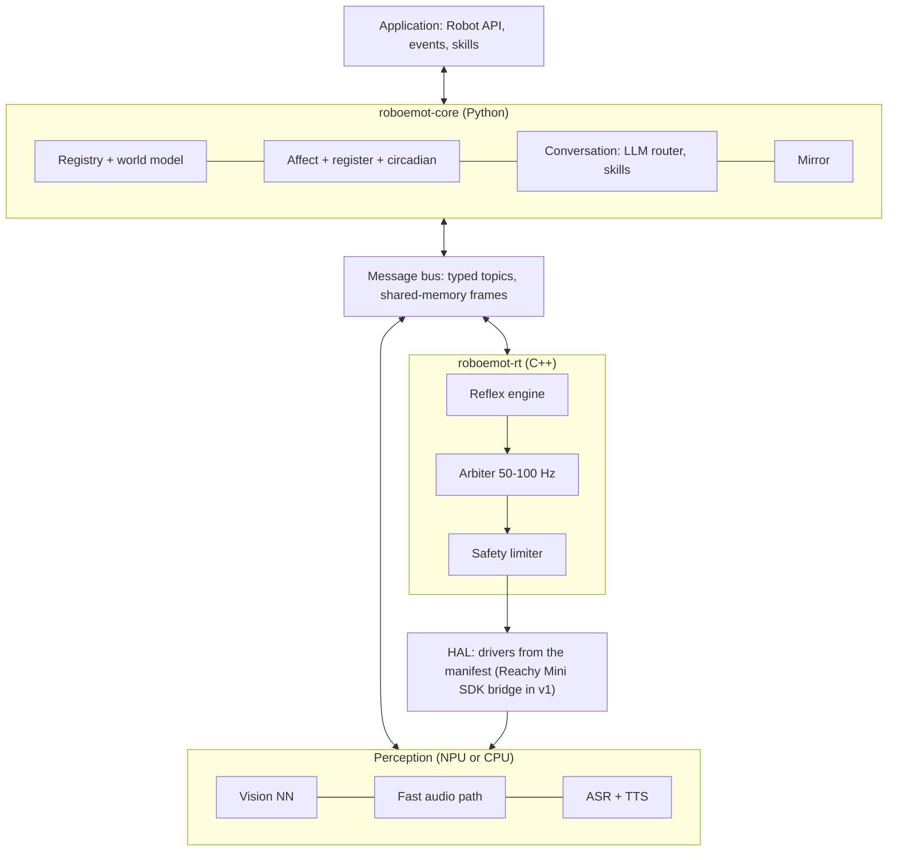

# RoboEmot: Engineering Specification

Oct 12, 2026 · Marcello · Status: Draft v0.2 · Source of truth: this file.

## 1. Overview

RoboEmot is a robot-agnostic library that gives a robot social and emotional behaviour: it recognises known people, adapts its empathic register to each of them, imitates and learns movements, reacts to voice, and converses through an LLM. It runs fully on the robot or on a local edge computer, with or without an NPU (v1: on the Raspberry Pi CM4 inside Reachy Mini Wireless), and any robot plugs in through a manifest and a driver.

### Goals

- One API, many robots: the same application code runs on a desk companion, a micro-robot head or a wheeled platform, described by a robot manifest. v1 ships a Reachy Mini driver and runs entirely on Reachy Mini Wireless (section 4A).
- Recognise enrolled people and unknown people, and estimate age group and gender for every face.
- Choose an empathic register per interlocutor and express affect through every channel the robot has (motion, light, sound, voice); mood and energy follow a simulated circadian rhythm entrained by ambient light from the camera.
- Reflexes independent of LLM latency: under 100 ms from audio or IMU triggers on every profile; from vision triggers, under 100 ms on npu and 250 ms on cm4 (section 13).
- Mirror movements live and learn new gestures from demonstration.
- Conversational loop: speech in, LLM through a router, speech out, with affect.
- Privacy by default: biometric data never leaves the local RoboEmot host (the robot itself on Reachy Mini Wireless). Every behaviour and expression parameter is configurable, with personality presets (section 11A).

### Non-goals for v1

- Grasping and manipulation, SLAM and navigation.
- Coordination between several robots.
- On-device training of large models (only enrollment and gesture recording happen on the robot).
- Any therapeutic or medical claim.

### Glossary

| Term | Meaning |
| --- | --- |
| Robot manifest | YAML file declaring a robot's joints or pose groups, sensors, expressive channels and limits |
| Driver | Code that talks to the actual hardware (or to a vendor SDK) behind a manifest entry |
| Pose group | Set of joints the vendor SDK commands as one pose (Reachy Mini's 6-DoF head) |
| Profile | Model and rate set for a compute class: `npu` (accelerator) or `cm4` (CPU only, Raspberry Pi CM4) |
| Percept | Timestamped observation published by a perception module (face, pose, utterance) |
| Affect state | The robot's internal emotional state: continuous valence/arousal plus a discrete label |
| Empathic register | Parameter set that shapes how the robot behaves with one interlocutor (voice, wording, motion amplitude, distance) |
| Minor present | A child or teen, declared or estimated, or a person of unknown age group, is in view; triggers the conservative policies of sections 7, 8 and 12 |
| Motion primitive | Named, parameterised movement (nod, wave, look-at) replayable on any compatible robot |
| Reflex | Fast, hard-wired reaction from percept to motion that never waits on the Python core or the LLM |
| Skill | High-level action exposed to applications and to the LLM as a tool |
| LLM route | One OpenAI-compatible endpoint (`base_url`, `api_key`, `model`) with its timeout, budget and minors flag |

## 2. Decisions and assumptions

The sketch defines the capabilities; the decisions below fix the architecture. Assumptions are marked and repeated in Open questions.

| Topic | Decision | Consequence |
| --- | --- | --- |
| Compute placement | Fully on-board. v1 target: Reachy Mini Wireless, on its Raspberry Pi CM4 (CPU only); an NPU board is the optional higher profile | No mandatory host; every model must fit the CPU, RAM and thermal budget of the cm4 profile (section 13) |
| Runtime | Python core for API and orchestration; C++ nodes for real-time paths | Motor loop and audio I/O are C++ processes; Python never sits in a <20 ms loop. Exception: on Reachy Mini the daemon owns hardware and audio, and a Python bridge streams targets at 50 Hz (section 4A) |
| ROS 2 | Optional adapter package | Core has its own bus; `roboemot-ros2` maps it to topics and actions |
| LLM | OpenAI-compatible Chat Completions API as the single LLM protocol; any remote model behind a base URL (cloud provider, LAN server, LiteLLM proxy) | Conversation degrades gracefully when offline; reflexes never depend on it |
| Mirror neural net | Live mimicry and learning from demonstration | Pose estimation + retargeting in v1; learned gestures stored as motion primitives |
| Age and gender | Estimated by vision for every face, enrolled people included | Estimates carry confidence and an `unknown` value; a declared value at enrollment overrides them |
| "Use MxM (?)" in the sketch | Dropped | Not specified |
| Spec language | English |  |

### Assumptions to confirm

- "Different empathic registry" is read as **empathic register**: the style of behaviour chosen per interlocutor. The per-person data lives in a separate **registry** of people, animals and objects (section 6).
- Spoken languages: Italian and English in v1. Italian matters for gender, because it drives grammatical agreement ("benvenuto" / "benvenuta").
- "Fully on-board" covers perception, reflexes, ASR and TTS. A capable LLM does not fit most edge boards, so the router may reach a LAN server or the cloud for conversation only.
- A microcontroller (for example ESP32-S3) may sit on the robot as an I/O coprocessor for servos, LEDs and sensors. It is a driver target, not a compute node.

## 3. System architecture

RoboEmot runs as a few processes on one board, joined by a local message bus: Python orchestrates, perception runs on the NPU (or on the CPU in the cm4 profile), and a C++ real-time core arbitrates motion; on Reachy Mini it hands targets to the robot's daemon through an SDK bridge (section 4A). The LLM sits in the slowest loop and is never on the path from a percept to a motion.



Sensor streams flow up from the HAL into perception, percepts go onto the bus, and both the Python core and the C++ reflex engine consume them. Motion requests from apps, skills, mimicry and reflexes all end in the arbiter and the safety limiter before any driver is written.

### Process model

| Process | Language | Crash behaviour |
| --- | --- | --- |
| `rt` (motor loop, reflexes, audio I/O) | C++ | Supervisor restarts; joints go limp or hold per manifest until it is back |
| `vision` | Python + NPU or CPU runtime | Restarted; attention falls back to sound direction (on Reachy Mini, to the daemon's head tracking) |
| `audio` (VAD, ASR, TTS, fast path) | Python + C++ | Restarted; robot stays expressive but silent |
| `core` (registry, affect, conversation, app) | Python | Restarted; `rt` keeps idle motion and reflexes running |

A supervisor (systemd units or a small launcher) starts processes in dependency order and restarts them with back-off. In Reachy Mini app mode the app process is both the supervisor and the SDK bridge: if it exits, the session ends and the daemon parks the robot.

## 4. Robot manifest and hardware abstraction

Every robot is a manifest plus drivers; no module above the HAL may reference a concrete device. Modules query capabilities at start-up and disable features the robot cannot support (no camera means no vision, no mimicry, no face recognition).

### Manifest

```yaml
robot:
  id: desk-head-v1
  frame: base_link
joints:
  - name: neck_pan
    driver: esp32_servo_bus
    channel: 0
    limits: {min_deg: -60, max_deg: 60, max_vel_dps: 180, max_acc_dps2: 900}
    home_deg: 0
    compliance: spring_return        # informs the safety limiter
  - name: neck_tilt
    driver: esp32_servo_bus
    channel: 1
    limits: {min_deg: -20, max_deg: 30, max_vel_dps: 120, max_acc_dps2: 600}
sensors:
  camera_main: {driver: v4l2, device: /dev/video0, fov_deg: 78, mount: neck_tilt}
  mic_array:   {driver: alsa, device: hw:1, channels: 2}
  imu:         {driver: esp32_imu, model: mpu6050}
  proximity:   [{driver: esp32_tof, model: vl53l0x, mount: front}]
expressive_channels:
  eyes:    {type: led_matrix, driver: esp32_ws2812, pixels: 64}
  voice:   {type: speaker, driver: alsa, device: hw:0}
  body:    {type: joints, joints: [neck_pan, neck_tilt]}
retargeting:            # used by the mirror module (section 9)
  neck_pan:  {source: head_yaw,   scale: 1.0, offset_deg: 0}
  neck_tilt: {source: head_pitch, scale: 0.8, offset_deg: 5}
safety:
  estop: {driver: gpio, pin: 17, active_low: true}
  watchdog_ms: 200
```

URDF is accepted as an optional `kinematics:` reference for robots with real chains; simple robots need only the joint list.

### Discovery

A robot that announces itself on the LAN declares it in its manifest, so finding robots stays robot-agnostic:

```yaml
robot:
  id: reachy-mini-wireless
  discovery: {mdns_service: _reachy-mini._tcp, match_txt: {model: Reachy Mini Wireless}}
```

`roboemot.discovery` browses the mDNS service types that the manifests declare and pairs each answering robot with the first manifest whose service type and TXT values match (`match_txt` tells apart robots sharing a service, such as Reachy Mini Wireless and Lite). It prefers IPv4, because `.local` names often resolve to link-local IPv6 first, and falls back to the OS resolver when a responder sends its SRV and TXT records but not its addresses. `roboemot discover` lists the robots found; the install wizard offers them as a pick list. The mDNS dependency (`zeroconf`) is an optional extra, never installed on the robot. A robot without mDNS, such as an ESP32-S3 head on USB, omits `discovery` and is addressed directly.

### Driver interfaces

| Interface | Methods | Notes |
| --- | --- | --- |
| `JointDriver` | `write_targets(t, positions, velocities)`, `read_state()`, `enable()`, `disable()` | C++; called by the motor loop at its own rate |
| `PoseGroupDriver` | `write_pose_targets(t, groups)`, `read_state()`, `set_mode(active / limp / teach)` | For vendor SDKs that take poses, not servo angles (Reachy Mini); Python bridge or C++ client |
| `SensorDriver` | `open()`, `stream() -> frames`, `close()` | Camera, microphone, IMU, proximity, touch |
| `ChannelDriver` | `render(frame)` | LEDs, display face, speaker; receives already-composed frames |
| `TransportDriver` | `send(bytes)`, `recv()` | Shared serial/USB/I2C link to a coprocessor such as an ESP32-S3 |

A reference coprocessor firmware (ESP32-S3) exposes servos, WS2812 LEDs, IMU and ToF over one framed USB-CDC protocol with CRC and sequence numbers, so small robots need no custom driver code.

### Capability negotiation

At start-up the runtime builds a capability set (`has_camera`, `has_speech_out`, `dof=2`...). Each module declares what it requires and what it can use optionally; the runtime starts only modules whose requirements are met and logs which features are off.

## 4A. Reachy Mini driver (v1 reference robot)

v1 must ship a driver for Pollen Robotics' Reachy Mini, Lite and Wireless, built on the official `reachy_mini` Python SDK (Apache 2.0). Rule: whenever the SDK or its daemon already does something RoboEmot needs, the driver delegates to it instead of reimplementing it; RoboEmot adds only what the SDK lacks (identity, affect, register, arbitration across sources, conversation policy).

### How Reachy Mini is controlled

- A daemon owns the hardware (USB/serial I/O, safety clamping, sensors) and exposes REST and WebSocket on port 8000. The SDK is a client: `ReachyMini()` auto-detects USB/localhost or network.
- **Lite**: the daemon runs on the PC the robot is plugged into. **Wireless**: the daemon runs on the robot's Raspberry Pi CM4, reachable at `reachy-mini.local`.
- Degrees of freedom exposed by the SDK: head pose (position + roll/pitch/yaw, built with `create_head_pose`), `body_yaw`, and two `antennas`. Joints are not addressed one servo at a time.
- Limits enforced by the SDK (values are clamped): head pitch and roll ±40°, head yaw ±180°, body yaw ±160°, head-to-body yaw difference at most 65°.

Reachy Mini Wireless hardware, from the Seeed Studio hardware page and Pollen's store page:

| Part | Specification |
| --- | --- |
| Compute | Raspberry Pi CM4104016: 4 GB RAM, 16 GB eMMC, Wi-Fi; no NPU |
| Camera | Sony IMX708, 12 MP, 120° wide angle, autofocus |
| Audio | 4 PDM MEMS microphones, 5 W speaker |
| Motion | Head 6 DoF (3 rotations, 3 translations), body 1 rotation, 2 antennas with 1 rotation each |
| Power | LiFePO4 battery, 2000 mAh, 6.4 V, 12.8 Wh, plus mains supply |
| IMU | Built in (Wireless only) |

### Deployment with Reachy Mini

v1 must run entirely on Reachy Mini Wireless: RoboEmot is installed as a Reachy Mini app on the robot's Raspberry Pi CM4, next to the daemon, with no external computer. The CM4 has no NPU, so the library defines a CPU-only profile, `cm4`, beside the `npu` profile: same API and features, smaller models and lower rates (section 13).

| Variant | Daemon runs on | RoboEmot runs on | Profile | SDK connection | Media backend |
| --- | --- | --- | --- | --- | --- |
| Wireless (v1 default) | CM4 on the robot | CM4, as a Reachy Mini app | `cm4` | localhost | `local` (GStreamer IPC) |
| Lite | Host PC (USB) | Same host PC | `npu` if an accelerator is present, otherwise `cm4` models on the CPU | `localhost_only` | `local` |
| Wireless + optional edge box | CM4 on the robot | Edge box with NPU on the LAN | `npu` | `network` | `webrtc` (H.264, Opus) |

Off-robot compute is optional, never required. Recognition, register, affect, reflexes, expression, mimicry, ASR and TTS all work with the robot alone; only the conversational LLM needs a LAN or cloud route, because no useful LLM fits the CM4 next to the rest of the stack. Without a route the robot stays fully expressive but does not converse.

### Mapping RoboEmot interfaces to the SDK

| RoboEmot need | Reachy Mini SDK / daemon feature | How the driver uses it |
| --- | --- | --- |
| Streamed joint targets (arbiter output) | `set_target(head=..., antennas=..., body_yaw=...)` | Called at 50 Hz with the arbitrated pose; no interpolation on our side beyond the arbiter's blend |
| Discrete commanded moves | `goto_target(..., duration, method)` with `linear`, `minjerk`, `ease_in_out`, `cartoon` | Not used during a session: in SDK 1.11 `goto_target` blocks the caller until the move ends, which would stall the bridge and every reflex. The arbiter streams everything with `set_target` and applies the same interpolation curves (min-jerk, ease-in-out, cartoon) itself |
| Joint state | `GET /api/state/full`, WebSocket `/api/state/ws/full` | Subscribed for `read_state()` and for `motion.state` on the bus |
| Safety limits | Daemon clamping | Kept as the last layer; RoboEmot's limiter still applies tighter caps (child present, velocity, acceleration) and the 65° head-body coupling before sending |
| Motor modes | `enable_motors()`, `disable_motors()`, `enable_gravity_compensation()` | Mapped to RoboEmot states active / limp / teach; in gravity compensation position targets are ignored, so the arbiter pauses |
| Wake and sleep | Daemon `wake_up()` / `goto_sleep()`; idle reset after a crash | RoboEmot lifecycle `start`/`stop` calls them in client mode; in app mode (below) it never calls them, because the platform does |
| Camera | `mini.media.get_frame()` → `uint8` array (H, W, 3) | Implements the `camera_main` `SensorDriver` feeding vision (section 5) |
| Microphones | `mini.media.get_audio_sample()` → `float32`, 16 kHz, 2 channels | Feeds the capture stage of the voice pipeline (section 8) |
| Speaker | `mini.media.push_audio_sample()` (non-blocking, 16 kHz) | TTS output; the driver tracks queued duration to support barge-in |
| Sound direction | `mini.media.get_DoA()` → `(angle, is_speech_detected)` or `None` (0 rad left, π/2 front, π right; one half-plane, so front and back are not told apart) | Replaces our own direction-of-arrival estimate; drives the "turn toward voice" reflex and helps pick the active speaker |
| Fallback face tracking | `start_head_tracking(weight)`, `get_tracked_face()` (closest face, runs in the daemon) | Follows the closest face (`weight=1`) when that face is the attention target, including between detections on the `cm4` profile, and when the vision process is down; `weight=0` when RoboEmot's attention picks someone else (active speaker, enrolled person). How it blends with `set_target` streaming is verified in M0 |
| IMU (Wireless only) | `mini.imu` → accelerometer, gyroscope, quaternion, temperature | Lift and tilt detection for safety and for appraisal ("picked up") |
| Recording moves | `start_recording()` / `stop_recording()` on the robot | Storage path for learned gestures (section 9) |
| Simulation | Official MuJoCo simulation of the robot | Simulation test layer and CI (section 14) |

### Expressive channels on Reachy Mini

The default expression map for Reachy Mini uses head pose, body yaw, the two antennas and sound. Antennas carry most of the affect (for example: raised and still for curiosity, fast wiggle for joy, drooping for sadness); head pitch and small body turns add emphasis. No LED channel is assumed. The daemon can download Pollen's recorded move datasets (emotions, dances); RoboEmot can import them as keyframe primitives and stream them through the arbiter like any other primitive.

### Real-time path with Reachy Mini

With Reachy Mini the daemon, not `roboemot-rt`, owns the hardware loop, and one bridge process owns the only SDK client. The SDK's media layer marks camera and audio devices busy once opened, so no other RoboEmot process opens them: the bridge republishes camera frames, audio, direction of arrival, IMU and joint state on the bus (shared memory for frames and audio), and takes pose targets and TTS audio back. In app mode the bridge is the app process and uses the `ReachyMini` instance the daemon passes to `run()`.

`roboemot-rt` still runs the arbiter and the reflex engine and sends targets to the bridge, which calls `set_target` at 50 Hz over localhost. On the CM4, `roboemot-rt` and the bridge share one core with real-time priority (section 13). The bridge is the only Python hop on the reflex path; if it misses the 100 ms reflex budget in M0, it is replaced by a C++ client of the daemon's API, keeping a thin Python process only for media. Facts from the SDK source (1.11): the bridge connects with automatic\_body\_yaw=False, because the SDK default is True and the arbiter commands body yaw itself; it calls set\_target only after enable\_motors(), which pins targets to the present pose; antenna order is \[right, left\].

### Packaging as a Reachy Mini app

On Wireless, app mode is the primary deployment: RoboEmot ships as a `ReachyMiniApp` (`run(reachy_mini, stop_event)`), installable from the Reachy Mini Control desktop app (which replaced the web dashboard), publishable as a Hugging Face Space, or installed manually without publishing (wheels copied over SSH and installed with pip into the apps venv, through a repeatable install wizard with a read-only dry run, and removed by its uninstaller; see "Installer" below). The daemon starts it as a subprocess in `/venvs/apps_venv/`; `run()` launches the RoboEmot processes (`rt`, `vision`, `audio`, `core`) and stops them on `stop_event`. Its `custom_app_url` web UI hosts enrollment, consent and settings. The daemon's REST API starts and stops apps (`/api/apps/start-app/{name}`, `/api/apps/stop-current-app`) and names a startup app (`PUT /api/apps/startup-app`) that it starts on the robot's first wake-up. Platform constraints: one app at a time (starting a second one fails until the current one stops), the app never wakes or sleeps the robot (the installer may, through the REST API, before starting it), and native dependencies (ONNX Runtime, C++ nodes) must be built for the CM4's aarch64 and installed in that venv. Client mode (RoboEmot as a separate process with `ReachyMini()`) remains for Lite and for development.

#### Installer

The installer runs on a PC on the robot's LAN and is robot-agnostic (`roboemot.install`). A platform package registers the robot-specific part in the `roboemot.installers` entry-point group under the manifest's `robot.id`. For Reachy Mini Wireless that part is the daemon's REST API, the shared `/venvs/apps_venv`, package data staging, the entry-point check, start and stop, and the startup app.

- **Leave the robot as it was.** Apps share one Python environment, so other apps may install packages after RoboEmot. A full snapshot restore would undo their changes, so the installer records only what it changed itself:
  - the distributions it added;
  - for each distribution it replaced, the version that was there before;
  - the app data folder (`~/.local/share/roboemot` of the robot user: registry and models, section 12 Data), created private (0700) when it did not exist, together with any parent folder it had to create. A folder that already existed is not recorded and uninstall leaves it. Uninstall deletes the recorded folder (registry and models included), then those parents if empty, and verification fails while the folder remains. Before the recursive delete the recorded path must equal exactly the one the installer computes now (the SSH user's `$HOME` plus the default location) and, when it exists, its `realpath` on the robot must be the same path; otherwise nothing is deleted, the uninstaller warns, and verification fails so the record is kept. Only recorded parents that lie between `$HOME` and the folder are removed. At install time the installer warns if `ROBOEMOT_DATA_DIR` or a `data_dir` in the staged config would put the data elsewhere.

  The record is merged on every reinstall, and the original versions are never overwritten. It lives outside the environment and outside `/tmp` (Reachy: `/venvs/.roboemot-install.json`). It is written before pip runs and completed afterwards, so an interrupted install can still be undone.
- **Install.** Versions already in the environment are pinned. If the app needs to change a shared package, the installer lists the changes and asks first, and a refusal leaves everything untouched. Every pip call passes `--no-cache-dir`, so nothing is added to the robot user's pip cache. Wheels go to a `mktemp` directory under `/tmp`, which is deleted afterwards. Making the app the startup app first records which app it replaces.
- **Uninstall** (`--uninstall`). The steps are:
  - stop the app;
  - restore the previous startup app, only if the setting still names RoboEmot;
  - remove the app's distributions and the ones the record says it added, except those another installed distribution still requires;
  - reinstall the original versions of the ones it replaced, unless someone has changed them since. This needs internet access.
  - delete leftover modules inside site-packages, stale temporary directories and the platform's own leftovers (Reachy: a daemon app-metadata file, if the daemon ever wrote one);
  - verify, and only then delete the record.

  If verification fails, the record is kept, so running the uninstaller again picks up where it stopped. Running it twice is harmless. With no record, it removes only the app's own distributions and says so.
- **Dry run** (`--dry-run`, for install and uninstall). It is read-only, with no pip cache, temporary directory or record written. It lists what would be added, changed, removed or restored, and the data folder it would create or delete.
- Checked on Neve (daemon 1.11.0): the install dry run would add only `scipy`, with everything else pinned at the robot's versions.

### Reachy Mini manifest

```yaml
robot:
  id: reachy-mini-wireless
  driver: reachy_mini_sdk
  profile: cm4                    # CPU-only, runs on the robot's CM4
  connection: {mode: localhost_only, media_backend: local}
  discovery: {mdns_service: _reachy-mini._tcp, match_txt: {model: Reachy Mini Wireless}}
pose_groups:                      # SDK addresses poses, not servos
  head:
    type: pose6d
    limits: {pitch_deg: [-40, 40], roll_deg: [-40, 40], yaw_deg: [-180, 180]}
  body_yaw: {type: joint, limits: {min_deg: -160, max_deg: 160}}
  antennas: {type: joint_pair, names: [antenna_left, antenna_right]}
constraints:
  - {type: yaw_delta, a: head.yaw, b: body_yaw, max_deg: 65}
sensors:
  camera_main: {driver: reachy_mini_media}
  mic_array:   {driver: reachy_mini_media, doa: true}
  imu:         {driver: reachy_mini_imu}      # Wireless only
expressive_channels:
  voice: {type: speaker, driver: reachy_mini_media}
  body:  {type: pose_groups, groups: [head, body_yaw, antennas]}
motor_modes: {active: enabled, limp: disabled, teach: gravity_compensation}
dynamics:               # velocity and acceleration caps, measured in M0; required before release (section 12)
  head:     {max_vel_dps: null, max_acc_dps2: null}
  body_yaw: {max_vel_dps: null, max_acc_dps2: null}
  antennas: {max_vel_dps: null, max_acc_dps2: null}
retargeting:            # mirror module (section 9)
  head.yaw:      {source: head_yaw,   scale: 1.0}
  head.pitch:    {source: head_pitch, scale: 1.0}
  head.roll:     {source: head_roll,  scale: 1.0}
  body_yaw:      {source: torso_yaw,  scale: 1.0}
  antenna_left:  {source: left_arm_elevation,  scale: 0.5}
  antenna_right: {source: right_arm_elevation, scale: 0.5}
safety:
  estop: none                 # no hardware e-stop input on Reachy Mini
  soft_stop: hold_position    # stop streaming, motors stay enabled
  hard_stop: disable_motors   # limp; the daemon parks the robot when the session ends
  watchdog_ms: 200
```

The manifest schema gains `pose_groups`, `constraints` and `dynamics` for robots, like Reachy Mini, whose SDK exposes Cartesian poses instead of individual joints. `null` dynamics values are placeholders: section 12 rejects a manifest without limits, so they must be filled with values measured in M0 before release.

## 5. Vision neural net

Vision is a set of small models scheduled on the NPU (npu profile) or the CPU (cm4 profile) that publish percepts; it recognises people and things and feeds attention targets and gestures straight to the motor layer. Rates in the table are for the npu profile; cm4 rates are in section 13. Models are swappable: the library ships ONNX references and compiles them per target (Hailo HEF, RKNN, TensorRT for the npu profile; ONNX Runtime on CPU for the cm4 profile, with the smaller models and rates of section 13).

| Stage | Default model class | Rate | Output |
| --- | --- | --- | --- |
| Face detection | Lightweight detector (npu: SCRFD class; cm4 and M1: YuNet 2023mar, MIT) | 15 fps | Boxes + 5 landmarks |
| Face embedding | ArcFace-class encoder (cm4 and M1: SFace, Apache-2.0) | On new track, then 2 fps | Embedding for identity matching |
| Age group and gender | Classification heads on the face crop (cm4 and M1: FairFace ViT-B pair, Apache-2.0; `vision.attribute_precision` `auto` loads INT8 when the manifest `profile` is `cm4` and FP32 otherwise) | On new track, then 1 fps | `age_group` in {child, teen, adult, senior, unknown}; `gender` in {male, female, unknown}; probability each |
| Body pose | 17-keypoint estimator (RTMPose / MoveNet class) | 15 fps when mirror or attention needs it | Keypoints + confidence |
| Hand landmarks | Optional 21-point hand model | On demand | Hand pose for gestures |
| Objects | Small COCO-class detector, fixed classes (cm4 and M1: NanoDet-Plus-m 320, Apache-2.0 code and ONNX weights; Ultralytics YOLO is excluded, AGPL-3.0) | npu 5 fps; cm4 and M1 1 fps (section 13) | Labelled boxes |
| Tracking | ByteTrack-class multi-object tracker | Every frame | Stable `track_id` per person and object |

### Rules for estimated attributes

- Estimates are aggregated over a track (median of at least `identity.estimate_frames_min` frames, default 3; the age and gender job takes `vision.attribute_crops` crops per track, default 3, and the configuration is rejected if that is below `estimate_frames_min`, so raising the minimum for safety needs more crops explicitly) before use, and below a confidence threshold (default 0.8) the value is `unknown`.
- A value declared at enrollment always overrides the estimate for that person.
- Estimates can only make behaviour more conservative, never less: they select register defaults and can trigger the minor-present policy (sections 7, 8, 12), but never relax a cap or cause a refusal to interact. A person whose age group is unknown counts as a possible minor until a confident estimate or a declared value exists.
- Age and gender classifiers are known to be less accurate for children and for some demographic groups. The evaluation plan (section 14) measures error per group before a model is accepted.

### Connection to the motor layer

Vision publishes three motor-relevant signals on the bus, consumed directly by the reflex engine in roboemot-rt without passing through the Python core: `attention.target` (the face or object to look at, with priority), `proximity.approach` (a person or object entering the near zone), and `gesture.detected` (wave, point, raised hand). Attention selection prefers, in order: the active speaker, an enrolled person, the nearest face, the most salient moving object.

## 5A. World model and scanning

The robot keeps a "mental map" of who and what is around it, not only in front of the camera: people, animals and objects, each with a position, a confidence that fades when nothing confirms it, and the time it was last seen or heard. The map is fluid: entries appear, move, fade and disappear as observations arrive. The world model is robot-agnostic; each robot supplies its sensor sources and how it looks around through a plugin (section 4, Capability negotiation).

### Observations and sources

- Every source publishes observations on `percept.entity`: `kind` (person, animal, object), `category` (detector class, for example `cat`, `cup`), optional `identity` (a registry ID, when the source already resolved it), `bearing` (azimuth and elevation, radians), optional `distance_m`, `confidence`, optional appearance embedding, timestamp and `source` name.
- Sources are plugins (`WorldSource`): the vision pipeline (section 5), sound direction (`get_DoA()` on Reachy Mini, section 4A), and any robot-specific sensor (proximity, lidar, a robot's own detectors). Robot packages register them in the `roboemot.world` entry-point group keyed by the manifest `robot.id`, like diagnostics and installers; core stays robot-agnostic.
- A source that only hears (sound direction) produces bearing-only observations of kind `unknown`, which can confirm an entry or trigger a glance but never create a person, animal or object on their own.

### Frame

Positions are egocentric: bearing and distance from the robot's base, so a robot that does not move needs no mapping. Observations made with the head or body turned are rotated into the base frame using the joint state at capture time. A mobile robot's driver may report its own pose (`base_pose`); the world model then stores positions in that frame, and consumers see the same entries with no change in their interface. A room map (SLAM, rooms, zones) is not part of v1.

### Entries, matching and fading

- An entry holds: `entry_id`, kind, category, identity (registry ID or `unknown`), position and its uncertainty, confidence, first and last seen, sources that saw it.
- Matching an observation to an entry, first match wins: same identity; else same kind and category within an angular gate (`world.match_gate_deg`) and, when both have distances, a range gate; else a new entry. Appearance embeddings break ties between candidates.
- Confidence rises with each matching observation and decays with a half-life per kind (`world.half_life_s`, people shorter than objects). Out of the sensors' view the decay is slower (`world.out_of_view_decay_factor`): what the robot cannot see now is remembered, not forgotten. An entry whose bearing is in view but which is not detected decays at the full rate.
- Below `world.forget_confidence` an entry is removed. Events on the bus: `world.entity_appeared`, `world.entity_moved` (beyond `world.moved_threshold_deg`), `world.entity_gone`, and `world.snapshot` on request.
- Consumers: attention (look toward a known entry), appraisal rules (for example `person.returned`, `animal.appeared`), the LLM scene summary (section 8, entries by attention priority until its cap), and the registry (last seen, auto-enrollment).

### Scanning

- A scan policy in core decides when to look around; the robot plugin's `ScanPlanner` decides how (a sequence of poses within the manifest limits, for example head and body yaw sweeps).
- Triggers: idle for `world.scan.idle_interval_s` (jittered), wake-up from rest, and a glance toward an unexplained sound or motion (a bearing-only observation with no matching entry).
- Never while engaged with a person (a single glance toward a sound is allowed), never during quiet hours or circadian `resting` (section 7A), and only within the minor-present motion caps.
- Sweeps are motion requests at idle priority through the arbiter (section 10): attention, reflexes and safety always win (attention on an animal or object holds a due sweep off for at most `attention.object_max_hold_s`, then the sweep runs). Pace and amplitude scale with the persona's energy trait (section 11A, Persona).
- On Reachy Mini, body yaw (±160°) plus the head-to-body offset (up to 65°) and the 78° camera cover the whole room; sound direction covers the front half-plane without moving (the SDK reports one half-plane, so a sound behind is mirrored in front: a glance toward it is a guess the next sweep corrects).
- Sweeps and glances move head and body yaw only; head pitch stays with idle breathing. Pace scales with the energy trait's `idle_period_x`, amplitude (share of the full circle) with `motion_amplitude_x`, never below `world.scan.min_amplitude`; a present minor only slows the pace, since the arbiter already scales amplitude and speed (section 12).
- Only a person target or a speaker hint (engaged) cancels a sweep, drops a pending wake-up sweep and holds the idle clock; an animal or object target holds a due scan (sweep, wake-up or glance) off for at most `attention.object_max_hold_s` (default 30 s); the timer starts when the scan becomes due, survives a switch to another object, and resets when the object target is lost. After that the sweep runs, hiding the attention command while it does. A sweep ends with a glide home at scan pace. A glance toward a sound while engaged is allowed once per engagement, at most every `world.scan.glance_cooldown_s`, and is the one scan motion above idle priority (expression, for `glance_hold_s`). Today only sound feeds unexplained bearings; vision detections that match nothing create entries instead.
- A bearing-only observation gains `world.bearing_only_gain_factor` of the normal confidence and neither refreshes `last_seen` nor marks the entry in view, so a mirrored rear sound cannot keep an unseen entry alive.

### Known individuals and auto-enrollment

- Known animals and objects are registry entries (section 6) matched by appearance embedding, like people by face.
- Auto-enrollment (animals and objects only, never people): an unknown entry whose appearance clusters with earlier sightings on at least `world.autoenroll.min_days` different days, with a cluster tighter than `world.autoenroll.max_spread`, is enrolled with a placeholder name (`cat 1`, `mug 2`). The owner can rename, merge or delete it in the web UI. Defaults after the recognition spike (section 15): `world.autoenroll.min_days` 3, at least 5 sightings, `max_spread` 0.25 (cosine distance to the cluster centroid, max over members, with DINOv2-S, Apache-2.0). These are judgement values to tune on the robot. Objects separate poorly in the spike (66% rank-1 on a product catalogue, dogs 97.5%), so wrong merges are expected and the owner fixes them in the web UI.
- Algorithm (`roboemot.world.autoenroll`), online and per kind and category:
  1. An observation whose appearance embedding is at least `world.autoenroll.known_match_threshold` (default 0.875, that is 1 minus `join_radius`) close to an active animal or object record of the same kind (and category, when the record has one) attaches that identity to its world entry and collects nothing.
  2. Otherwise it is a *sighting*, at most one per world entry and at most one per candidate cluster per `world.autoenroll.sighting_min_interval_s` (300 s): a track watched for a minute, or an entry that keeps being recreated, is one sighting, not hundreds.
  3. A sighting joins the nearest candidate cluster whose centroid is within `join_radius` (cosine distance, default 0.125, half of `max_spread`), else starts one. A cluster keeps its last `max_members` embeddings, each with the local day it was seen on; sightings and days are counted from the retained members only, so a member that rolled out takes its day with it.
  4. A cluster with `min_days` days, `min_sightings` sightings and a spread (max over retained members of 1 minus cosine to the centroid) of at most `max_spread` is enrolled as `origin=auto`; the placeholder is `<category> <n>` in the `conversation.language` (`gatto 1`), with n one above the highest number any auto record of that name already has.
  The spread gate alone cannot tell two look-alikes apart: two animals at cosine distance 0.23 spread only about 0.06 around their midpoint. The tighter `join_radius` is what keeps them in separate clusters (and `known_match_threshold` keeps the second from being taken for the first once the first is enrolled); the spread gate then only guards against slow drift. The price is that one animal photographed very differently may split into several clusters and enroll later or twice, which the owner fixes by merging in the web UI.
- Candidates persist in the registry store (collection `candidates`, atomic writes, mode 0600, same data folder) even without the history opt-in. They are bounded (`max_clusters`, `max_members`) and deleted when enrolled, after `retention_days` without a sighting (checked at startup, at shutdown and on a periodic tick, whether or not anything is seen), when auto-enrollment is disabled or the kind is no longer listed (also at startup, and when the appearance model is missing), or by "Forget collected sightings" in the web UI (PIN again; it works without a running enroller). Deleting an auto-enrolled record does not suppress the animal: it can be enrolled again after `min_days` more days. Candidates made with another embedding model are deleted at load.
- `world.autoenroll.kinds` (default animals and objects) lists what may be auto-enrolled; people are refused in code, whatever the configuration. The recognition spike advises animals only (objects: 19 to 24% of mixed clusters accepted); the default follows this section, and section 15 asks whether to switch.
- People are enrolled only through the consent flow (section 6, Enrollment).

### History (opt-in)

- With `privacy.world_history` on (off by default; turning it on needs the admin confirmation, section 11A), every appear, move and gone event is stored locally with time, position and identity, for patterns such as "Marcello comes home around 18:00" and "the mug is usually on the left".
- Retention: `world.history_retention_days`, then deleted. `export(person_id)` and `forget(person_id)` include it. For unknown people the history stores only kind, position and time: no embedding and no link between sessions. History never leaves the robot.
- Without the opt-in, the live map stays in RAM and only the registry's `last_seen` and the auto-enrollment candidates (appearance embeddings of unknown animals and objects with the days they were seen) persist.

## 6. Registry and identity

The registry stores enrolled people, animals and objects as embeddings plus a profile, encrypted on the robot; identity is resolved per track by voting, never from a single frame. Animal and object records hold `entity_id`, kind, category, display name, appearance embeddings, `last_seen`, `origin` (`enrolled`, `xmp`, `auto`) and an optional description; they have no consent, age or register fields.

### Person record

| Field | Type | Source |
| --- | --- | --- |
| `person_id` | UUID | Generated |
| `display_name` | string | Enrollment |
| `face_embeddings` | 5 to 20 vectors; dimension set by the embedding model | Enrollment + optional online refresh |
| `voice_embedding` | vector, optional | Enrollment (speaker ID) |
| `age_group`, `gender` | enum + `declared` / `estimated` flag | Declared at enrollment or estimated (section 5) |
| `register_overrides` | partial register | Enrollment or app |
| `preferences` | key/value (preferred name, language, topics to avoid) | App or conversation, with confirmation |
| `consent` | who consented, when, scope; guardian for minors | Enrollment |
| `last_seen` | timestamp | Runtime |

### Enrollment

1. Operator starts enrollment from the API or a voice command ("remember me"), only when an operator PIN or the admin app confirms.
2. Robot captures 5 to 20 face crops at varied angles, rejecting blurred or low-confidence frames.
3. Operator records name, consent and, optionally, declared age group and gender.
4. Embeddings and profile are stored; raw images are discarded unless `keep_enrollment_images: true`.

### Matching

- Cosine similarity against all stored embeddings; a track is assigned to a person when the best match exceeds the threshold (default 0.45, which is the SFace seed; tuned per model, see the [model spike](../spikes/2026-10-m1-models.md)) on at least 3 of the last 5 evaluations, with a margin of 0.1 over the second best.
- Otherwise the track is `unknown` and gets a temporary anonymous ID for the session only.
- Face and voice IDs are fused when both exist; a disagreement drops the track to `unknown`.
- Online refresh adds a new embedding only after a high-confidence match, capped per person, to follow slow changes such as a growing child.

### Catalogue import (XMP)

- The owner can import a catalogue of known people, animals and objects as XMP sidecar files, written by common photo tools: MWG Regions (`mwg-rs:Regions`, with `Name` and `Type` such as `Face` and `Pet`), `dc:subject` and `lr:hierarchicalSubject` (for example `Animals|Cat|Mia`).
- XMP alone is enough: each record is created `pending` and gets its appearance when the robot sees it and the owner confirms ("this is Mia"), or by renaming an auto-enrolled placeholder.
- Photos are optional: when supplied with their sidecars, each tagged animal or object region is turned into an embedding in memory and the image is discarded at once. Catalogue photos are never stored, whatever `keep_enrollment_images` says (that option is for the people enrollment only). The embeddings sit on the still `pending` record, outside matching, until the owner confirms.
- People in an imported catalogue stay `pending` until the consent flow completes (Enrollment); the import never creates biometric data for a person without consent. Face regions are not even cropped or embedded: a person's photo yields a name and nothing else. The enrollment page lists the pending names; the owner may link one, and then the consent flow completes that record in place. Nothing is linked or removed by matching names.
- Parsing (`roboemot.registry.xmp`): the sidecar is untrusted. It is size-capped before parsing and parsed with `defusedxml` (DTDs and entities are refused: no external entities, no expansion bombs; `defusedxml` is a core dependency because the stdlib parser's protection depends on the expat build). Lists are walked through their direct `rdf:Bag/Seq/Alt` children only, under one budget of visited `rdf:li`; areas and dimensions must be finite and in range.
- Mapping: Face region or `People|Name` gives a person; Pet region or `Animals|Category|Name` an animal; `Objects|Category|Name` an object (Italian roots `Persone`, `Animali`, `Oggetti` too). Focus and BarCode regions are skipped, and a bare `dc:subject` keyword creates nothing. Region areas follow MWG: `stArea:x`/`y` are the centre. Categories are normalised to the detector's lower-case labels (`Cat` and `Gatto` give `cat`); an unknown category or two categories for one name and kind are reported as conflicts and neither is imported. Records are deduplicated by name (case-insensitive), kind and category, and against the registry.
- Photos: the photo is decoded only when the sidecar has animal or object regions and the appearance model runs (without OpenCV or the model the records are still imported and the report says so). JPEG and PNG only, recognised by magic bytes; the pixel count is read from the header and checked before decoding (decompression-bomb guard), then the image is decoded in memory. Limits are `catalogue.*`. A photo whose aspect ratio differs from the sidecar's `AppliedToDimensions` is skipped. One import runs at a time (`import_busy` otherwise), embedding stops after `catalogue.import_budget_s` (below the request deadline) and the report says `partial`; each photo row is keyed by the photo hash and the region, so repeating the import adds only what is missing.
- Web UI: one sidecar and at most one photo (base64 in JSON) per request, `POST /api/catalogue/import`. The body limit is `webui.catalogue_max_body_bytes`, granted only to logged-in sessions. Confirming ("this is Mia") picks an animal or object the robot sees now and pools its appearance with any photo rows; a record that already has photo rows can be activated without a live entry. Responses carry names, ids and counts, never embeddings or images.
- Deleted pending records: when the owner deletes a pending record in the web UI, a tombstone is kept so that importing the same catalogue again does not bring it back (the import reports it as skipped, `deleted`). The tombstone is an HMAC-SHA256 of the kind and the case-folded name under a random salt in the registry store (`roboemot.registry.tombstones`): no name, id, embedding or time is stored. Only pending records leave one; forgetting an enrolled person leaves nothing behind (section 12). The web UI shows the count and clears all of them (`POST /api/catalogue/tombstones/clear`), which also drops the salt.

### Deletion

`registry.forget(person_id)` removes every embedding, profile field and log reference for that person, synchronously.

## 7. Affect engine and empathic register

The affect engine keeps one internal emotional state that every percept can nudge; the empathic register decides how that state is expressed to the person in front of the robot.

### Affect state

- Continuous core: valence and arousal in \[-1, 1\], updated at 20 Hz, each decaying toward a baseline with a configurable half-life (default 8 s); the baseline itself follows the circadian rhythm (section 7A).
- Discrete label derived from the core plus recent events: `calm`, `joy`, `curiosity`, `surprise`, `sadness`, `fear`, `annoyance`, `sleepy`.
- Appraisal rules map events to impulses, for example: enrolled person appears → valence +0.4, arousal +0.2; loud sudden sound → arousal +0.6, label `surprise`; no interaction for 10 min → arousal toward -0.6, label `sleepy`.
- The LLM can propose an impulse through the `express_emotion` tool, but it is clamped (max 0.3 per turn) so conversation cannot override the robot's own state machine.

Rules are declared in YAML, so each application tunes personality without code.

### Empathic register

A register is a parameter set applied to every output channel:

| Parameter | Child default | Adult default | Unknown default |
| --- | --- | --- | --- |
| Speech rate | 0.9x | 1.0x | 1.0x |
| Pitch shift | +2 semitones | 0 | 0 |
| Vocabulary | Simple, short sentences | Normal | Normal, more formal |
| LLM persona fragment | Playful, encouraging, child-safe content policy | Friendly, direct | Polite, reserved |
| Motion amplitude | 1.2x | 1.0x | 0.7x |
| Approach distance | Robot never moves toward | Normal | Robot never moves toward |
| Reaction intensity | High | Medium | Low |

The values above are starting points to tune, not validated settings.

### Register selection

Resolved per active interlocutor, first match wins: person's `register_overrides` → declared age group → estimated age group (if confident) → `unknown` default. Teen uses the adult defaults with the minor content policy; senior uses the adult defaults. Gender, declared or estimated, selects only grammatical forms of address in gendered languages; it does not change other register parameters by default, and an app may opt in explicitly. With several people present, the register of the most restrictive group applies (a minor present applies the minor content policy).

### Expression map

The affect label and intensity are rendered through an expression map per robot: for each label, an LED pattern, a motion primitive with amplitude, an optional non-verbal sound, and TTS prosody offsets. A robot with only LEDs still expresses every label; missing channels are skipped. Motion amplitude, idle tempo and reaction intensity are scaled by the persona traits (section 11A, Persona) at the same stage as the register and the circadian state, before the safety limiter.

## 7A. Simulated circadian rhythm

RoboEmot runs a simulated 24-hour rhythm that shapes energy and mood across the day, and the camera's ambient-light reading entrains it: the robot gets drowsy when the room goes dark, wakes when the lights come on, and shifts gradually if the household keeps late hours. It changes the affect baseline and the register, never safety or reflexes.

### Model

A two-process model, after Borbély's model of human sleep regulation:

- **Process C (circadian):** a 24-hour oscillator with phase in hours. Light entrains it: each light sample nudges the phase toward the light/dark pattern it observes, by at most 1 hour per day, so a late evening shifts the rhythm gradually, like mild jet lag.
- **Process S (sleep pressure):** rises while the robot is active (interactions, speech, motion) and decays while it rests, with tunable time constants (defaults 18 h rise, 4 h decay).
- **Sleepiness** = S minus C, normalised to \[0, 1\]; thresholds with hysteresis give three states: awake, drowsy, resting.
- Without a camera, or when light readings are unreliable, the phase follows the system clock (optionally sunrise and sunset from a configured location).

### Light sensing from the camera

- Light is read from frames vision already captures; when vision is idle, one frame every 30 s. Only aggregates are kept: one light value per minute in a 24-hour ring buffer in RAM. No frame is stored.
- Pitfall: auto-exposure normalises image brightness, so mean pixel value alone does not measure room light. When the camera stack exposes exposure time and gain, the estimate is luminance divided by exposure times gain, calibrated once per robot. Reachy Mini's `get_frame()` returns pixels only; whether the media pipeline exposes the IMX708's exposure and gain is verified in M0.
- Fallback without metadata: mean luminance plus image noise (dark scenes at high gain are noisier), classified into three levels (dark, dim, bright) with hysteresis instead of a lux value.
- A sudden change (lamp switched on or off) is also an appraisal event for the affect engine (section 7), for example a startle or a waking sequence.
- Presence and activity of people act as a weak second cue, so a dark room with people talking does not put the robot to rest.

### Effects by state

| State | Affect baseline | Motion | Voice | Perception and compute |
| --- | --- | --- | --- | --- |
| Awake | Arousal +0.2 near the daily peak | Normal idle motion | Normal | Full profile rates |
| Drowsy | Arousal -0.3; label `sleepy` more likely | Slower, smaller idle motion; occasional yawn primitive (antennas droop, head tilts) | Speech rate 0.9x, volume -3 dB | Vision rates halved |
| Resting | Arousal -0.7 | Rest posture (head lowered, antennas down), motors enabled and holding, no idle motion | Wakes on the wake word or direct address and always answers, never postpones; replies shorter, speech rate 0.85x, volume -6 dB | Vision at one frame per 30 s for light and presence; ASR only after VAD and wake word |

Values are starting points to tune. Resting also cuts CPU load, heat and battery drain on the CM4.

- **Waking:** lights on, a person approaching or the wake word starts a 3-second waking sequence (stretch primitive); being woken at night lowers valence briefly, which shows in posture and prosody but never in a refusal: the robot answers every interaction in every state, only more quietly. A wake-up does not reset Process C; it only stops S from decaying.
- **Always active:** safety, the stop keyword, the soft and hard stops, and the minor-present policies work the same in every state.
- **Not the daemon's sleep:** resting is a RoboEmot behaviour with motors on. The daemon's sleep (motors off at the sleep pose) stays under platform control; in client mode an app may opt in to it after a configurable time in resting.

### Configuration and API

```yaml
circadian:
  enabled: true
  period_h: 24.0
  max_shift_h_per_day: 1.0
  light_source: camera          # camera | clock_only
  idle_sample_interval_s: 30
  location: null                # {lat, lon} for the clock-only sunrise/sunset fallback
  quiet_hours: ["22:30", "07:00"]   # resting is forced at least in this window
```

`robot.circadian.state` returns phase, sleepiness, state and light level; changes are published as `circadian.state` on the bus; `robot.circadian.hold("awake", minutes=30)` lets an app keep the robot awake, for example during a party.

## 8. Voice pipeline

Voice has two paths: a fast on-board path that triggers emotional reactions within 300 ms, and a slow path that streams the transcript to the LLM and speaks the answer. The fast path never waits for the slow one.

### Stages

1. **Capture** (C++ on robots with raw audio devices; on Reachy Mini the bridge delivers get\_audio\_sample() at 16 kHz stereo and the direction of arrival from get\_DoA()): acoustic echo cancellation against the robot's own speaker, noise suppression, and an own direction-of-arrival estimate only when the robot has 2+ mics and no DoA of its own. Whether Reachy Mini's media layer already cancels echo is verified in M0.
2. **Voice activity detection**: Silero-class VAD; optional wake word, configured per app (default: off when an enrolled person is in view, on otherwise).
3. **Fast path, on-board**: prosody features (loudness, pitch, speaking rate), a small speech-emotion classifier, and keyword spotting (the robot's name, "stop", "no", greetings). Outputs affect impulses and reflex events, for example turning toward the speaker.
4. **ASR, on-board, streaming**: Italian and English with partial hypotheses; one language is active at a time (speaker's profile, else the app default), because two parallel recognisers do not fit the cm4 CPU budget. npu profile: Whisper-class model (faster-whisper or whisper.cpp). cm4 profile: Vosk small models, streaming and built for Raspberry Pi (Italian vosk-model-small-it-0.22, 48 MB, word error rate 16.9% on Common Voice). That error rate is workable for conversation with an LLM, which tolerates misrecognitions, but weak for names and exact commands, so keyword spotting (stage 3) handles those; the optional edge box can run a larger model.
5. **Speaker ID (optional)**: voice embedding matched against the registry and fused with face ID.
6. **Slow path, LLM**: at the end of the utterance (VAD endpoint) the final transcript goes to the router, because Chat Completions takes complete messages; partial hypotheses stay local (keywords, barge-in); the request carries the system prompt (persona, register and safety rules, composed as in Conversation state below), the speaker's profile summary, the current affect state, a short scene description (who is present and what is visible: people, animals and objects) and the skill tools (section 11).
7. **TTS, on-board, streaming**: Piper-class neural TTS with Italian and English voices, speaking from the first complete sentence of the LLM stream; prosody set by register and affect.
8. **Barge-in**: speech from the user during TTS stops playback within 200 ms and cancels the LLM stream.

### LLM router

- Interface `LLMBackend.stream(messages, tools, policy) -> tokens | tool_calls`; the only v1 implementation is an OpenAI-compatible client (next subsection).
- Route order is configured per app, for example: LAN server → cloud provider. Fallback triggers on timeout (first token later than 1.5 s) or error.
- Only text leaves the robot: transcripts and the scene summary. Audio and images are never sent unless an app enables a multimodal route explicitly.
- A per-route flag `allowed_for_minors` blocks routes that are not approved when a minor is present.
- When no route answers, the robot plays a register-appropriate fallback ("I can't think right now") and keeps reflexes running. When no route is even reachable, the router says so at once (`Offline`) instead of waiting for timeouts, and the robot replies nonverbally (section 12A).

### OpenAI-compatible routes

Every LLM route speaks the OpenAI Chat Completions API (streaming + tool calling), so any remote model behind a compatible endpoint plugs in with three settings: `base_url`, `api_key`, `model`. On the CM4 the only dependency is the lightweight `openai` Python client; no LLM SDK or CLI from any single vendor is installed on the robot.

- Route config, edited from the app web UI and stored encrypted on the robot:

  ```yaml
  llm_routes:
    - name: lan
      base_url: http://192.168.1.20:1234/v1   # LM Studio, llama.cpp server, vLLM, Ollama
      api_key: none
      model: local-model
      first_token_timeout_s: 1.5
    - name: cloud
      base_url: https://api.openai.com/v1     # or OpenRouter, Anthropic, any compatible provider
      api_key: ${secret:cloud_key}
      model: <model-id>
      allowed_for_minors: false
      daily_token_budget: 200000
  ```
- Features used are the common subset that compatible servers support: `messages` with system/user/assistant/tool roles, `stream: true`, `tools` with `tool_choice: "auto"`, `max_tokens`. Not relied on: `response_format`, forced tool choice, `seed`, logprobs, and non-default sampling parameters, because several providers ignore or reject them.
- Skills map one to one to OpenAI-format tools: the JSON schemas generated from `@robot.skill` (section 11) are sent as `tools`, and tool calls are executed by `core` as they stream back.
- No provider is privileged; the default preset is a configuration choice, not a code dependency. Provider notes: OpenAI's own API (the GPT models behind ChatGPT; a ChatGPT subscription does not include API access) is the reference implementation of the protocol. Local servers (LM Studio, llama.cpp, vLLM, Ollama) and aggregators (OpenRouter) expose the same API. Claude is reachable through Anthropic's compatible endpoint (`https://api.anthropic.com/v1/`), which Anthropic describes as meant for testing rather than production and which has no prompt caching, or through a LiteLLM proxy on the LAN that calls the native Anthropic API.
- Per-route conformance test (M3): streaming, tool call round trip, first-token latency, and Italian output, run from the web UI before a route is enabled.
- Only text is sent: transcript, scene summary, and the speaker's display name and preferences. Never embeddings or audio.
- Optional multimodal opt-in: an app may allow sending one camera frame (`image_url`) to a route that supports images, for open-ended questions ("what am I holding?"). Off by default and blocked while a minor is present.
- `allowed_for_minors` is false by default on every route; a route is cleared only after the deployment has been checked against that provider's usage policy for minors. Until then the robot does not converse while a minor is present but stays expressive.
- A daily token budget per route caps spend, charged also when an answer is cut short (barge-in, timeout, error). The first-token timeout counts until the first real content (role-only chunks do not count), and stall\_timeout\_s bounds later gaps; no network means the fallback of the previous subsection applies.

### Conversation state

- A session starts when a person engages and ends after 5 minutes without them in view or speaking.
- Short-term memory: the last 12 turns of the session, kept in RAM only and dropped when the session ends.
- Long-term memory: only preferences the person confirmed through `remember_preference`, stored in the registry (section 6). No transcripts are stored.
- Each request carries the system prompt, the profile and scene summaries and the short-term turns, trimmed to a per-route token budget. Trimming drops the oldest turns only, never a part of the system prompt. Parts 1 to 4 below are fixed per configuration, and if they alone exceed a route's budget that is a configuration error at load time; the profile and scene summaries have their own length caps (`conversation.profile_summary_max_chars`, `conversation.scene_summary_max_chars`), and the scene summary lists entities by attention priority until its cap.
- The system prompt is composed by code in a fixed order, the same for every route, local or remote:
  1. `persona.prompt`: the robot's identity (section 11A, Persona).
  2. The active register's `persona_fragment` (section 7).
  3. Rules rendered from structured parameters, so the persona prompt does not repeat them in prose: the register's `vocabulary`, `conversation.max_reply_sentences`, the reply language (`conversation.language`, or the speaker's), and the sentence mood-tag format when `voice.mood_source` is `llm_tagged`.
  4. The safety block: owned by the library and not removable by any persona, preset or app. It states honesty about being a robot and about uncertainty, no instructions that put people or the robot at physical risk, and, while a minor is present, the minor content policy. Configuration can only append rules to it (`safety.extra_prompt_rules`). Prompt text has no safe direction, so any change to these rules or to `persona.prompt`, at runtime or in a file, needs the admin confirmation (section 11A, Guardrails).
  5. The speaker's profile summary, the scene summary and the current affect state (label and intensity).

### Voice, expressivity and mood

The robot's voice is configured on three independent axes: **voice** (who speaks), **expressivity** (how much feeling shows) and **mood** (which feeling, and where it comes from). TTS backends declare which controls they support, and RoboEmot maps the same configuration onto each.

#### TTS backends in v1

| Backend | Runs on | Voices | Native controls | Mood control |
| --- | --- | --- | --- | --- |
| Piper (default, offline) | CM4 | Italian: paola, riccardo, serena; English voices | `length_scale` (rate), `noise_scale` (audio variation), `noise_w_scale` (rhythm variation), `volume`, speaker ID on multi-speaker models | Emulated: prosody deltas, pauses, post-processing pitch shift, wording, non-verbal sounds |
| OpenAI-compatible speech API (`/v1/audio/speech`) | Remote route | Provider's voices (OpenAI: 13, marin and cedar recommended) | Voice, output format (PCM for streaming) | Native on instructable models: `gpt-4o-mini-tts` takes `instructions` for emotional range, intonation, tone and whispering |

Kokoro-82M (Apache 2.0) is an optional plugin; its two Italian voices are graded C by the authors, so it is not a default. The remote backend follows the LLM routes' rules (section 8): text only, timeout, budget, minors flag, and fallback to Piper when offline. OpenAI states its voices are optimised for English, so Italian quality is evaluated in M3. Remote PCM arrives at 24 kHz and is resampled to the 16 kHz that Reachy Mini's speaker path takes.

Licence note: the maintained Piper (`piper1-gpl`) is GPL-3.0, so RoboEmot calls it as a separate process, not as a linked library, and the project licence decision (Open questions) must take it into account.

#### Configuration

```yaml
voice:
  backend: piper                      # piper | openai_speech | kokoro
  fallback_backend: piper
  voices: {it: it_IT-paola-medium, en: en_US-amy-medium}
  base: {rate: 1.0, pitch_st: 0, volume_db: 0, variability: 0.6}
  expressivity: 0.7                   # 0 = flat delivery, 1 = full mood modulation
  mood_source: auto                   # auto (affect engine) | fixed | llm_tagged
  fixed_mood: null                    # used when mood_source is fixed
  llm_tag_max_deviation: 0.3          # how far an LLM sentence tag may move from the affect state
  moods:
    joy:      {rate: +0.10, pitch_st: +2, volume_db: +1, variability: +0.2, pause_scale: 0.8,
               instructions: "bright, warm, smiling", sounds: [giggle]}
    sadness:  {rate: -0.15, pitch_st: -2, volume_db: -3, variability: -0.2, pause_scale: 1.4,
               instructions: "soft, slow, a little down"}
    curiosity: {rate: +0.05, pitch_st: +1, pause_scale: 1.1, instructions: "intrigued, rising intonation"}
    sleepy:   {rate: -0.20, volume_db: -6, pause_scale: 1.6, instructions: "drowsy, quiet, near a whisper",
               sounds: [yawn]}
  limits: {rate: [0.7, 1.3], pitch_st: [-4, 4], volume_db: [-12, 3]}
```

#### How the final delivery is computed

1. Start from `voice.base`.
2. Apply the persona traits (section 11A, Persona), the register (section 7) and the circadian state (section 7A), as multipliers and offsets.
3. Add the mood deltas, scaled by affect intensity times `expressivity`.
4. Clamp to `voice.limits` and to the backend's supported range, then render: native parameters for Piper, `instructions` text for instructable remote models.

Mood sources: `auto` follows the affect engine sentence by sentence; `fixed` pins one mood (useful for an app or a demo); `llm_tagged` lets the LLM tag each sentence with a mood, stripped before synthesis and kept within `llm_tag_max_deviation` of the affect state, so the voice and the robot's body never contradict each other. On Piper, wording also carries mood: the rules rendered into the system prompt (Conversation state) ask the LLM for interjections and punctuation that match it.

The web UI previews any sentence in any mood and voice before saving, and every value above is part of the `voice` parameter group (section 11A).

## 9. Mirror neural net

The mirror module turns observed human movement into robot movement in two modes: live mimicry, and recording gestures that become reusable motion primitives. In v1 the "neural" part is the pose estimator; mapping to joints is explicit retargeting, so it works on any robot with a manifest and stays inspectable.

### Live mimicry

1. Pose keypoints (section 5) for the selected person are converted to body angles: head yaw, pitch and roll; shoulder and elbow angles; torso lean.
2. The manifest's `retargeting` block maps each angle to a joint with scale, offset and an optional inversion (mirror image by default, so the robot moves like a reflection).
3. A One Euro filter smooths the signal; keypoints below 0.5 confidence hold the last value and decay to home after 1 s.
4. Targets go to the motor layer as the `mimicry` source at its priority (section 10), where the safety limiter clamps position, velocity and acceleration.

End-to-end latency target: under 150 ms from camera frame to joint command on npu, 250 ms on cm4 (section 13).

### Learning from demonstration

1. Triggered by API or voice ("watch me", then "that's a wave").
2. The module records retargeted joint trajectories, not video, for up to 10 s.
3. Segmentation trims idle start and end; the trajectory is fitted to a parametric primitive (dynamic movement primitive or keyframes + spline) so it can be replayed faster, slower, larger or smaller.
4. The primitive is saved with its name, the source robot ID and the joints it uses. On another robot it is replayed only on joints with matching semantic names, after rescaling to that robot's limits.
5. The robot replays it once and asks for confirmation before saving.

On Reachy Mini a demonstration can also be kinesthetic: the driver switches to `enable_gravity_compensation()`, the person moves the head by hand, the SDK's `start_recording()` / `stop_recording()` capture the trajectory, and `enable_motors()` restores position control. This path needs no vision, so it is the cheaper default on the `cm4` profile. Gravity compensation requires the daemon's Placo kinematics backend, which M0 verifies on Wireless.

### Later phase (not v1)

- A learned retargeting network for robots whose kinematics differ too much from a human for angle mapping.
- Imitation policies trained from many demonstrations, on a host, then deployed to the NPU.

## 10. Motor neural net

The motor layer moves the robot on command and also on its own: every motion request carries a source and a priority, and one arbiter in C++ blends them into joint or pose-group targets at a fixed rate (100 Hz by default, 50 Hz towards the Reachy Mini daemon). The sketch's "motor neural net" is a pluggable `MotionPolicy` slot; v1 ships a procedural policy and the interface for a learned one.

### Sources and priority

| Priority | Source | Examples | Behaviour |
| --- | --- | --- | --- |
| 0 (highest) | Safety | E-stop, watchdog timeout, joint fault, tilt from IMU | Freeze or go limp per joint `compliance`; nothing overrides it |
| 1 | Reflex | Startle on loud sound, withdraw on close proximity, look toward new voice | Pre-empts lower sources for its duration (100 to 800 ms) |
| 2 | Commanded | App call or LLM skill: `nod`, `look_at(person)`, `play("wave")` | Runs to completion unless pre-empted |
| 3 | Mimicry | Mirror live mode | Continuous stream while enabled |
| 4 | Expression | Affect-driven motion from the expression map | Layered additively on top of 2 and 3 where joints are free |
| 5 (lowest) | Idle | Breathing, small gaze shifts, attention tracking, scan sweeps | Always running when nothing else claims the joint. Both are idle tier, so the app orders them: a person target or speaker hint (engaged) cancels a sweep and clears the `scan` source the same tick; attention on an animal or object ("watch, then scan") holds a due scan off for at most `attention.object_max_hold_s`, after which the sweep runs and that attention command is dropped for its duration. The one exception is a single glance toward a sound while engaged, fed at expression priority (above idle) for `world.scan.glance_hold_s` |

Arbitration is per joint: a commanded nod claims the neck but leaves the LEDs and other joints to expression and idle. Switching sources cross-fades over 150 ms unless the source is safety.

### Motor loop (C++)

- Rate 100 Hz (configurable 50 to 200 Hz per robot); jitter target under 2 ms on a dedicated core with real-time priority.
- Each cycle: read joint state, collect targets from sources, arbitrate, apply the safety limiter (position, velocity, acceleration, and current if the driver reports it), write to the drivers.
- The loop runs on even when Python stalls; if no command arrives for `watchdog_ms`, it returns joints to home slowly.

### Reflexes

Reflexes are declared as rules in YAML (trigger percept, condition, motion primitive, cooldown) and compiled into the C++ process, so the percept-to-motion path never waits on the Python core or the LLM. On Reachy Mini the percept arrives from, and the target leaves through, the Python SDK bridge; that hop counts inside the latency budget. Target: under 100 ms from percept to first joint movement.

### MotionPolicy interface

`MotionPolicy.step(affect, attention, active_primitives, joint_state) -> joint_offsets` produces the idle and expression layers. The procedural default uses noise and spring models; a learned policy (small MLP or recurrent net on the NPU) can replace it once there is data to train it.

## 11. Public API and extension points

Applications use one async Python object, `Robot`, built from a manifest; everything else is a plugin behind a typed interface.

### Packages

| Package | Language | Contents |
| --- | --- | --- |
| `roboemot-core` | Python | Runtime, bus client, registry, affect engine, circadian model, register, router, skills, Python API |
| `roboemot-rt` | C++ | Motor loop, arbiter, safety limiter, reflex engine, audio capture/playback on robots with raw devices |
| `roboemot-reachymini` | Python | Reachy Mini `PoseGroupDriver`, SDK bridge (media, IMU, state), `ReachyMiniApp` wrapper, install wizard |
| `roboemot-models` | Python + build scripts | Model registry, ONNX references, compilers for Hailo / RKNN / TensorRT, int8 CPU builds for the cm4 profile |
| `roboemot-firmware` | C++ (ESP-IDF) | Reference ESP32-S3 coprocessor firmware |
| `roboemot-ros2` | Python | Optional bridge to ROS 2 topics and actions |

### Application example

```python
import asyncio, threading
from reachy_mini import ReachyMini, ReachyMiniApp
from roboemot import Robot

class RoboEmotApp(ReachyMiniApp):
    custom_app_url = "http://0.0.0.0:8042"   # enrollment, consent and settings UI

    def run(self, reachy_mini: ReachyMini, stop_event: threading.Event):
        # Reuse the connected client the daemon passes in: one SDK client per robot
        asyncio.run(self.main(reachy_mini, stop_event))

    async def main(self, reachy_mini, stop_event):
        robot = await Robot.from_reachy_mini(
            reachy_mini, manifest="reachy-mini-wireless.yaml", app="companion.yaml")

        @robot.on("person.recognized")
        async def greet(evt):
            await robot.say(f"Ciao {evt.person.display_name}!")
            await robot.play("wave", amplitude=evt.register.motion_amplitude)

        @robot.skill(description="Show the user how happy the robot is")
        async def celebrate(intensity: float = 0.5):
            robot.affect.impulse(valence=0.5 * intensity, arousal=0.4 * intensity)
            await robot.play("antenna_wiggle")

        await robot.run(until=stop_event)   # perception, conversation, motion

if __name__ == "__main__":
    app = RoboEmotApp()
    try:
        app.wrapped_run()
    except KeyboardInterrupt:
        app.stop()
```

Outside app mode, `Robot.from_manifest(path)` opens its own connection: any other robot, or Reachy Mini Lite in client mode.

### Core API surface

- `robot.say(text)`, `robot.listen()`, `robot.converse(enabled)`
- `robot.look_at(target)`, `robot.play(primitive, **params)`, `robot.stop()`
- `robot.mirror.start(person)`, `robot.mirror.record(name)`, `robot.mirror.stop()`
- `robot.registry.enroll(...)`, `robot.registry.forget(person_id)`, `robot.registry.list()`
- `robot.affect.state`, `robot.affect.impulse(...)`
- `robot.on(event)` for events; `robot.skill(...)` to expose a function to apps and to the LLM

### Plugin interfaces

`JointDriver`, PoseGroupDriver, `SensorDriver`, `ChannelDriver`, `PerceptionModule`, `WorldSource`, `ScanPlanner`, `ASRBackend`, `TTSBackend`, `LLMBackend`, `MotionPolicy`, `AppraisalRule`. Plugins are registered through Python entry points; C++ drivers through a small C ABI loaded by `roboemot-rt`.

### Bus

One process per heavy module (rt, vision, audio, core; plus the SDK bridge on Reachy Mini), connected by a local message bus with shared-memory transport for frames: Zenoh or iceoryx2 are the candidates, chosen in milestone M0. Messages are typed with versioned schemas (Protobuf or FlatBuffers). Main topics: `percept.face`, `percept.pose`, `percept.utterance`, `percept.entity`, `world.entity_appeared`, `world.entity_moved`, `world.entity_gone`, `person.recognized`, `affect.state`, `attention.target`, `motion.request`, `motion.state`, `speech.say`, `safety.event`, circadian.state; camera frames and audio in/out travel over shared memory.

### LLM tools

The LLM sees only skills marked `llm_visible=True`, with JSON schemas generated from type hints. It cannot address joints directly. Default visible skills: `play`, `look_at`, `express_emotion`, `remember_preference` (asks for confirmation), `stop_talking`.

## 11A. Configuration and personality

Every aspect that can influence expressions or behaviour is a named, typed parameter with a documented default, unit and range; no behavioural constant is hard-coded. Every number given in sections 5 to 10 and 7A is the default of such a parameter, not a fixed value.

### Layers

The effective configuration is the merge of six layers; a later layer overrides an earlier one, key by key:

1. **Library defaults:** shipped with RoboEmot, documented in the generated reference.
2. **Robot manifest:** hardware limits, channels, expression map and retargeting for that robot. Hardware limits are ceilings no later layer can exceed.
3. **Personality preset:** a named bundle (for example `calm`, `curious`, `playful`) that can extend another preset.
4. **App config:** the application's own file, such as `companion.yaml`. Values the library derives in place of app values (persona traits rated by an LLM, section 11A Persona) sit just above it, in memory only.
5. **Per-person overrides:** `register_overrides` and preferences in the registry (section 6).
6. **Runtime overrides:** set from the API or the web UI, either persistent or with a time limit (`ttl`).

### Rules

- **Schema:** parameters are declared as typed models (pydantic) and exported as JSON Schema. The reference docs and the web UI forms are generated from the schema; unknown keys and out-of-range values are rejected with the reason.
- **Hot reload:** a change applies within 1 s without restart, except parameters marked restart-only (model choices, profile). The merged result is published as `config.changed` on the bus.
- **Not only scalars:** expression entries are keyframe sequences, and mappings such as affect to motion amplitude are piecewise-linear tables, so the shape of a behaviour is configurable, not just its strength.
- **Guardrails:** safety parameters (`safety.*`, minor-present policies) can be changed at runtime only in the conservative direction; loosening them requires editing the app config and confirming with the admin PIN in the web UI. Privacy options are off by default and need an explicit opt-in. Prompt text (`persona.prompt`, `safety.extra_prompt_rules`) changes only with the admin confirmation, in any layer. Every change, from any layer (runtime, preset switch, hot reload), is checked as a whole candidate configuration against the admin-approved baseline, so section-level writes cannot bypass the rules; per-person overrides may shape only register, voice, conversation and `persona.traits` (never the persona prompt), never a guarded value.
- **Versioning and audit:** every file carries `schema_version`, with shipped migrations; every runtime change is logged locally with time, source, old and new value.
- **Preview:** the web UI can play an expression or primitive with the current values before saving.
- **Enforced in CI:** a lint check fails when a behaviour module uses a numeric constant instead of a config parameter.

### Parameter catalog (main groups)

| Group | Parameters (examples) | Defaults defined in |
| --- | --- | --- |
| `affect` | update rate, half-life, label regions in the valence/arousal plane, LLM impulse cap | Section 7 |
| `appraisal` | rules: event, condition, valence and arousal impulse, label, cooldown | Section 7 |
| `register` | per age group (child, teen, adult, senior, unknown): speech rate, pitch, vocabulary, persona fragment, motion amplitude, approach distance, reaction intensity; whether gender changes parameters | Section 7 |
| `expression_map` | per label: motion keyframes and amplitude, antenna poses, sound, TTS prosody offsets, LED pattern | Section 7, manifest |
| `circadian` | period, max daily shift, S and C time constants, state thresholds, per-state effects, quiet hours (default 22:30 to 07:00), light sampling | Section 7A |
| `motion.idle` | breathing amplitude and period, gaze-shift interval, micro-movement noise | Section 10 |
| `motion.arbiter` | source priorities, cross-fade time, loop rate | Section 10 |
| `reflexes` | rules: trigger, threshold, primitive, amplitude, cooldown | Section 10 |
| `attention` | priority order, switch hysteresis, head-tracking weight policy, maximum hold of a due scan by an animal or object target | Sections 4A, 5 |
| `identity` | match threshold, margin, votes, estimate confidence threshold, online refresh cap | Sections 5, 6 |
| `world` | match gate and range gate, tie tolerance, half-life per kind, out-of-view decay factor, forget confidence, moved threshold, initial confidence, confidence gain, position blend, initial and minimum uncertainty; bearing-only gain factor; scan interval and jitter, waypoint dwell, overlap and speed, minimum amplitude, glance hold, cooldown and age, sound-direction rate and confidence (`world.scan.*`); auto-enrollment days and spread; history retention | Section 5A |
| `mirror` | retargeting, filter parameters, keypoint confidence floor, hold and decay, mirror image, recording length | Section 9 |
| `voice` | TTS backend and fallback, voice per language, base rate, pitch, volume and variability, expressivity, mood source, per-mood prosody deltas, instructions and sounds, limits; wake word and its policy, barge-in sensitivity, active ASR language | Section 8 |
| `persona` | identity prompt and its length cap, traits (warmth, energy, playfulness, formality), trait source (manual or LLM), trait-to-parameter tables | Section 11A |
| `conversation` | session timeout, history turns, reply length, language, profile and scene summary caps | Section 8 |
| `llm_routes` | endpoints, timeouts, token budgets, minors flag | Section 8 |
| `safety` (conservative only at runtime) | minor-present motion factor, watchdog, stop behaviour, extra rules appended to the prompt's safety block | Sections 8, 12 |
| `privacy` (opt-in) | multimodal frames, pseudonyms to cloud, keeping enrollment images, debug recording, world history | Sections 5A, 12 |
| `connectivity` | per link (network, robot): failure and success thresholds, check backoff and jitter, check timeout; offline gestures, spoken offline phrase per language, cue cooldown | Section 12A |

### Personality preset example

```yaml
personality: curious
extends: default
schema_version: 1
persona:
  traits: {energy: 1.0, playfulness: 0.8}   # livelier motion, idle and voice; reactions one step up
affect:
  half_life_s: 6
appraisal:
  overrides:
    - {event: person.unknown_appears, valence: 0.2, arousal: 0.4, label: curiosity}
expression_map:
  curiosity:
    antennas: {keyframes: [[0.0, up, up], [0.4, up, tilt]], wiggle_hz: 0}
    head: {tilt_deg: 15, duration_s: 0.6}
motion:
  idle: {gaze_shift_interval_s: [2, 6]}
circadian:
  quiet_hours: ["22:30", "07:00"]
```

API: `robot.config.get(key)`, `robot.config.set(key, value, ttl=None)`, `robot.config.preset(name)`, and the `config.changed` event.

### Persona

The persona is the robot's identity: one short prompt that every LLM request carries (section 8, Conversation state), and a few numeric traits that shape the body and the voice the same way with or without an LLM. Switching preset switches words, voice and motion together.

```yaml
persona:
  prompt: >-
    You are a small robot with a body and feelings of your own. You notice the people,
    animals and things around you, remember only what people choose to share, and react
    honestly to what happens. Speak briefly and warmly, like a curious friend, not like an
    assistant. Say when you don't know. Your words, voice and movements express one mood:
    keep them in agreement.
  prompt_max_chars: 600
  traits_source: manual            # manual | llm
  traits: {warmth: 0.7, energy: 0.5, playfulness: 0.5, formality: 0.3}   # each in [0, 1]
  trait_effects:                   # piecewise-linear tables: trait value -> effect on an existing parameter
    energy:
      motion_amplitude_x:   [[0, 0.8], [0.5, 1.0], [1, 1.2]]   # multiplies register.*.motion_amplitude
      idle_period_x:        [[0, 1.25], [0.5, 1.0], [1, 0.8]]  # multiplies motion.idle breathing_period_s and gaze_shift_interval_s
      voice_rate_x:         [[0, 0.9], [0.5, 1.0], [1, 1.1]]   # multiplies voice.base.rate
    warmth:
      voice_pitch_st_add:   [[0, -1], [0.7, 0], [1, 0.5]]      # added to voice.base.pitch_st
      expressivity_x:       [[0, 0.7], [0.7, 1.0], [1, 1.0]]   # multiplies voice.expressivity
    playfulness:
      reaction_steps:       [[0, -1], [0.5, 0], [1, 1]]        # steps on register.*.reaction_intensity (low, medium, high)
      voice_variability_add: [[0, -0.1], [0.5, 0], [1, 0.1]]   # added to voice.base.variability
    formality:
      vocabulary_steps:     [[0, 0], [0.7, 0], [1, 1]]         # steps on register.*.vocabulary toward formal
```

Rules:

- **Prompt.** The default is in English and any language is accepted; the reply language is added by code (section 8), so one prompt serves every language. Rejected at load when longer than `prompt_max_chars`. It states identity and tone; vocabulary level, reply length cap, language, mood tags and safety are rendered by code, so it need not repeat them.
- **Traits are runtime multipliers and offsets, never configuration writes.** They apply at the same stage as the register and the circadian state (section 7, Expression map; section 8, How the final delivery is computed). An app's explicit values (`voice.base.rate`, `register.*.motion_amplitude`) stay the base the traits scale around. The result is then clamped as usual by `voice.limits`, the manifest ceilings and the safety limiter, so no persona can pass a safety bound.
- **Steps and clamping.** `_x` keys multiply, `_add` keys add, `_steps` keys move an enumerated parameter by whole steps (rounded to the nearest step, halves away from zero) and stop at its ends. Every result is clamped to the target parameter's own schema range.
- **Neutral defaults.** With the default traits every table yields exactly 1.0 (or 0 for `_add` and `_steps`), so the default persona changes no behaviour. Presets (`calm`, `curious`) set their own traits and may replace the prompt; traits act on every age group's register, child and unknown included, always within the register's ranges and the safety caps.
- **Trait source `llm` (opt-in).** The router asks the first available route, once, to rate the prompt on each trait. The request uses the common protocol subset only (no `response_format`, no forced tool choice): the reply is parsed as text and validated against the trait schema. The result is cached by a hash of prompt and model and reused until either changes; the call is charged to the route's daily token budget and logged in the audit log (section 11A, Rules) with source `persona.llm`. The manual `traits` apply from startup; a valid LLM result replaces them through hot reload (`config.changed`). If no route is configured or reachable, the budget is spent, or the reply does not validate, the manual `traits` stay: the fallback is logged once and never delays startup. The rated traits sit just above the app config and below per-person and runtime overrides, so a person's own traits still win, and they are never written to a file. The LLM proposes only trait values, so this path cannot reach any other parameter.

## 12. Privacy, safety and ethics

RoboEmot processes biometric data of adults and children in a home, so privacy and physical safety are requirements of the library, not of each app. This section is engineering guidance, not legal advice; a deployment outside a private household needs its own legal review.

### Data

- Face and voice embeddings used to identify people are biometric data, a special category under GDPR Art. 9. Enrollment requires recorded consent; for minors, consent from a parent or guardian.
- Unknown people are tracked only with session-scoped anonymous IDs, never stored after the session ends; the opt-in world history (section 5A) keeps only kind, position and time for them, with no embedding and no link between sessions.
- Everything the app writes lives in one data folder (`roboemot.paths.data_dir()`: the `data_dir` config value, else `$ROBOEMOT_DATA_DIR`, else `~/.local/share/roboemot`; mode 0700): the registry in `registry/` and, unless `vision.models_dir` is set, the models in `models/`. The installer records and removes it (section 4A, Installer). Until M5 the registry runs without encryption (`allow_plaintext`), protected by file modes only, and the app logs a warning at startup.
- Registry and logs are encrypted at rest (key in a secure element or TPM when present; the CM4 has neither, so the key sits in a root-only file, optionally wrapped by a passphrase entered in the web UI after boot, with recognition off until it is unlocked).
- Catalogue photos (section 6) are decoded in memory and never written or logged. The auto-enrollment candidates of unknown animals and objects (section 5A: appearance embeddings with the days seen) persist in the registry folder with the same file modes, and are bounded and purged by age. Crops of furniture and toys, and Pet regions drawn by the owner in a photo, can contain people (a face in the background, a child holding the toy): those embeddings persist for up to `world.autoenroll.retention_days` even without the history opt-in, and for a catalogue photo until the record is confirmed or deleted. They are not matched against people and never leave the robot, but the owner should know.
- No camera frames or audio are written to disk by default; debug recording is opt-in, time-limited and shows a visible indicator (an LED, or on Reachy Mini a fixed antenna pose plus a banner in the web UI).
- Only text (transcript + scene summary) can reach an off-board LLM route, and that can be disabled entirely; the single-frame multimodal opt-in (section 8) is off by default and blocked while a minor is present.
- `export(person_id)` and `forget(person_id)` support access and erasure requests. Names, preferences and transcripts sent to a cloud route are personal data processed by that provider: the consent text at enrollment says so, and a per-route option sends pseudonyms instead of names.
- The app web UI (enrollment, registry, diagnostics) is plain HTTP on the LAN until TLS lands (M5). Residual risk: on a shared or untrusted Wi-Fi the operator PIN and the session cookie cross the network in clear, so anyone who can sniff the segment can log in. Mitigations in place: the PIN is set only through the installer or the CLI, never over the web; sessions are short (`webui.session_ttl_s` idle, `webui.session_max_s` absolute) and end when the PIN changes; guesses are limited (global budget plus per-client back-off, loopback exempt); the Host header must be an IP, `localhost`, `*.local` or `webui.allowed_hosts` (DNS rebinding), state changes need a CSRF token and a same-origin Origin; forgetting a person or purging an item asks for the PIN again. The page binds to the LAN only when the manifest names a robot profile (`cm4`, `npu`); sim and dev runs bind to loopback. Deploy it on a trusted network until TLS is in.

### Physical safety

- Hardware e-stop input where the robot has one, and a software watchdog; both bypass Python. Reachy Mini has no e-stop input: it has a soft stop (hold position) and a hard stop (disable\_motors), both reachable from the web UI and the "stop" voice keyword, and the daemon parks the robot when the session ends.
- Per-joint position, velocity and acceleration limits from the manifest, enforced in the C++ limiter; a manifest without limits is rejected (Reachy Mini's velocity and acceleration caps are measured in M0).
- With a minor present (glossary), motion amplitude and speed caps drop to a configured fraction (default 0.6) and the robot never moves toward them. Acceleration, which is braking capacity, is never reduced, so the robot can always stop within its limits when the factor drops mid-motion. Coupled constraints such as the 65 degree head-body yaw limit are planned a configurable margin inside the limit (default 3 degrees), so an acceleration-limited follower never exceeds it. The signal fails safe (`roboemot.vision.minor`): it starts on, switches on with the first face percept whose `possible_minor` is set (declared or estimated child, or unknown age), and switches off only after a hold of face-stage frames processed with no possible minor. The hold is the larger of `safety.minor_hold_s` (default 5 s) and `safety.minor_hold_periods` (default 3) detection periods at the current governor rate. If vision is unavailable or no face-stage frame arrives for the hold, the caps stay on. One tracker feeds the motion loop, the scan context and, once the conversation pipeline exists, the LLM router and prompt.
- The LLM controls motion only through whitelisted skills, which the limiter still clamps.

### Behaviour and content

- With a minor present, a stricter content policy applies on every LLM route and a filter on the output before TTS.
- The robot does not claim to be human or to have feelings it does not model; the affect state is an expressive model, and documentation says so.
- Gender and age estimates are never spoken aloud or exposed to the LLM as facts about a person; the LLM receives only the resolved form of address.

## 12A. Connectivity and degradation

RoboEmot runs on the robot (section 4A), so "offline" mostly means the robot lost its Wi-Fi or internet: model routes in the cloud or on the LAN, and an optional edge box, stop answering. Everything on the CM4 keeps running. Less often the link to the robot's own daemon breaks (a daemon backend restart, or Wi-Fi in client mode). In both cases the robot must not look stuck: it keeps its liveness (idle, gaze, antennas, affect), shows the outage through body language, and recovers by itself.

### Links

Every outside dependency is a link with an online or offline state. A link goes offline after `failures_to_offline` failures in a row and comes back after `successes_to_online` successes, so one slow answer does not flap it. While online it is checked every `probe_max_s`; once offline, checks start at `probe_initial_s` and grow by `probe_backoff` up to `probe_max_s`, each delay spread by `probe_jitter`. Changes go on the bus as `link.<name>.lost` and `link.<name>.restored`. Parameters live in `connectivity.network` and `connectivity.robot` (section 11A).

- **Model routes.** Each route is checked with a TCP connection to its host and port: no API call, no credentials, nothing outside the OpenAI-compatible subset (section 8). Real requests also count: connection errors are failures, an HTTP error status means the server is reachable, and a timeout (possibly a slow model on a fine network) only triggers an immediate reachability check. The `network` link is offline when every route is. The router skips unreachable routes without waiting for their timeouts and raises `Offline` when none is reachable.
- **Robot.** `connectivity.robot.failures_to_offline` failed motion ticks in a row mark the robot link lost. The loop stops writing targets and retries `read_state` with backoff, asking the driver to `reconnect` when a check fails (the Reachy Mini SDK's websocket never reconnects by itself, and its state getters return cached values on a dead link, so the driver checks the connection's liveness; checked against the v1.11.0 source and in the MuJoCo simulation with 1.12.0). On recovery the loop re-aligns the limiter and the arbiter to the measured pose and only then reports `link.robot.restored`: motion resumes from where the robot really is, under its velocity and acceleration limits. Only driver failures count against the link, not faults in RoboEmot's own code. A robot unreachable at start-up begins lost and is recovered the same way.
- **Motors.** Recovery never turns the motors on: the app never wakes the robot (section 4A), and a backend restarted without wake-up, or a robot put to sleep or stopped by its owner, must stay that way. The loop reads the motor mode from the driver (on Reachy Mini, `backend_status.motor_control_mode` in the daemon status); while the motors are off it follows the measured pose without writing targets, and resumes from that pose once the platform turns them on.

### Behaviour while offline

- Appraisal rules (section 7) colour the affect state: `link.network.lost` lowers valence and arousal (subdued), `link.network.restored` and `link.robot.restored` raise them (perking up).
- On recovery the robot plays a short perk-up gesture (head up, antennas toward vertical).
- When someone speaks while the network is down, the robot does not wait for a model that cannot answer: it attends to the speaker and plays a puzzled, slightly apologetic gesture (head tilt, antennas spreading), and no request is sent.
- A spoken cue, `connectivity.offline_phrases[language]`, is said once per outage and on speech while offline, at most every `cue_cooldown_s`. It goes through the voice pipeline once TTS is wired (section 8); until then it is silent.
- Gestures are additive primitives (section 10) over whichever of their dofs the manifest declares, so robots without antennas or head roll show the part they can.

### Diagnostics

A debug report describes the robot state, hardware, resource use, system and battery in one JSON document. The CLI prints it (`roboemot debug`), and the running app keeps the same report in a registry, so the web page (M1) only has to serve it as JSON.

- **Sections.** Each source fills one named section with `ok` and `data`, or `ok: false` and `error`. Sources run in parallel, each with its own time limit, so a failed or hung source shows as an error and the rest still report. The report holds plain JSON values only, and any field whose name contains key, token, secret, password or credential is redacted. Frames, audio and embeddings never appear in it (section 12).
- **Scope.** Each section says where its data comes from:
  - `local`: the machine that builds the report. This covers OS and board, uptime, CPU, memory, disks and network interfaces. It also covers temperatures, plus Raspberry Pi throttling and under-voltage flags. It also covers battery and power supplies: the OS battery summary and `/sys/class/power_supply` in SI units. Values the platform does not report are left out and labelled, never guessed. The `process` section is the app process.
  - `robot`: the robot's platform.
  - `runtime`: the running app. This covers the motion loop (mode, motors off, ticks, overruns, errors, jitter, robot link), the network links per route (endpoint only), and the manifest and mood.
- **Robot-agnostic.** Generic sources live in the core. A platform package registers its robot sources in the `roboemot.diagnostics` entry-point group under the manifest's `robot.id`. A robot with no registered sources still gets the generic sections, plus a section saying that no platform sources are installed.
- **Reachy Mini.** Read-only daemon calls (1.11):
  - `robot.daemon`: `/api/daemon/status`, with version, hardware id, backend control-loop stats and errors;
  - `robot.motors`: `/api/motors/status`;
  - `robot.state`: `/api/state/full`, with joints, direction of arrival and IMU (including board temperature);
  - `robot.app`: `/api/apps/current-app-status`.

  The daemon reports no battery, CPU or memory data, so those come only from the `local` sections built on the robot. Motor input-voltage errors, the closest signal it has to a weak supply, are only written to the daemon log (checked against the SDK source), not to its status.
- **Remote use.** `roboemot debug --host <robot>` or `--discover` from a PC returns only the robot's platform sections. The `local` sections would describe the PC, so they are left out and the report says so. To get them, run the command on the robot over SSH.

## 13. Reference hardware and performance budgets

v1's primary reference is Reachy Mini Wireless running the `cm4` profile on its Raspberry Pi CM4 (4x Cortex-A72, no NPU); NPU boards run the `npu` profile with the same API. NPU figures are vendor peak numbers from memory, approximate; all `cm4` rates and budgets below are targets to validate in M0, not measurements.

| Board | Accelerator (approx. peak) | Profile | Role | On-board LLM |
| --- | --- | --- | --- | --- |
| Reachy Mini Wireless (Raspberry Pi CM4) | None, CPU only | `cm4` | v1 primary reference | No; router to LAN or cloud |
| Raspberry Pi 5, 8 GB + Hailo-8L or Hailo-8 (M.2) | 13 or 26 TOPS INT8 | `npu` | Custom robots, Reachy Mini edge box | No realistic option |
| Rockchip RK3588 board, 16 GB | \~6 TOPS INT8 | `npu` | Low-cost alternative | Small quantised models (1B to 3B class), slow |
| NVIDIA Jetson Orin Nano 8 GB | \~67 TOPS (Super mode) | `npu` | High end, CUDA tooling | Small quantised models for short replies |

### cm4 profile

Every feature stays available on the CM4; what changes is model size and rate. An adaptive governor lowers vision rates first when CPU load or SoC temperature passes its limit, so audio and reflexes keep their budgets. Speaker ID and hand landmarks are off by default on cm4.

| Stage | cm4 choice | Target rate |
| --- | --- | --- |
| Face detection | YuNet 2023mar (MIT) on CPU, 320x240 input | 5 to 10 fps |
| Face following between detections | Daemon head tracking (`start_head_tracking`, `get_tracked_face`) | Daemon rate |
| Face embedding | SFace (Apache-2.0) | On new track, then 0.5 fps |
| Age group and gender | FairFace ViT-B age and gender pair, INT8 (Apache-2.0, dynamic QInt8 built by `roboemot models fetch`), low priority | Once per new track on `vision.attribute_crops` crops (default 3, not below `identity.estimate_frames_min`); unknown (possible minor) until it returns |
| Body pose | MoveNet Lightning-class | 5 to 8 fps, only while mimicry or gesture detection is active |
| Objects | NanoDet-Plus-m 320 (Apache-2.0, 4.8 MB, 80 COCO classes, ONNX Runtime CPU), on by default (`vision.objects_enabled`) | 1 fps (`vision.rates.objects_hz`) |
| Speech emotion | Prosody features; classifier optional | Per utterance |
| ASR | Vosk small streaming models (vosk-model-small-it-0.22, 48 MB, WER 16.9% on Common Voice; small English model alongside) | Real time |
| TTS | Piper, Italian voices paola, riccardo or serena (remote speech API optional for richer mood) | Faster than real time |

The two ViT-B models are 343 MB each in FP32 (about 690 MB, about 200 ms per call each on a Mac with 2 threads). The cm4 profile uses INT8 dynamic quantization (`vision.attribute_precision: auto` resolves to INT8 for the `cm4` manifest profile and FP32 otherwise): about 87 MB each, about 140 ms for the pair per crop on a Mac with 2 threads, 289 MB peak RSS for the pair, and accuracy within the noise of FP32 on a 1,400-image FairFace subset (INT8 did label 0.8 points more minors as adult or senior, 3 of 357, which is inside that noise but in the unsafe direction; see section 15). The INT8 files are made on the device by `roboemot models fetch` from the FP32 files, so the FP32 pair (about 690 MB) must be on disk during fetch; `roboemot models prune --sources` then deletes it and about 174 MB remain. Quantization time and peak RAM on the CM4 are not measured (section 15). The CM4 time per crop is not measured: crops per track is configurable (`vision.attribute_crops`, 1 to 10, default 3; the 0.8 confidence rule applies at any count) and is to be tuned after running `scripts/bench/run_cm4.py` on Neve, which also settles the RAM against the 2.4 GB budget. Individual animals and objects use DINOv2-S (Apache-2.0, 88 MB). The object detector is on by default because the detector itself is cheap: 11.3 ms per frame on a Mac with 2 threads for the whole `detect()` (9.7 ms for the network), 84 MB peak RSS. The total CM4 cost of the object stage is not known. With the guessed Mac-to-CM4 factor of 8 to 20x (not measured, section 15) the detector takes about 90 to 230 ms per second at 1 fps, and the animal and object embeddings (DINOv2-S, 76 ms on the Mac, so 0.6 to 1.5 s each on the guess) add at most one embedding per object frame, because `vision.max_entity_embeds_per_frame` (default 1) bounds them and is separate from the face budget `vision.max_embeds_per_frame`, so faces never wait for entities; entities take turns, oldest embedding first, and one track's burst evaluations are at least `vision.entity_burst_min_gap_s` (1 s) apart. The worst case, with many new tracks in view, is therefore roughly 0.7 to 1.75 s of two-thread compute per second on top of the faces; above 1 s the frame path cannot keep up, frames are dropped (latest wins), and the governor lowers vision rates under CPU load or temperature. In steady state each track is re-embedded every `1 / vision.rates.appearance_hz` (2 s). If the CM4 shows pressure the levers are `vision.rates.objects_hz`, `vision.max_entity_embeds_per_frame` and `vision.objects_enabled: false`. If the NanoDet or DINOv2-S file is missing or unverified, faces keep running and the object stage is off, with the reason in the debug report. Which COCO classes count as animal or object is configuration: `vision.animal_categories` (default bird, cat, dog, horse, sheep, cow) and `vision.object_categories` (default cup, bottle, chair, couch, potted_plant, tv, laptop, book, remote, cell_phone, bowl, teddy_bear); every other class, `person` included, is ignored (people come from the face detector). Observations carry readable category names (`vision.object_display_names`, for example `potted plant`). If the model file is missing or unverified, the app runs with objects off and the debug report says why. Animal and object tracks start at `vision.object_score_min` and live for the larger of `vision.object_lost_s` and `vision.object_lost_periods` detection periods at the current governor rate. A track is reported after `vision.object_confirm_hits` (default 2) matched detections, so a thing seen in a single object frame is not reported (about 31% of detections at the default score are false and rarely repeat; the price is a 1 s delay and lost recall for things seen once). Detections start a track at `vision.object_score_min` (0.4: 69% precision and 24% recall over these classes on 1,500 COCO val images, AP50 41.0% mean; the detector finds large, close things and misses small ones). Measurements: [model spike](../spikes/2026-10-m1-models.md).

Face embeddings are model-specific: moving a registry between profiles requires re-enrollment, because enrollment images are not kept by default.

An optional ESP32-S3 coprocessor handles servos, LEDs, IMU and ToF over USB, which suits small robots built from hobby parts.

### Latency budgets (95th percentile, per profile)

| Path | `npu` | `cm4` |
| --- | --- | --- |
| Audio, DoA or IMU trigger to reflex motion | ≤ 100 ms | ≤ 100 ms |
| Vision trigger to reflex motion | ≤ 100 ms | ≤ 250 ms |
| Camera frame to mimicry command | ≤ 150 ms | ≤ 250 ms |
| End of user speech to fast-path reaction (turn, antennas) | ≤ 300 ms | ≤ 300 ms |
| Track start to identity decision | ≤ 1.0 s | ≤ 2.5 s |
| End of user speech to first TTS audio (LAN or cloud LLM) | ≤ 1.5 s | ≤ 2.0 s |
| Barge-in to TTS stop | ≤ 200 ms | ≤ 200 ms |
| Motion command jitter | ≤ 2 ms at 100 Hz (`roboemot-rt` drives hardware) | ≤ 5 ms at 50 Hz (bridge to the daemon) |

### Resource budgets

- `npu`: vision pipeline under 70% average NPU utilisation with face, pose and object models active; one core reserved for `roboemot-rt`; core + models under 5 GB on an 8 GB board; cold start under 20 s.
- `cm4`: core allocation is one core for roboemot-rt and the bridge, one for the daemon and its media pipeline, two shared by vision, audio and core; RAM under 2.4 GB, 60% of the CM4's 4 GB, the rest left to the daemon and its media pipeline; on battery (12.8 Wh) the governor also lowers rates to extend runtime; sustained load stays below the firmware's thermal throttling threshold; cold start under 30 s.

## 14. Testing, simulation and milestones

Every module must run without hardware: drivers have mocks, perception can replay recorded sessions, and the motor loop runs against a simulated robot. Hardware-in-the-loop tests run on the reference board before a release.

### Test layers

| Layer | What | Where |
| --- | --- | --- |
| Unit | Affect rules, register resolution, arbiter, limiter, retargeting math; system prompt composition (order, safety block not removable, trimming drops turns only), persona traits (neutral defaults, clamping, LLM trait source and its fallbacks) | CI, every commit |
| Contract | Each driver against the `JointDriver` / PoseGroupDriver / `SensorDriver` spec (limits respected, timing, reconnect) | CI with mocks; HIL for real drivers |
| Replay | Recorded camera + audio sessions with ground-truth labels, played through the full stack | CI nightly |
| Simulation | Reachy Mini's official MuJoCo simulation (reachy-mini-daemon --sim --headless, no display needed) driven through the same driver; other manifests in MuJoCo or a kinematic mock for motion, mimicry and safety tests | CI nightly |
| Perception eval | Identity accuracy (false accept rate, false reject rate), age-group and gender error per demographic group, pose quality | Before accepting any model |
| Latency | Budgets in section 13, measured on the reference board | HIL, every release |
| Safety | E-stop, watchdog, limiter, child-present caps | HIL, every release; a failure blocks the release |

Endurance: before each release, a 2-hour continuous run on the CM4, on battery and on mains, must stay below the thermal throttling threshold and within the latency budgets. Circadian behaviour (section 7A) is tested by replaying a recorded 24-hour light log at accelerated time.

### Milestones

1. **M0 Skeleton**: manifest parser, layered configuration with schema, validation and hot reload (section 11A), capability negotiation, bus choice (Zenoh vs iceoryx2), C++ motor loop with limiter and e-stop, mock, Reachy Mini and ESP32-S3 drivers, Reachy Mini app packaging for the CM4 with a repeatable install wizard. Exit: Reachy Mini Wireless, first in its MuJoCo simulation and then real, moves safely through the driver with RoboEmot running on its CM4, and the reflex latency is measured.
2. **M1 Perception**: face detection, tracking, embeddings, registry with enrollment, age/gender estimation, attention target; world model with sources, scanning and the Reachy Mini plugin; animals and objects with auto-enrollment and XMP import. Exit: robot looks at and names enrolled people, and keeps a map of the people, animals and objects around it that stays correct while it scans; eval report published (eval report: [docs/eval/m1.md](../eval/m1.md), measured on a Mac; the CM4 rows are open, section 15).
3. **M2 Affect and expression**: affect engine, appraisal rules, expression maps, empathic register, reflex engine, circadian model with camera light sensing. Exit: robot reacts distinctly to known adult, known child and stranger with no LLM, and moves through awake, drowsy and resting on a replayed 24-hour light log.
4. **M3 Voice**: capture with AEC, VAD, fast path, ASR, TTS, barge-in, LLM router with skills. Exit: Italian and English conversation within latency budgets.
5. **M4 Mirror**: live mimicry and learning from demonstration. Exit: a gesture recorded on one robot replays on a second robot with a different manifest.
6. **M5 Hardening**: second and third reference boards, ROS 2 adapter, privacy features (export, forget, encryption), documentation, TLS for the app web UI (PIN and cookie are in clear on the LAN until then, section 12). Exit: v1.0.

Milestones are ordered by dependency; dates are not set yet.

## 15. Open questions

- [ ] Is "empathic register" (style per interlocutor) the right reading of "empathic registry" in the sketch?
- [ ] Which robots are the first targets beyond the 2-DoF head: wheeled base, arms, display face? This sets the M4 exit test.
- [ ] Is a 16.9% word error rate in Italian (Vosk small) acceptable on the robot alone, or should ASR move to the optional edge box when one is present?
- [ ] Which remote model is the default preset shipped with v1 (any OpenAI-compatible endpoint works)?
- [ ] Spoken languages beyond Italian and English?
- [ ] Should gender estimation also change register parameters beyond forms of address, and for which use case?
- [ ] Is the library open source, and under which licence? Partly answered: M1 uses a permissive-weights stack (YuNet, SFace, FairFace ViT-B, DINOv2-S; [spike](../spikes/2026-10-m1-models.md)); the library licence itself is still open. It affects the choice of pretrained models (some face models have non-commercial licences) and how Piper (GPL-3.0) is bundled.
- [ ] Is the Reachy Mini app web UI enough for enrollment and settings, or is a phone app needed?
- [ ] To verify on hardware: does Reachy Mini Control embed `custom_app_url` in an iframe? The web UI sends `frame-ancestors 'none'` (`webui.frame_ancestors`, admin-confirmed to change). If Control frames it, set that option to the Control origin and decide the session cookie's SameSite (Strict does not travel in a cross-site frame). Also: `RoboEmotApp` sets `dont_start_webserver = True` when it sets `custom_app_url`, so the SDK does not start its own server on the same port.
- [ ] Is a learned motor policy expected in v1, or is the procedural policy with a plug-in slot acceptable?
- [x] Resolved by the M1 model spike ([spike](../spikes/2026-10-m1-models.md)): a general image embedding (DINOv2-S) tells individual dogs apart well (97.5% rank-1) and household objects poorly (66%); auto-enrollment covers both, with defaults in section 5A.
- [ ] Auto-enrollment (section 5A): should objects be auto-enrolled at all? The spike advises animals only (`world.autoenroll.kinds`). `min_days` 3, `min_sightings` 5, `max_spread` 0.25, `join_radius` 0.125, `known_match_threshold` 0.875 and `sighting_min_interval_s` 300 are judgement values with no data on days or on a moving robot; tune them on the robot, and check how often two look-alike pets end up as one record (or one pet as several). The [M1 eval report](../eval/m1.md) simulated multi-day streams on dog and product photos with the shipped gates: no record mixed two individuals (35 records in total), but only 26 of 200 dogs and 9 of 1,000 products were enrolled (one individual splits into many candidate clusters); real days, a moving head and identical look-alikes are still unmeasured.
- [ ] Catalogue import (section 6): the web request runs one DINOv2 pass per tagged region on the request thread (`catalogue.max_regions`, default 16, within `webui.request_deadline_s`); measure it on the CM4. Also check that EXIF orientation is applied the way MWG regions expect on photos from the owner's tools.
- [ ] Are warmth, energy, playfulness and formality the right persona traits, and do the default trait tables (section 11A, Persona) feel right on the robot?

* [ ] Are the reduced cm4 rates acceptable for v1 (vision 5 to 10 fps, identity within 2.5 s, object detection on at 1 fps)?
* [ ] Should any route be cleared for use with children present (per-provider usage-policy check), or should conversation stay adults-only in v1?

- [ ] Resolved: default quiet hours 22:30 to 07:00, configurable like every behaviour parameter (section 11A).

### To verify on the robot in M0

These are facts to measure, not decisions:

- [ ] Track start to identity decision on the CM4 (budget p95 at most 2.5 s): the [M1 eval report](../eval/m1.md) measured p95 1.31 s at 5 Hz detection and 0.86 s at 8 Hz on a Mac (M3 Pro, 2 threads); the CM4 value is unmeasured.
- [x] Age group (section 5): in the [M1 eval report](../eval/m1.md) the FairFace pair with 3 crops and the 0.8 rule never labelled a teenager or a senior correctly: single crops do predict teen and senior, but never with a group probability of 0.8 or more, so those faces come out `unknown` (66% of teens and 93% of seniors; 28% of teens come out `adult`), and 12.9% of FairFace minors under 20 were labelled adult. Decided for M1: the groups stay child, adult and unknown, and the 0.8 rule and the bin mapping do not change. Teen and senior are effectively unreachable with the current model and rule (a face is estimated teen or senior only through a declared value), and that is accepted: an estimate that never reaches 0.8 stays `unknown`, which counts as a possible minor (the conservative side). Revisit with a better model or calibration.
- [ ] Run `scripts/bench/run_cm4.py` on Neve to replace the guessed CM4 latencies in the [model spike](../spikes/2026-10-m1-models.md), and check RAM with the two ViT-B models loaded.
- [ ] On the CM4: time and peak RAM of the on-device INT8 quantization in `roboemot models fetch` (it loads a 343 MB FP32 model per file; the 2.4 GB budget and the daemon's memory must hold during it), and the free disk needed (about 690 MB of FP32 sources until `models prune --sources`). If it does not fit, produce the INT8 files elsewhere.
- [ ] Object detector on the CM4: run `scripts/bench/run_cm4.py --only nanodet_plus_m_320,yolox_nano_416` on Neve for p50 and p95 at 1 and 2 threads (the 80 to 200 ms in the [spike](../spikes/2026-10-m1-models.md) is a guess), plus the DINOv2-S embeddings of several simultaneous animal and object tracks, and decide whether `vision.objects_enabled` can stay on by default and at which `vision.rates.objects_hz`.
- [ ] INT8 FairFace speed on the Cortex-A72, which has no INT8 dot-product instructions: the 2.7 to 3.0x speed-up seen on the Mac may be smaller there; it sets `vision.attribute_crops`.
- [ ] Re-run the FairFace accuracy on all 10,954 validation images, FP32 against INT8 (about 30 minutes for INT8 alone): on the 1,400-image subset INT8 labelled 0.8 points more minors as adult or senior (inside the noise, unsafe direction), and the full set decides whether that holds.

- [ ] Resolved from the SDK source: `goto_target` blocks until the move ends, so RoboEmot streams only (section 4A).
- [ ] How daemon head tracking combines with `set_target` streaming. Per the SDK, `weight=1` lets tracking own head orientation, intermediate values blend in app motion, `0` pauses detection; the blend needs measuring on the robot.
- [ ] Gravity compensation needs the daemon started with `--kinematics-engine Placo` (the default is AnalyticalKinematics): check that the Wireless daemon can run Placo and what it costs on the CM4.
- [ ] Reachy Mini's media layer cancels speaker echo, or RoboEmot must.
- [ ] The IMX708's exposure and gain are readable through the SDK media pipeline (circadian light sensing).
- [x] Resolved from the SDK source: an installed app can be the daemon's startup app (`PUT /api/apps/startup-app`); the daemon starts it after the robot's first wake-up, so no systemd unit is needed. Still to check on the robot: whether the Wireless wakes by itself at boot or waits for a touch on the antennas.
- [ ] The robot OS is 64-bit (aarch64) and `pollen` has sudo, for native builds and real-time priority.
- [ ] Velocity and acceleration caps for head, body and antennas, then re-check that the 3 degree planning margin of the head-body coupling (safety.constraint\_margin\_deg) still keeps it under 65 degrees (manifest `dynamics`).
- [ ] Reflex latency through the Python bridge stays within 100 ms.
- [ ] SDK head yaw is a base-frame angle (not relative to the body), as the gaze split assumes.
- [ ] Installer (section 4A, Installer): a real install then `--uninstall` on Neve leaves an empty diff (apps-venv `pip list` and `site-packages`, `~`, `/venvs`, `/tmp`, `daemon_config.json`, startup app, installed apps), including the data folder `~/.local/share/roboemot` (and `.local` or `.local/share` if the install created them), with the app having run and enrolled someone in between. Only the dry runs have run there so far, and they left no file changed.
- [ ] Diagnostics (section 12A) on the CM4. Checked on Neve (CM4 Rev 1.1, kernel 6.18, daemon 1.11.0): `/sys/class/power_supply` is empty, so Linux exposes no battery charge or health, and no fuel-gauge driver is bound; `pollen` can run `vcgencmd get_throttled`, so under-voltage flags (the only supply-health signal) and SoC temperature are reported. Still to check: that `roboemot debug` on the robot finds the app process (the daemon runs it as `python -u -m roboemot_reachymini.main`), and whether the battery board can be read at all (ask Pollen).
- [ ] Connectivity gestures (section 12A): antenna directions (droop spreads outward, perk-up rises toward vertical; signs inferred from the home pose) and amplitudes look right; behaviour on a real Wi-Fi loss; whether an app survives a daemon backend restart in app mode (only client mode was simulated).

## Sources

- [Reachy Mini Python SDK](https://huggingface.co/docs/reachy_mini/SDK/python-sdk)
- [Reachy Mini core concepts: architecture, frames, safety limits, motor modes](https://huggingface.co/docs/reachy_mini/SDK/core-concept)
- [Reachy Mini apps: structure, publishing, constraints](https://huggingface.co/docs/reachy_mini/SDK/apps)
- [Reachy Mini wake and sleep lifecycle](https://huggingface.co/docs/reachy_mini/SDK/lifecycle-contract)
- [Reachy Mini AI integrations, REST and WebSocket API](https://huggingface.co/docs/reachy_mini/SDK/integration)
- [pollen-robotics/reachy\_mini on GitHub: Lite vs Wireless (CM4), licence, simulation](https://github.com/pollen-robotics/reachy_mini)

* [Seeed Studio wiki: Reachy Mini hardware](https://wiki.seeedstudio.com/reachymini_platforms_reachy_mini_hardware/)
* [Pollen Robotics store: Reachy Mini Wireless](https://store.pollen-robotics.com/products/reachy-mini-wireless-version)
* [Vosk models (Italian WER and sizes)](https://alphacephei.com/vosk/models)

- [Anthropic: OpenAI SDK compatibility (supported fields and limits)](https://platform.claude.com/docs/en/api/openai-sdk)

* [OpenAI text-to-speech guide (models, voices, instructions, streaming)](https://developers.openai.com/api/docs/guides/text-to-speech)
* [Piper (OHF-Voice/piper1-gpl): synthesis parameters, GPL-3.0](https://github.com/OHF-Voice/piper1-gpl/blob/main/docs/API_PYTHON.md)
* [Piper Italian voices](https://huggingface.co/rhasspy/piper-voices/tree/main/it/it_IT)
* [Kokoro-82M voices (Italian grades)](https://huggingface.co/hexgrad/Kokoro-82M/blob/main/VOICES.md)
