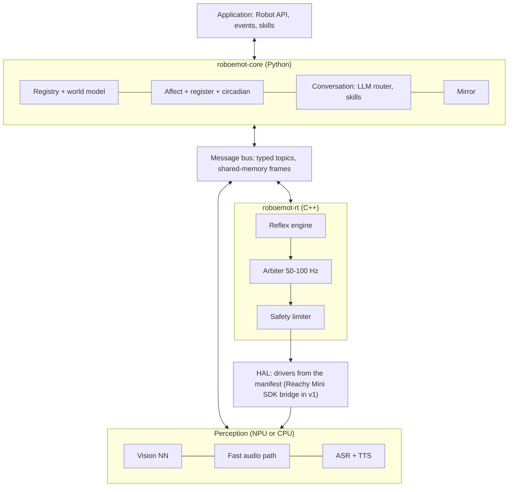

# RoboEmot: Engineering Specification

Oct 12, 2026 · Marcello · Status: Draft v0.2 · Source of truth: this file.

## 1. Overview

RoboEmot is a robot-agnostic library that gives a robot social and emotional behaviour: it recognises known people, adapts its empathic register to each of them, imitates and learns movements, reacts to voice, and converses through an LLM. It runs fully on the robot or on a local edge computer, with or without an NPU (v1: on the Raspberry Pi CM4 inside Reachy Mini Wireless), and any robot plugs in through a manifest and a driver.

### Goals

- One API, many robots: the same application code runs on a desk companion, a micro-robot head or a wheeled platform, described by a robot manifest. v1 ships a Reachy Mini driver and runs entirely on Reachy Mini Wireless (section 4A).
- Recognise enrolled people and unknown people, and estimate age group and gender for every face.
- Choose an empathic register per interlocutor and express affect through every channel the robot has (motion, light, sound, voice); mood and energy follow a simulated circadian rhythm entrained by ambient light from the camera.
- Reflexes independent of LLM latency: under 100 ms from audio or IMU triggers on every profile; from vision triggers, under 100 ms on npu and 250 ms on cm4 (section 13).
- Mirror movements live and learn new gestures from demonstration.
- Conversational loop: speech in, LLM through a router, speech out, with affect.
- Privacy by default: biometric data never leaves the local RoboEmot host (the robot itself on Reachy Mini Wireless). Every behaviour and expression parameter is configurable, with personality presets (section 11A).

### Non-goals for v1

- Grasping and manipulation, SLAM and navigation.
- Coordination between several robots.
- On-device training of large models (only enrollment and gesture recording happen on the robot).
- Any therapeutic or medical claim.

### Glossary

| Term | Meaning |
| --- | --- |
| Robot manifest | YAML file declaring a robot's joints or pose groups, sensors, expressive channels and limits |
| Driver | Code that talks to the actual hardware (or to a vendor SDK) behind a manifest entry |
| Pose group | Set of joints the vendor SDK commands as one pose (Reachy Mini's 6-DoF head) |
| Profile | Model and rate set for a compute class: `npu` (accelerator) or `cm4` (CPU only, Raspberry Pi CM4) |
| Percept | Timestamped observation published by a perception module (face, pose, utterance) |
| Affect state | The robot's internal emotional state: continuous valence/arousal plus a discrete label |
| Empathic register | Parameter set that shapes how the robot behaves with one interlocutor (voice, wording, motion amplitude, distance) |
| Minor present | A child or teen, declared or estimated, or a person of unknown age group, is in view; triggers the conservative policies of sections 7, 8 and 12 |
| Motion primitive | Named, parameterised movement (nod, wave, look-at) replayable on any compatible robot |
| Reflex | Fast, hard-wired reaction from percept to motion that never waits on the Python core or the LLM |
| Skill | High-level action exposed to applications and to the LLM as a tool |
| LLM route | One OpenAI-compatible endpoint (`base_url`, `api_key`, `model`) with its timeout and budget |

## 2. Decisions and assumptions

The sketch defines the capabilities; the decisions below fix the architecture. Assumptions are marked and repeated in Open questions.

| Topic | Decision | Consequence |
| --- | --- | --- |
| Compute placement | Fully on-board. v1 target: Reachy Mini Wireless, on its Raspberry Pi CM4 (CPU only); an NPU board is the optional higher profile | No mandatory host; every model must fit the CPU, RAM and thermal budget of the cm4 profile (section 13) |
| Runtime | Python core for API and orchestration; C++ nodes for real-time paths | Motor loop and audio I/O are C++ processes; Python never sits in a <20 ms loop. Exception: on Reachy Mini the daemon owns hardware and audio, and a Python bridge streams targets at 50 Hz (section 4A) |
| ROS 2 | Optional adapter package | Core has its own bus; `roboemot-ros2` maps it to topics and actions |
| LLM | OpenAI-compatible Chat Completions API as the single LLM protocol; any remote model behind a base URL (cloud provider, LAN server, LiteLLM proxy) | Conversation degrades gracefully when offline; reflexes never depend on it |
| Mirror neural net | Live mimicry and learning from demonstration | Pose estimation + retargeting in v1; learned gestures stored as motion primitives |
| Age and gender | Estimated by vision for every face, enrolled people included | Estimates carry confidence and an `unknown` value; a declared value at enrollment overrides them |
| "Use MxM (?)" in the sketch | Dropped | Not specified |
| Spec language | English |  |

### Assumptions to confirm

- "Different empathic registry" is read as **empathic register**: the style of behaviour chosen per interlocutor. The per-person data lives in a separate **registry** of people, animals and objects (section 6).
- Spoken languages: Italian and English in v1. Italian matters for gender, because it drives grammatical agreement ("benvenuto" / "benvenuta").
- "Fully on-board" covers perception, reflexes, ASR and TTS. A capable LLM does not fit most edge boards, so the router may reach a LAN server or the cloud for conversation only.
- A microcontroller (for example ESP32-S3) may sit on the robot as an I/O coprocessor for servos, LEDs and sensors. It is a driver target, not a compute node.

## 3. System architecture

RoboEmot runs as a few processes on one board, joined by a local message bus: Python orchestrates, perception runs on the NPU (or on the CPU in the cm4 profile), and a C++ real-time core arbitrates motion; on Reachy Mini it hands targets to the robot's daemon through an SDK bridge (section 4A). The LLM sits in the slowest loop and is never on the path from a percept to a motion.



Sensor streams flow up from the HAL into perception, percepts go onto the bus, and both the Python core and the C++ reflex engine consume them. Motion requests from apps, skills, mimicry and reflexes all end in the arbiter and the safety limiter before any driver is written.

### Process model

| Process | Language | Crash behaviour |
| --- | --- | --- |
| `rt` (motor loop, reflexes, audio I/O) | C++ | Supervisor restarts; joints go limp or hold per manifest until it is back |
| `vision` | Python + NPU or CPU runtime | Restarted; attention falls back to sound direction (on Reachy Mini, to the daemon's head tracking) |
| `audio` (VAD, ASR, TTS, fast path) | Python + C++ | Restarted; robot stays expressive but silent |
| `core` (registry, affect, conversation, app) | Python | Restarted; `rt` keeps idle motion and reflexes running |

A supervisor (systemd units or a small launcher) starts processes in dependency order and restarts them with back-off. In Reachy Mini app mode the app process is both the supervisor and the SDK bridge: if it exits, the session ends and the daemon parks the robot.

## 4. Robot manifest and hardware abstraction

Every robot is a manifest plus drivers; no module above the HAL may reference a concrete device. Modules query capabilities at start-up and disable features the robot cannot support (no camera means no vision, no mimicry, no face recognition).

### Manifest

```yaml
robot:
  id: desk-head-v1
  frame: base_link
joints:
  - name: neck_pan
    driver: esp32_servo_bus
    channel: 0
    limits: {min_deg: -60, max_deg: 60, max_vel_dps: 180, max_acc_dps2: 900}
    home_deg: 0
    compliance: spring_return        # informs the safety limiter
  - name: neck_tilt
    driver: esp32_servo_bus
    channel: 1
    limits: {min_deg: -20, max_deg: 30, max_vel_dps: 120, max_acc_dps2: 600}
sensors:
  camera_main: {driver: v4l2, device: /dev/video0, fov_deg: 78, mount: neck_tilt}
  mic_array:   {driver: alsa, device: hw:1, channels: 2}
  imu:         {driver: esp32_imu, model: mpu6050}
  proximity:   [{driver: esp32_tof, model: vl53l0x, mount: front}]
expressive_channels:
  eyes:    {type: led_matrix, driver: esp32_ws2812, pixels: 64}
  voice:   {type: speaker, driver: alsa, device: hw:0}
  body:    {type: joints, joints: [neck_pan, neck_tilt]}
retargeting:            # used by the mirror module (section 9)
  neck_pan:  {source: head_yaw,   scale: 1.0, offset_deg: 0}
  neck_tilt: {source: head_pitch, scale: 0.8, offset_deg: 5}
safety:
  estop: {driver: gpio, pin: 17, active_low: true}
  watchdog_ms: 200
```

URDF is accepted as an optional `kinematics:` reference for robots with real chains; simple robots need only the joint list.

### Discovery

A robot that announces itself on the LAN declares it in its manifest, so finding robots stays robot-agnostic:

```yaml
robot:
  id: reachy-mini-wireless
  discovery: {mdns_service: _reachy-mini._tcp, match_txt: {model: Reachy Mini Wireless}}
```

`roboemot.discovery` browses the mDNS service types that the manifests declare and pairs each answering robot with the first manifest whose service type and TXT values match (`match_txt` tells apart robots sharing a service, such as Reachy Mini Wireless and Lite). It prefers IPv4, because `.local` names often resolve to link-local IPv6 first, and falls back to the OS resolver when a responder sends its SRV and TXT records but not its addresses. `roboemot discover` lists the robots found; the install wizard offers them as a pick list. The mDNS dependency (`zeroconf`) is an optional extra, never installed on the robot. A robot without mDNS, such as an ESP32-S3 head on USB, omits `discovery` and is addressed directly.

### Driver interfaces

| Interface | Methods | Notes |
| --- | --- | --- |
| `JointDriver` | `write_targets(t, positions, velocities)`, `read_state()`, `enable()`, `disable()` | C++; called by the motor loop at its own rate |
| `PoseGroupDriver` | `write_pose_targets(t, groups)`, `read_state()`, `set_mode(active / limp / teach)` | For vendor SDKs that take poses, not servo angles (Reachy Mini); Python bridge or C++ client |
| `SensorDriver` | `open()`, `stream() -> frames`, `close()` | Camera, microphone, IMU, proximity, touch |
| `ChannelDriver` | `render(frame)` | LEDs, display face, speaker; receives already-composed frames |
| `TransportDriver` | `send(bytes)`, `recv()` | Shared serial/USB/I2C link to a coprocessor such as an ESP32-S3 |

A reference coprocessor firmware (ESP32-S3) exposes servos, WS2812 LEDs, IMU and ToF over one framed USB-CDC protocol with CRC and sequence numbers, so small robots need no custom driver code.

### Capability negotiation

At start-up the runtime builds a capability set (`has_camera`, `has_speech_out`, `dof=2`...). Each module declares what it requires and what it can use optionally; the runtime starts only modules whose requirements are met and logs which features are off.

## 4A. Reachy Mini driver (v1 reference robot)

v1 must ship a driver for Pollen Robotics' Reachy Mini, Lite and Wireless, built on the official `reachy_mini` Python SDK (Apache 2.0). Rule: whenever the SDK or its daemon already does something RoboEmot needs, the driver delegates to it instead of reimplementing it; RoboEmot adds only what the SDK lacks (identity, affect, register, arbitration across sources, conversation policy).

### How Reachy Mini is controlled

- A daemon owns the hardware (USB/serial I/O, safety clamping, sensors) and exposes REST and WebSocket on port 8000. The SDK is a client: `ReachyMini()` auto-detects USB/localhost or network.
- **Lite**: the daemon runs on the PC the robot is plugged into. **Wireless**: the daemon runs on the robot's Raspberry Pi CM4, reachable at `reachy-mini.local`.
- Degrees of freedom exposed by the SDK: head pose (position + roll/pitch/yaw, built with `create_head_pose`), `body_yaw`, and two `antennas`. Joints are not addressed one servo at a time.
- Limits enforced by the SDK (values are clamped): head pitch and roll ±40°, head yaw ±180°, body yaw ±160°, head-to-body yaw difference at most 65°.

Reachy Mini Wireless hardware, from the Seeed Studio hardware page and Pollen's store page:

| Part | Specification |
| --- | --- |
| Compute | Raspberry Pi CM4104016: 4 GB RAM, 16 GB eMMC, Wi-Fi; no NPU |
| Camera | Sony IMX708, 12 MP, 120° wide angle, autofocus |
| Audio | 4 PDM MEMS microphones, 5 W speaker |
| Motion | Head 6 DoF (3 rotations, 3 translations), body 1 rotation, 2 antennas with 1 rotation each |
| Power | LiFePO4 battery, 2000 mAh, 6.4 V, 12.8 Wh, plus mains supply |
| IMU | Built in (Wireless only) |

### Hierarchy gate

Every robot-specific capability follows one hierarchy: an abstraction in core (a protocol or an abstract method), implemented by the robot package and found through a `roboemot.*` entry point keyed by `robot.id`. `packages/roboemot-core/tests/test_robot_hierarchy.py` enforces it in the normal `pytest` run, on the syntax tree (comments and docstrings excluded):

- no module of core imports a robot package or a robot SDK;
- identifiers and string literals in core contain no robot vocabulary (terms derived from every manifest in `configs/manifests/`, plus `reachy`, `pollen`, `antenna`, `/api/apps`);
- every installed `roboemot.*` entry-point group is registered in `roboemot.plugins.GROUPS` and each registered object satisfies its protocol;
- robot packages do not probe core objects, or the vendor SDK, with `hasattr`/`getattr` on a literal name. An optional capability of a core object is declared on its protocol: `FrameSource.camera_model(width, height)` (None when the camera does not know its intrinsics), `ASRBackend.missing_words(language, words)` (None when the backend cannot tell) and `WorldSource.speaking` (set by the host, None until then). The SDK surface a robot package touches is described by typed protocols in the package (Reachy Mini: `roboemot_reachymini.sdk`, each member cited to the SDK source line it comes from; the app refuses to start on a `reachy_mini` older than `sdk.MIN_SDK`, 1.12, the version of the robot's daemon and SDK) and accessed directly: no `try/except AttributeError` stand-in either;
- core builds its config and renderer with a non-Reachy manifest (`desk-head-v1`).

The violations that existed when the gate was introduced were listed in `packages/roboemot-core/tests/robot_hierarchy_baseline.yaml`, which is now empty (`[]`): any finding fails. An entry may never be added.

### Deployment with Reachy Mini

v1 must run entirely on Reachy Mini Wireless: RoboEmot is installed as a Reachy Mini app on the robot's Raspberry Pi CM4, next to the daemon, with no external computer. The CM4 has no NPU, so the library defines a CPU-only profile, `cm4`, beside the `npu` profile: same API and features, smaller models and lower rates (section 13).

| Variant | Daemon runs on | RoboEmot runs on | Profile | SDK connection | Media backend |
| --- | --- | --- | --- | --- | --- |
| Wireless (v1 default) | CM4 on the robot | CM4, as a Reachy Mini app | `cm4` | localhost | `local` (GStreamer IPC) |
| Lite | Host PC (USB) | Same host PC | `npu` if an accelerator is present, otherwise `cm4` models on the CPU | `localhost_only` | `local` |
| Wireless + optional edge box | CM4 on the robot | Edge box with NPU on the LAN | `npu` | `network` | `webrtc` (H.264, Opus) |

Off-robot compute is optional, never required. Recognition, register, affect, reflexes, expression, mimicry, ASR and TTS all work with the robot alone; only the conversational LLM needs a LAN or cloud route, because no useful LLM fits the CM4 next to the rest of the stack. Without a route the robot stays fully expressive but does not converse.

### Mapping RoboEmot interfaces to the SDK

| RoboEmot need | Reachy Mini SDK / daemon feature | How the driver uses it |
| --- | --- | --- |
| Streamed joint targets (arbiter output) | `set_target(head=..., antennas=..., body_yaw=...)` | Called at 50 Hz with the arbitrated pose; no interpolation on our side beyond the arbiter's blend |
| Discrete commanded moves | `goto_target(..., duration, method)` with `linear`, `minjerk`, `ease_in_out`, `cartoon` | Not used during a session: in SDK 1.12 `goto_target` blocks the caller until the move ends, which would stall the bridge and every reflex. The arbiter streams everything with `set_target` and applies the same interpolation curves (min-jerk, ease-in-out, cartoon) itself |
| Joint state | `GET /api/state/full`, WebSocket `/api/state/ws/full` | Subscribed for `read_state()` and for `motion.state` on the bus |
| Safety limits | Daemon clamping | Kept as the last layer; RoboEmot's limiter still applies tighter caps (child present, velocity, acceleration) and the 65° head-body coupling before sending |
| Motor modes | `enable_motors()`, `disable_motors()`, `enable_gravity_compensation()` | Mapped to RoboEmot states active / limp / teach; in gravity compensation position targets are ignored, so the arbiter pauses |
| Wake and sleep | Daemon `wake_up()` / `goto_sleep()`; idle reset after a crash | RoboEmot lifecycle `start`/`stop` calls them in client mode; in app mode (below) it never calls them, because the platform does |
| Platform moves | Moves the daemon runs itself (`Backend.play_move`: the owner's go-to-sleep or wake-up from the app, the idle reset) raise `Backend.is_move_running`; while it is set the daemon drops every `set_target` from every transport and accepts them again as the move ends | RoboEmot has no cheap way to read that flag: the SDK websocket never carries it (only the WebRTC state snapshot does), `GET /api/move/running` and `WS /api/move/ws/updates` list only REST-created moves and miss the WebRTC `goto_sleep`, and polling `POST /api/move/set_target` would put one `uvicorn.access` INFO line per probe in the robot journal. The motion loop therefore detects the effect instead: the measured pose stops following the commands (section 12A, Robot, External control). `goto_sleep` is a 2 s move, then a 2.0 s wait with no move running, then the motors are disabled (`daemon/backend/abstract.py`) |
| Camera | `mini.media.get_frame()` → `uint8` array (H, W, 3) | Implements the `camera_main` `SensorDriver` feeding vision (section 5) |
| Microphones | `mini.media.get_audio_sample()` → `float32`, 16 kHz, 2 channels | Feeds the capture stage of the voice pipeline (section 8) |
| Speaker | `mini.media.push_audio_sample()` (non-blocking, 16 kHz) | TTS output; the driver tracks queued duration to support barge-in |
| Sound direction | `mini.media.get_DoA()` → `(angle, is_speech_detected)` or `None` (0 rad left, π/2 front, π right; one half-plane, so front and back are not told apart) | Replaces our own direction-of-arrival estimate; drives the "turn toward voice" reflex and helps pick the active speaker |
| Fallback face tracking | `start_head_tracking(weight)`, `get_tracked_face()` (closest face, runs in the daemon) | Follows the closest face (`weight=1`) when that face is the attention target, including between detections on the `cm4` profile, and when the vision process is down; `weight=0` when RoboEmot's attention picks someone else (active speaker, enrolled person). How it blends with `set_target` streaming is verified in M0 |
| IMU (Wireless only) | `mini.imu` → accelerometer, gyroscope, quaternion, temperature | Lift and tilt detection for safety and for appraisal ("picked up") |
| Recording moves | `start_recording()` / `stop_recording()` on the robot | Storage path for learned gestures (section 9) |
| Simulation | Official MuJoCo simulation of the robot | Simulation test layer and CI (section 14) |

### Expressive channels on Reachy Mini

The default expression map for Reachy Mini uses head pose, body yaw, the two antennas and sound. Antennas carry most of the affect (for example: raised and still for curiosity, fast wiggle for joy, drooping for sadness); head pitch and small body turns add emphasis. No LED channel is assumed. The daemon can download Pollen's recorded move datasets (emotions, dances); RoboEmot can import them as keyframe primitives and stream them through the arbiter like any other primitive.

### Real-time path with Reachy Mini

With Reachy Mini the daemon, not `roboemot-rt`, owns the hardware loop, and one bridge process owns the only SDK client. The SDK's media layer marks camera and audio devices busy once opened, so no other RoboEmot process opens them: the bridge republishes camera frames, audio, direction of arrival, IMU and joint state on the bus (shared memory for frames and audio), and takes pose targets and TTS audio back. In app mode the bridge is the app process and uses the `ReachyMini` instance the daemon passes to `run()`.

`roboemot-rt` still runs the arbiter and the reflex engine and sends targets to the bridge, which calls `set_target` at 50 Hz over localhost. On the CM4, `roboemot-rt` and the bridge share one core with real-time priority (section 13). The bridge is the only Python hop on the reflex path; if it misses the 100 ms reflex budget in M0, it is replaced by a C++ client of the daemon's API, keeping a thin Python process only for media. Facts from the SDK source (1.12.0, the robot's version): the daemon's runner creates the `ReachyMini` connection (the SDK default is `automatic_body_yaw=True`), and the driver calls `set_automatic_body_yaw(False)` when it starts and again after a reconnect, because the arbiter commands body yaw itself; it calls set\_target only after enable\_motors(), which pins targets to the present pose; antenna order is \[right, left\].

### Packaging as a Reachy Mini app

On Wireless, app mode is the primary deployment: RoboEmot ships as a `ReachyMiniApp` (`run(reachy_mini, stop_event)`), installable from the Reachy Mini Control desktop app (which replaced the web dashboard), publishable as a Hugging Face Space, or installed manually without publishing (wheels copied over SSH and installed with pip into the apps venv, through a repeatable install wizard with a read-only dry run, and removed by its uninstaller; see "Installer" below). The daemon starts it as a subprocess in `/venvs/apps_venv/`; `run()` launches the RoboEmot processes (`rt`, `vision`, `audio`, `core`) and stops them on `stop_event`. Its `custom_app_url` web UI hosts enrollment, consent and settings. The daemon's REST API starts and stops apps (`/api/apps/start-app/{name}`, `/api/apps/stop-current-app`) and names a startup app (`PUT /api/apps/startup-app`) that it starts on the robot's first wake-up. Platform constraints: one app at a time (starting a second one fails until the current one stops), the app never wakes or sleeps the robot (the installer may, through the REST API, before starting it), and native dependencies (ONNX Runtime, C++ nodes) must be built for the CM4's aarch64 and installed in that venv. Client mode (RoboEmot as a separate process with `ReachyMini()`) remains for Lite and for development.

The app class is a thin adapter (SPEC 11, Plugin interfaces): `RoboEmotApp(RuntimeHost, ReachyMiniApp).run` loads the config stack and the manifest, calls `load_robot_platform(manifest.robot.id)` and `require_runtime()`, binds the connected `ReachyMini` with `platform.bind(...)` and runs core's `Runtime`. The robot-agnostic pipeline (assembly, hot reload, main loop, debug-report sources, web UI server) lives in `roboemot.runtime`; the rules of this section stay in the Reachy driver, camera, audio, speaker and session. The class attributes the daemon reads (`custom_app_url`, `dont_start_webserver`) and the entry point `roboemot_reachymini.main` are unchanged.

#### Installer

The installer runs on a PC on the robot's LAN and is robot-agnostic (`roboemot.install`). A platform package registers the robot-specific part in the `roboemot.installers` entry-point group under the manifest's `robot.id`. For Reachy Mini Wireless that part is the daemon's REST API, the shared `/venvs/apps_venv`, package data staging, the entry-point check, start and stop, and the startup app.

- **Leave the robot as it was.** Apps share one Python environment, so other apps may install packages after RoboEmot. A full snapshot restore would undo their changes, so the installer records only what it changed itself:
  - the distributions it added;
  - for each distribution it replaced, the version that was there before;
  - the app data folder (`~/.local/share/roboemot` of the robot user: registry, models and the persona trait cache, section 12 Data), created private (0700) when it did not exist, together with any parent folder it had to create. A folder that already existed is not recorded and uninstall leaves it. Uninstall deletes the recorded folder (registry, models and trait cache included), then those parents if empty, and verification fails while the folder remains. Before the recursive delete the recorded path must equal exactly the one the installer computes now (the SSH user's `$HOME` plus the default location) and, when it exists, its `realpath` on the robot must be the same path; otherwise nothing is deleted, the uninstaller warns, and verification fails so the record is kept. Only recorded parents that lie between `$HOME` and the folder are removed. At install time the installer warns if `ROBOEMOT_DATA_DIR` or a `data_dir` in the staged config would put the data elsewhere.

  The record is merged on every reinstall, and the original versions are never overwritten. It lives outside the environment and outside `/tmp` (Reachy: `/venvs/.roboemot-install.json`). It is written before pip runs and completed afterwards, so an interrupted install can still be undone.
- **Secrets.** `--secret NAME` (or the prompt on a terminal) stores an API key in the robot's secret store (section 8, Secrets). The value is typed on the PC without echo and sent only on the SSH channel's standard input to `roboemot secrets set` on the robot, so it is in no command line, log or message. A name that was not in the store is recorded (names only, before the write); uninstall removes exactly those names. Other secrets, and a name that existed before even if replaced on request, are kept only when the data folder predates the install; a data folder the installer created is deleted whole, secrets included. The dry run neither asks, writes nor creates the file; the uninstall dry run lists the names it would remove.
- **Missing apps environment.** A freshly flashed Reachy has only `/venvs/mini_daemon`; the daemon (1.12) creates `/venvs/apps_venv` lazily on the first app install. When it is missing, the installer does the same: `/venvs/mini_daemon/bin/python -m venv /venvs/apps_venv`, then `pip install --no-cache-dir reachy-mini==<version of reachy_mini in the daemon venv>` (pinned, unlike the daemon). The architecture, Python and free-space checks run against the daemon interpreter (free space on `/venvs` while the venv does not exist), and the record gets `env_created` before the venv is created, so an interrupted install can be undone. A platform that cannot create its environment (`Platform.base_python` is `None`) fails with a clear error. The dry run reports `would create /venvs/apps_venv` and skips the dependency check, which needs the environment; nothing is written.
- **Stop first.** After the SSH checks and before the cache and pip steps, if the platform's running app is RoboEmot itself the installer stops it (`Platform.running_app()` equal to `app_name`, then `stop_app()`) and says `stopped roboemot before installing: a running process keeps the old code`. Another running app is left alone. The dry run reports `would stop roboemot before installing` and calls nothing. The later `Start roboemot now?` prompt keeps its default of yes. If the install fails after the stop, the installer prints how to start RoboEmot again (`python scripts/run_on_robot.py`); a failing stop aborts before anything is installed. The dry run counts the stop once.
- **Run and restart.** `python scripts/run_on_robot.py` (`roboemot.install.run`) starts the installed app over the robot's own API, without SSH, and prints the web UI address; it does nothing when RoboEmot already runs. `--restart` restarts a running RoboEmot through the platform's `restart(ui)` (`Platform.restart`; Reachy: the daemon's `restart-current-app`), then waits until it runs again. The daemon answers after the stop and the new start; if the request fails (an error after the stop, a timeout), the installer reads the current app once and either keeps waiting (still RoboEmot) or says RoboEmot is stopped and how to start it. It asks first with no as the default, and `-y` answers yes, because the head may move: the daemon's stop goes to the zero pose unless the robot is asleep. When RoboEmot is not running, or another app is running, `--restart` takes the normal start flow. With `--dry-run` it only reports what it would do. A platform whose `restart` is None (it cannot restart the app) gets a clear error. Every `Platform` declares `restart`, as None if need be (no attribute is probed); `run` reads it only for `--restart`, so a plain run still works on a platform written before it.
- **Install.** Versions already in the environment are pinned. If the app needs to change a shared package, the installer lists the changes and asks first, and a refusal leaves everything untouched. Every pip call passes `--no-cache-dir`, so nothing is added to the robot user's pip cache. Wheels go to a `mktemp` directory under `/tmp`, which is deleted afterwards. Making the app the startup app first records which app it replaces.
- **Vision (on by default, `--no-vision` skips it; owner decision 2026-10-21).** The installer adds the `vision` extra (OpenCV, ONNX) to the core install and, in the models step, fetches the vision weights (`roboemot models fetch --all`, INT8 files included in the size check). The models step already warns and skips when the free space is short; with vision on, that warning names `--no-vision`. A re-run over an install made without vision adds the extra and the weights; uninstall removes the vision models folder like the voice one (recorded when the installer created it, or with the data folder). The dry run reports `would install the vision extra` and the sizes of the voice and vision models.
- **Voice (on by default, `--no-voice` skips it; owner decision 2026-10-21).** `voice.enabled` stays false as the library default (a robot without a microphone or speaker must not change), so the installer enables it for the robot it sets up: the core decides (`roboemot.install.app_config_overrides`) and the platform writes the app config the app reads (Reachy: `data/app.yaml` in the package data, `ConfigStack` app layer). The file is generated, not concatenated: a header saying the installer wrote it, then one commented part per purpose, `voice.enabled: true` and, with `--dev`, the content of `configs/dev-unmeasured.yaml` (`safety.allow_unmeasured_dynamics: true`). With voice but without `--dev` the file still exists (voice only); with `--no-voice` and without `--dev` there is no file. Every install rewrites it. The wizard's verification reads the installed file back and fails when `voice.enabled` or the dev flag differ from what was asked. The dry run prints what the file will contain and writes nothing. The file is package data, so uninstall removes it with the package and the record names no extra path. `--no-voice` also makes Piper and the models step default to off (not even asked; `--piper` and `--models` still force them), except that with vision on the models step stays and fetches the vision weights, with the voice files that `models fetch --all` brings along. With voice on, a declined Piper or models step warns that the robot will not speak or will not listen.
- **Piper (optional, `--no-piper` skips it).** `piper-tts` is GPL-3.0 and runs as its own process, so the installer makes a virtualenv `piper-venv` in the data folder (recorded before it is created, removed by uninstall). `piper-tts` and every transitive dependency are installed from a hash-pinned lock (`roboemot/install/locks/piper-<arch>-py<MM>.txt`, package data) with `pip install --require-hashes --only-binary=:all: --no-cache-dir -r`, so a tampered or swapped artifact fails instead of installing. The installer picks the lock by the robot's architecture and Python minor version (aarch64 on 3.11 and 3.12; x86_64 on 3.12 for the CI `models` job, which installs from its lock the same way) and refuses a target without one. The lock is copied to the same `mktemp` directory as the wheels. `roboemot.install.PIPER_TTS_VERSION` is the only place the version is written; `scripts/lock_piper.py` regenerates the locks from it with `uv pip compile --generate-hashes` for each target (no local install), and a unit test checks that each lock pins that version and that every requirement carries a hash. The dry run reports the lock it would use and writes nothing.
- **Uninstall** (`--uninstall`). The steps are:
  - stop the app;
  - restore the previous startup app, only if the setting still names RoboEmot;
  - remove the app's distributions and the ones the record says it added, except those another installed distribution still requires;
  - reinstall the original versions of the ones it replaced, unless someone has changed them since. This needs internet access.
  - delete leftover modules inside site-packages, stale temporary directories and the platform's own leftovers (Reachy: a daemon app-metadata file, if the daemon ever wrote one);
  - delete the environment the record says the installer created (Reachy: `/venvs/apps_venv`), unless another app lives in it (any `reachy_mini_apps` entry point other than ours): then it is kept and the other apps are named in a warning;
  - verify, and only then delete the record.

  With the environment already gone, the uninstaller skips the package steps and still cleans the recorded data folder, Piper virtualenv, temporary directories and daemon metadata. If verification fails, the record is kept, so running the uninstaller again picks up where it stopped. Running it twice is harmless. With no record, it removes only the app's own distributions and says so.
- **Dry run** (`--dry-run`, for install and uninstall). It is read-only, with no pip cache, temporary directory or record written. It lists what would be added, changed, removed or restored, and the data folder it would create or delete.
- Checked on Neve (daemon 1.11.0): the install dry run would add only `scipy`, with everything else pinned at the robot's versions.

### Reachy Mini manifest

```yaml
robot:
  id: reachy-mini-wireless
  driver: reachy_mini_sdk
  profile: cm4                    # CPU-only, runs on the robot's CM4
  connection: {mode: localhost_only, media_backend: local}
  discovery: {mdns_service: _reachy-mini._tcp, match_txt: {model: Reachy Mini Wireless}}
pose_groups:                      # SDK addresses poses, not servos
  head:
    type: pose6d
    limits: {pitch_deg: [-40, 40], roll_deg: [-40, 40], yaw_deg: [-180, 180]}
  body_yaw: {type: joint, limits: {min_deg: -160, max_deg: 160}}
  antennas: {type: joint_pair, names: [antenna_left, antenna_right]}
constraints:
  - {type: yaw_delta, a: head.yaw, b: body_yaw, max_deg: 65}
sensors:
  camera_main: {driver: reachy_mini_media}
  mic_array:   {driver: reachy_mini_media, doa: true}
  imu:         {driver: reachy_mini_imu}      # Wireless only
expressive_channels:
  voice: {type: speaker, driver: reachy_mini_media}
  body:  {type: pose_groups, groups: [head, body_yaw, antennas]}
motor_modes: {active: enabled, limp: disabled, teach: gravity_compensation}
dynamics:               # velocity and acceleration caps, measured in M0; required before release (section 12)
  head:     {max_vel_dps: null, max_acc_dps2: null}
  body_yaw: {max_vel_dps: null, max_acc_dps2: null}
  antennas: {max_vel_dps: null, max_acc_dps2: null}
retargeting:            # mirror module (section 9)
  head.yaw:      {source: head_yaw,   scale: 1.0}
  head.pitch:    {source: head_pitch, scale: 1.0}
  head.roll:     {source: head_roll,  scale: 1.0}
  body_yaw:      {source: torso_yaw,  scale: 1.0}
  antenna_left:  {source: left_arm_elevation,  scale: 0.5}
  antenna_right: {source: right_arm_elevation, scale: 0.5}
safety:
  estop: none                 # no hardware e-stop input on Reachy Mini
  soft_stop: hold_position    # stop streaming, motors stay enabled
  hard_stop: disable_motors   # limp; the daemon parks the robot when the session ends
  watchdog_ms: 200
behaviour:                      # excerpt: the robot's name (section 8 stage 2); maps and poses omitted
  voice:
    default_name: Reachy
    keywords:
      it: {name_aliases: [reati]}
      en: {name_aliases: [riyadh she]}
```

The manifest's `behaviour.voice` carries the robot's name and its voice pitch, nothing else: `default_name` (the name the manifest's aliases are spellings of; never the shown or spoken name) and, per language, `keywords.<language>.name_aliases` (spellings the recognizer produces for it). The pitch is `base.pitch_st` and `limits.pitch_st` (a `[lo, hi]` pair that must hold the base; each side is checked against the schema default when the manifest sets only the other), the robot's voice character and not a library default: Reachy Mini sets `+5` with limits `[-4, 8]` (child-like, gender-neutral; varispeed moves the formants with the pitch; the wider limits keep room for moods, the energy curve and the child register, and the delivery clamps at +8, a 1.59x `length_scale`). The owner's own `voice.base.pitch_st` / `voice.limits.pitch_st` (runtime or app layer) still win. Every other `voice` key is refused at load, so a manifest cannot change a privacy or safety setting. Each name is validated like one from the platform or the owner: letters, digits, spaces and `'.-` only, at most the schema maximum of `voice.name_max_chars` (not the owner's setting, so a tight owner cap cannot make a shipped manifest fail at start-up; manifest names are only matched, never shown). Core defaults carry no name and no alias (section 11A).

The manifest's `behaviour.motion` may set the loop rates of its hardware and nothing else: `arbiter.loop_hz` (Reachy Mini: 50 Hz, the rate of `set_target` over the daemon websocket) and `app_tick_hz`. Limits, blending and priorities stay with the schema, the presets and the owner; any other `motion` key is refused at load. The app reads both from the merged configuration (SPEC 11A): the motion loop takes `motion.arbiter.loop_hz` and the app's main loop waits `1 / motion.app_tick_hz` per tick.

The manifest schema gains `pose_groups`, `constraints` and `dynamics` for robots, like Reachy Mini, whose SDK exposes Cartesian poses instead of individual joints. `null` dynamics values are placeholders: section 12 rejects a manifest without limits, so they must be filled with values measured in M0 before release.

## 5. Vision neural net

Vision is a set of small models scheduled on the NPU (npu profile) or the CPU (cm4 profile) that publish percepts; it recognises people and things and feeds attention targets and gestures straight to the motor layer. Rates in the table are for the npu profile; cm4 rates are in section 13. Models are swappable: the library ships ONNX references and compiles them per target (Hailo HEF, RKNN, TensorRT for the npu profile; ONNX Runtime on CPU for the cm4 profile, with the smaller models and rates of section 13).

| Stage | Default model class | Rate | Output |
| --- | --- | --- | --- |
| Face detection | Lightweight detector (npu: SCRFD class; cm4 and M1: YuNet 2023mar, MIT) | 15 fps | Boxes + 5 landmarks |
| Face embedding | ArcFace-class encoder (cm4 and M1: SFace, Apache-2.0) | On new track, then 2 fps | Embedding for identity matching |
| Age group and gender | Classification heads on the face crop (cm4 and M1: FairFace ViT-B pair, Apache-2.0; `vision.attribute_precision` `auto` loads INT8 when the manifest `profile` is `cm4` and FP32 otherwise) | On new track, then 1 fps | `age_group` in {child, teen, adult, senior, unknown}; `gender` in {male, female, unknown}; probability each |
| Body pose | 17-keypoint estimator (RTMPose / MoveNet class) | 15 fps when mirror or attention needs it | Keypoints + confidence |
| Hand landmarks | Optional 21-point hand model | On demand | Hand pose for gestures |
| Objects | Small COCO-class detector, fixed classes (cm4 and M1: NanoDet-Plus-m 320, Apache-2.0 code and ONNX weights; Ultralytics YOLO is excluded, AGPL-3.0) | npu 5 fps; cm4 and M1 1 fps (section 13) | Labelled boxes |
| Tracking | ByteTrack-class multi-object tracker | Every frame | Stable `track_id` per person and object |

### Rules for estimated attributes

- Estimates are aggregated over a track (median of at least `identity.estimate_frames_min` frames, default 3; the age and gender job takes `vision.attribute_crops` crops per track, default 3, and the configuration is rejected if that is below `estimate_frames_min`, so raising the minimum for safety needs more crops explicitly) before use, and below a confidence threshold (default 0.8) the value is `unknown`.
- A value declared at enrollment always overrides the estimate for that person.
- Estimates can only make behaviour more conservative, never less: they select register defaults and can trigger the minor-present policy (sections 7, 8, 12), but never relax a cap or cause a refusal to interact. A person whose age group is unknown counts as a possible minor until a confident estimate or a declared value exists.
- Age and gender classifiers are known to be less accurate for children and for some demographic groups. The evaluation plan (section 14) measures error per group before a model is accepted.

### Connection to the motor layer

Vision publishes three motor-relevant signals on the bus, consumed directly by the reflex engine in roboemot-rt without passing through the Python core: `attention.target` (the face or object to look at, with priority), `proximity.approach` (a person or object entering the near zone), and `gesture.detected` (wave, point, raised hand). Attention selection prefers, in order: the active speaker, an enrolled person, the nearest face, the most salient moving object.

## 5A. World model and scanning

The robot keeps a "mental map" of who and what is around it, not only in front of the camera: people, animals and objects, each with a position, a confidence that fades when nothing confirms it, and the time it was last seen or heard. The map is fluid: entries appear, move, fade and disappear as observations arrive. The world model is robot-agnostic; each robot supplies its sensor sources and how it looks around through a plugin (section 4, Capability negotiation).

### Observations and sources

- Every source publishes observations on `percept.entity`: `kind` (person, animal, object), `category` (detector class, for example `cat`, `cup`), optional `identity` (a registry ID, when the source already resolved it), `bearing` (azimuth and elevation, radians), optional `distance_m`, `confidence`, optional appearance embedding, timestamp and `source` name.
- Sources are plugins (`WorldSource`): the vision pipeline (section 5), sound direction (`get_DoA()` on Reachy Mini, section 4A), and any robot-specific sensor (proximity, lidar, a robot's own detectors). Robot packages register them in the `roboemot.world` entry-point group keyed by the manifest `robot.id`, like diagnostics and installers; core stays robot-agnostic.
- A source that only hears (sound direction) produces bearing-only observations of kind `unknown`, which can confirm an entry or trigger a glance but never create a person, animal or object on their own.

### Frame

Positions are egocentric: bearing and distance from the robot's base, so a robot that does not move needs no mapping. Observations made with the head or body turned are rotated into the base frame using the joint state at capture time. A mobile robot's driver may report its own pose (`base_pose`); the world model then stores positions in that frame, and consumers see the same entries with no change in their interface. A room map (SLAM, rooms, zones) is not part of v1.

### Entries, matching and fading

- An entry holds: `entry_id`, kind, category, identity (registry ID or `unknown`), position and its uncertainty, confidence, first and last seen, sources that saw it.
- Matching an observation to an entry, first match wins: same identity; else same kind and category within an angular gate (`world.match_gate_deg`) and, when both have distances, a range gate; else a new entry. Appearance embeddings break ties between candidates.
- Confidence rises with each matching observation and decays with a half-life per kind (`world.half_life_s`, people shorter than objects). Out of the sensors' view the decay is slower (`world.out_of_view_decay_factor`): what the robot cannot see now is remembered, not forgotten. An entry whose bearing is in view but which is not detected decays at the full rate.
- Below `world.forget_confidence` an entry is removed. Events on the bus: `world.entity_appeared`, `world.entity_moved` (beyond `world.moved_threshold_deg`), `world.entity_gone`, and `world.snapshot` on request.
- Consumers: attention (look toward a known entry), appraisal rules (for example `person.returned`, `animal.appears`), the LLM scene summary (section 8, entries by attention priority until its cap), and the registry (last seen, auto-enrollment).

### Scanning

- A scan policy in core decides when to look around; the robot plugin's `ScanPlanner` decides how (a sequence of poses within the manifest limits, for example head and body yaw sweeps).
- Triggers: idle for `world.scan.idle_interval_s` (jittered), or, after a person target or speaker hint is lost, only `world.scan.target_lost_delay_s` (default 8 s, jittered by `target_lost_jitter_s`, 3 s; scaled by the persona's `idle_period_x` like the idle interval; it applies once per loss, then the idle interval is back), wake-up from rest, and a glance toward an unexplained sound or motion (a bearing-only observation with no matching entry).
- Never while engaged with a person (a single glance toward a sound is allowed), never during quiet hours or circadian `resting` (section 7A), and only within the minor-present motion caps.
- Sweeps are motion requests at idle priority through the arbiter (section 10): attention, reflexes and safety always win (attention on an animal or object holds a due sweep off for at most `attention.object_max_hold_s`, then the sweep runs). Pace and amplitude scale with the persona's energy trait (section 11A, Persona).
- On Reachy Mini, body yaw (±160°) plus the head-to-body offset (up to 65°) and the 78° camera cover the whole room; sound direction covers the front half-plane without moving (the SDK reports one half-plane, so a sound behind is mirrored in front: a glance toward it is a guess the next sweep corrects).
- Sweeps and glances move head and body yaw only; head pitch stays with idle breathing. Pace scales with the energy trait's `idle_period_x`, amplitude (share of the full circle) with `motion_amplitude_x`, never below `world.scan.min_amplitude`; a present minor only slows the pace, since the arbiter already scales amplitude and speed (section 12).
- Only a person target or a speaker hint (engaged) cancels a sweep, drops a pending wake-up sweep and holds the idle clock; an animal or object target holds a due scan (sweep, wake-up or glance) off for at most `attention.object_max_hold_s` (default 30 s); the timer starts when the scan becomes due, survives a switch to another object, and resets when the object target is lost. After that the sweep runs, hiding the attention command while it does. A sweep ends with a glide home at scan pace. A glance toward a sound while engaged is allowed once per engagement, at most every `world.scan.glance_cooldown_s`, and is the one scan motion above idle priority (expression, for `glance_hold_s`). Today only sound feeds unexplained bearings; vision detections that match nothing create entries instead.
- A bearing-only observation gains `world.bearing_only_gain_factor` of the normal confidence and neither refreshes `last_seen` nor marks the entry in view, so a mirrored rear sound cannot keep an unseen entry alive.

### Known individuals and auto-enrollment

- Known animals and objects are registry entries (section 6) matched by appearance embedding, like people by face.
- Auto-enrollment (animals and objects only, never people): an unknown entry whose appearance clusters with earlier sightings on at least `world.autoenroll.min_days` different days, with a cluster tighter than `world.autoenroll.max_spread`, is enrolled with a placeholder name (`cat 1`, `mug 2`). The owner can rename, merge or delete it in the web UI. Defaults after the recognition spike (section 15): `world.autoenroll.min_days` 3, at least 5 sightings, `max_spread` 0.25 (cosine distance to the cluster centroid, max over members, with DINOv2-S, Apache-2.0). These are judgement values to tune on the robot. Objects separate poorly in the spike (66% rank-1 on a product catalogue, dogs 97.5%), so wrong merges are expected and the owner fixes them in the web UI.
- Algorithm (`roboemot.world.autoenroll`), online and per kind and category:
  1. An observation whose appearance embedding is at least `world.autoenroll.known_match_threshold` (default 0.875, that is 1 minus `join_radius`) close to an active animal or object record of the same kind (and category, when the record has one) attaches that identity to its world entry and collects nothing.
  2. Otherwise it is a *sighting*, at most one per world entry and at most one per candidate cluster per `world.autoenroll.sighting_min_interval_s` (300 s): a track watched for a minute, or an entry that keeps being recreated, is one sighting, not hundreds.
  3. A sighting joins the nearest candidate cluster whose centroid is within `join_radius` (cosine distance, default 0.125, half of `max_spread`), else starts one. A cluster keeps its last `max_members` embeddings, each with the local day it was seen on; sightings and days are counted from the retained members only, so a member that rolled out takes its day with it.
  4. A cluster with `min_days` days, `min_sightings` sightings and a spread (max over retained members of 1 minus cosine to the centroid) of at most `max_spread` is enrolled as `origin=auto`; the placeholder is `<category> <n>` in the `conversation.language` (`gatto 1`), with n one above the highest number any auto record of that name already has.
  The spread gate alone cannot tell two look-alikes apart: two animals at cosine distance 0.23 spread only about 0.06 around their midpoint. The tighter `join_radius` is what keeps them in separate clusters (and `known_match_threshold` keeps the second from being taken for the first once the first is enrolled); the spread gate then only guards against slow drift. The price is that one animal photographed very differently may split into several clusters and enroll later or twice, which the owner fixes by merging in the web UI.
- Candidates persist in the registry store (collection `candidates`, atomic writes, mode 0600, same data folder) even without the history opt-in. They are bounded (`max_clusters`, `max_members`) and deleted when enrolled, after `retention_days` without a sighting (checked at startup, at shutdown and on a periodic tick, whether or not anything is seen), when auto-enrollment is disabled or the kind is no longer listed (also at startup, and when the appearance model is missing), or by "Forget collected sightings" in the web UI (PIN again; it works without a running enroller). Deleting an auto-enrolled record does not suppress the animal: it can be enrolled again after `min_days` more days. Candidates made with another embedding model are deleted at load.
- `world.autoenroll.kinds` (default animals and objects) lists what may be auto-enrolled; people are refused in code, whatever the configuration. The recognition spike advises animals only (objects: 19 to 24% of mixed clusters accepted); the default follows this section, and section 15 asks whether to switch.
- People are enrolled only through the consent flow (section 6, Enrollment).

### History (opt-in)

- With `privacy.world_history` on (off by default; turning it on needs the admin confirmation, section 11A), every appear, move and gone event is stored locally with time, position and identity, for patterns such as "Marcello comes home around 18:00" and "the mug is usually on the left".
- Retention: `world.history_retention_days`, then deleted. `export(person_id)` and `forget(person_id)` include it. For unknown people the history stores only kind, position and time: no embedding and no link between sessions. History never leaves the robot.
- Without the opt-in, the live map stays in RAM and only the registry's `last_seen` and the auto-enrollment candidates (appearance embeddings of unknown animals and objects with the days they were seen) persist.

## 6. Registry and identity

The registry stores enrolled people, animals and objects as embeddings plus a profile, encrypted on the robot; identity is resolved per track by voting, never from a single frame. Animal and object records hold `entity_id`, kind, category, display name, appearance embeddings, `last_seen`, `origin` (`enrolled`, `xmp`, `auto`) and an optional description; they have no consent, age or register fields.

### Person record

| Field | Type | Source |
| --- | --- | --- |
| `person_id` | UUID | Generated |
| `display_name` | string | Enrollment |
| `face_embeddings` | 5 to 20 vectors; dimension set by the embedding model | Enrollment + optional online refresh |
| `voice_embedding` | vector, optional | Enrollment (speaker ID) |
| `age_group`, `gender` | enum + `declared` / `estimated` flag | Declared at enrollment or estimated (section 5) |
| `register_overrides` | partial register | Enrollment or app |
| `preferences` | key/value (preferred name, language, topics to avoid) | App or conversation, with confirmation |
| `consent` | who consented, when, scope; guardian for minors | Enrollment |
| `last_seen` | timestamp | Runtime |

### Enrollment

1. Operator starts enrollment from the API or a voice command ("remember me"), only when an operator PIN or the admin app confirms.
2. Robot captures 5 to 20 face crops at varied angles, rejecting blurred or low-confidence frames.
3. Operator records name, consent and, optionally, declared age group and gender.
4. Embeddings and profile are stored; raw images are discarded unless `keep_enrollment_images: true`.

### Matching

- Cosine similarity against all stored embeddings; a track is assigned to a person when the best match exceeds the threshold (default 0.45, which is the SFace seed; tuned per model, see the [model spike](../spikes/2026-10-m1-models.md)) on at least 3 of the last 5 evaluations, with a margin of 0.1 over the second best.
- Otherwise the track is `unknown` and gets a temporary anonymous ID for the session only.
- Face and voice IDs are fused when both exist; a disagreement drops the track to `unknown`.
- Online refresh adds a new embedding only after a high-confidence match, capped per person, to follow slow changes such as a growing child.

### Catalogue import (XMP)

- The owner can import a catalogue of known people, animals and objects as XMP sidecar files, written by common photo tools: MWG Regions (`mwg-rs:Regions`, with `Name` and `Type` such as `Face` and `Pet`), `dc:subject` and `lr:hierarchicalSubject` (for example `Animals|Cat|Mia`).
- XMP alone is enough: each record is created `pending` and gets its appearance when the robot sees it and the owner confirms ("this is Mia"), or by renaming an auto-enrolled placeholder.
- Photos are optional: when supplied with their sidecars, each tagged animal or object region is turned into an embedding in memory and the image is discarded at once. Catalogue photos are never stored, whatever `keep_enrollment_images` says (that option is for the people enrollment only). The embeddings sit on the still `pending` record, outside matching, until the owner confirms.
- People in an imported catalogue stay `pending` until the consent flow completes (Enrollment); the import never creates biometric data for a person without consent. Face regions are not even cropped or embedded: a person's photo yields a name and nothing else. The enrollment page lists the pending names; the owner may link one, and then the consent flow completes that record in place. Nothing is linked or removed by matching names.
- Parsing (`roboemot.registry.xmp`): the sidecar is untrusted. It is size-capped before parsing and parsed with `defusedxml` (DTDs and entities are refused: no external entities, no expansion bombs; `defusedxml` is a core dependency because the stdlib parser's protection depends on the expat build). Lists are walked through their direct `rdf:Bag/Seq/Alt` children only, under one budget of visited `rdf:li`; areas and dimensions must be finite and in range.
- Mapping: Face region or `People|Name` gives a person; Pet region or `Animals|Category|Name` an animal; `Objects|Category|Name` an object (Italian roots `Persone`, `Animali`, `Oggetti` too). Focus and BarCode regions are skipped, and a bare `dc:subject` keyword creates nothing. Region areas follow MWG: `stArea:x`/`y` are the centre. Categories are normalised to the detector's lower-case labels (`Cat` and `Gatto` give `cat`); an unknown category or two categories for one name and kind are reported as conflicts and neither is imported. Records are deduplicated by name (case-insensitive), kind and category, and against the registry.
- Photos: the photo is decoded only when the sidecar has animal or object regions and the appearance model runs (without OpenCV or the model the records are still imported and the report says so). JPEG and PNG only, recognised by magic bytes; the pixel count is read from the header and checked before decoding (decompression-bomb guard), then the image is decoded in memory. Limits are `catalogue.*`. A photo whose aspect ratio differs from the sidecar's `AppliedToDimensions` is skipped. One import runs at a time (`import_busy` otherwise), embedding stops after `catalogue.import_budget_s` (below the request deadline) and the report says `partial`; each photo row is keyed by the photo hash and the region, so repeating the import adds only what is missing.
- Web UI: one sidecar and at most one photo (base64 in JSON) per request, `POST /api/catalogue/import`. The body limit is `webui.catalogue_max_body_bytes`, granted only to logged-in sessions. Confirming ("this is Mia") picks an animal or object the robot sees now and pools its appearance with any photo rows; a record that already has photo rows can be activated without a live entry. Responses carry names, ids and counts, never embeddings or images.
- Deleted pending records: when the owner deletes a pending animal or object in the web UI, a tombstone is kept so that importing the same catalogue again does not bring it back (the import reports it as skipped, `deleted`). The tombstone is an HMAC-SHA256 of the kind, the category and the case-folded name under a random salt in the registry store (`roboemot.registry.tombstones`); no name, id, embedding or time is stored. It is pseudonymised, not anonymous: the salt sits next to the keys, so until encryption at rest (M5) someone with the files can test guessed names against them, and file times show when a deletion happened. People never leave a tombstone: a person is removed with `forget` (erasure, section 12), which leaves nothing behind, so a forgotten pending person can be imported again. An unreadable salt is quarantined and the tombstones it made are dropped. The web UI shows the count and clears all of them (`POST /api/catalogue/tombstones/clear`, admin PIN), which also drops the salt.

### Deletion

`registry.forget(person_id)` removes every embedding, profile field and log reference for that person, synchronously.

## 7. Affect engine and empathic register

The affect engine keeps one internal emotional state that every percept can nudge; the empathic register decides how that state is expressed to the person in front of the robot.

### Affect state

- Continuous core: valence and arousal in \[-1, 1\], updated at 20 Hz, each decaying toward a baseline with a configurable half-life (default 8 s); the baseline itself follows the circadian rhythm (section 7A).
- Discrete label derived from the core plus recent events: `calm`, `joy`, `curiosity`, `surprise`, `sadness`, `fear`, `annoyance`, `sleepy`.
- Appraisal rules map events to impulses, for example: enrolled person appears → valence +0.4, arousal +0.2; loud sudden sound → arousal +0.6, label `surprise`; no interaction for 10 min → arousal toward -0.6, label `sleepy`.
- The LLM can propose an impulse through the `express_emotion` tool, but it is clamped (max 0.3 per turn) so conversation cannot override the robot's own state machine.

Rules are declared in YAML, so each application tunes personality without code. A rule may carry an optional `when` condition: a map of event payload fields that must equal the given values (strings, booleans or numbers; a missing field never matches). Rules merge across layers by `event` and `when`, so two rules for one event with different conditions coexist.

### Appraisal events

An adapter in the affect module (`roboemot.affect.appraisal`) turns bus messages into these event names; the library defaults give the starting-point impulses (all tunable, none a fixed value):

| Event | Emitted when | Payload fields | Default rule (valence, arousal, label, cooldown) |
| --- | --- | --- | --- |
| `person.known` | any `person.recognized` | `person_id`, `age_group`, `possible_minor` | +0.4, +0.2, none, 60 s (the enrolled-person example above) |
| `person.known_<age_group>` | recognised person, one event per registry age group (`child`, `teen`, `adult`, `senior`; `person.known_unknown` for `unknown`), in addition to `person.known` | same | `child`: +0.3, +0.3, `joy`, 60 s (stronger joy than an adult). `teen`, `adult`, `senior`: +0.1, 0, `calm`, 60 s (teen and senior take the adult values as a starting point). `unknown`: none |
| `person.unknown_appears` | a new face track still without an owner `appraisal.unknown_face_after_s` (3 s) after it appeared; at most once per track. A face recognised inside that window never emits it; one recognised later has already emitted it and then emits `person.known` too | `track_id`, `age_group`, `possible_minor` | +0.05, +0.3, `curiosity`, 30 s (curiosity with almost no valence change) |
| `animal.appears` | `world.entity_appeared` of kind `animal` | `entity_id`, `category` | +0.2, +0.3, `curiosity`, 30 s |
| `idle.long` | no face, attention target or recognised person for `appraisal.idle_after_s` (600 s); once, until interaction resumes | none | 0, -0.6, `sleepy`, 600 s |
| `sound.loud` | the reflex engine's audio intake: a rising edge of `reflexes.audio.loud_event_ratio` over the running floor (section 10); published on the bus as `sound.loud` | none | as in the example above |
| `light.on` | the confirmed light level rises from `dark` (section 7A) | none | 0, +0.3, `surprise`, 30 s |
| `light.off` | the confirmed light level falls to `dark` (section 7A) | none | 0, -0.2, `sleepy`, 60 s (a mild drift to sleepy) |
| `circadian.woken_at_night` | the robot leaves `resting` inside the quiet hours because a person appeared or `wake()` was called, not because of light or an app `hold` (section 7A, Waking) | none | -0.3, +0.1, none, 300 s (a brief dip in valence; the robot still answers) |
| `link.*`, `conversation.unavailable` | connectivity (section 12A) | none | section 12A |

Rule events are validated when the configuration loads: an unknown name (for example the retired `person.recognized`) or a `label` outside `affect.labels` is rejected; `link.*` events and names listed in `appraisal.extra_events` (for plugins) are accepted. Cooldowns are kept per rule and, when the payload names a person, entity or track, per subject. In a loop-driven tick a long track gap is tolerated: an unnamed face is dropped after the larger of `appraisal.track_lost_s` and `appraisal.track_lost_periods` face-detection periods.

The affect state is published on `affect.state` at `affect.update_hz`, capped by the rate of the app loop that ticks the engine (50 ms).

### Empathic register

A register is a parameter set applied to every output channel:

| Parameter | Child default | Adult default | Unknown default |
| --- | --- | --- | --- |
| Speech rate | 0.9x | 1.0x | 1.0x |
| Pitch shift | +2 semitones | 0 | 0 |
| Vocabulary | Simple, short sentences | Normal | Normal, more formal |
| LLM persona fragment | Playful, encouraging, child-safe content policy | Friendly, direct | Polite, reserved |
| Motion amplitude | 1.2x | 1.0x | 0.7x |
| Approach distance | Robot never moves toward | Normal | Robot never moves toward |
| Reaction intensity | High | Medium | Low |

The values above are starting points to tune, not validated settings.

### Register selection

Resolved per active interlocutor, first match wins: person's `register_overrides` → declared age group → estimated age group (if confident) → `unknown` default. Teen uses the adult defaults with the minor content policy; senior uses the adult defaults. Gender, declared or estimated, selects only grammatical forms of address in gendered languages; it does not change other register parameters by default, and an app may opt in explicitly. With several people present, the register of the most restrictive group applies (a minor present applies the minor content policy).

Implementation (`roboemot.affect.register`):

- **People in view** come from `percept.face` (the pipeline has already replaced the estimate by the declared value for a recognised person and withheld an estimate below `identity.estimate_confidence_min`, so the resolver reads `age_group` and `age_source` as given). A face track stays in the set for the larger of `expression.register_hold_s` (2 s) and `expression.register_hold_periods` (3) face-detection periods at the rate the governor allows now. Nobody in view resolves to `unknown`, the fail-closed default.
- **Per person.** Declared age group, else a confident estimate (`age_source` `declared` or `estimated`), else `unknown`; then the person's `register_overrides` are laid over that register field by field. An override can only tighten a guarded field (`approach_allowed` stays false, `minor_content_policy` stays true once the group sets them), and an override that does not validate is ignored and logged without the person or the values, except that its valid guarded fields (`approach_allowed: false`, `minor_content_policy: true`) still apply. Overrides are validated against the register schema when a record is written. If the record cannot be read (registry error, missing record) the person resolves as `unknown`.
- **Most restrictive**, for several people, field by field: `minor_content_policy` is true if any person has it; `approach_allowed` is true only if every person allows it; `motion_amplitude` is the lowest; `reaction_intensity` is the lowest (low < medium < high). The fields that have no restrictiveness order (speech rate, pitch, vocabulary, persona fragment) come from the most restrictive person, ranked by those four criteria in that order (a minor policy first, then no approach, then the lower amplitude, then the lower intensity), a tie going to the stricter default group (`unknown`, `child`, `teen`, `adult`, `senior`); that person's group names the result. A child next to an adult therefore gets the child's wording with the adult's amplitude (1.0x) and medium reactions, and never approach.
- **Persona shaping** (section 11A, Persona) is applied once to that result, not per person. While `MinorPresence` reports a possible minor (including its hold time), the minor content policy applies and approach is not allowed, even if everyone in view is an adult.
- The register is published on `register.active` when it changes (`group`, the shaped parameters including the persona fragment, which is app configuration text the prompt builder needs and not data about a person, and the number of people; never a person id) and summarised, without the prompt fragment, in the debug report.

### Expression map

The map is part of the robot manifest's `behaviour` block (config layer 2, section 11A) and is read through the configuration as `expression_map`, so presets, the app config and runtime overrides can change it and a hot reload applies it. The affect label and intensity are rendered through an expression map per robot: for each label, an LED pattern, a motion primitive with amplitude, an optional non-verbal sound, and TTS prosody offsets. A robot with only LEDs still expresses every label; missing channels are skipped. Motion amplitude, idle tempo and reaction intensity are scaled by the persona traits (section 11A, Persona) at the same stage as the register and the circadian state, before the safety limiter.

**Shape (`expression_map`).** One entry per affect label: `channels` maps a channel (the name of an angle dof of the loaded manifest: core keeps no list of joint names, the Reachy Mini map uses `antenna_right`, `antenna_left`, `head.pitch`, `head.roll`, `head.yaw`) to `[t_s, offset_deg]` keyframes of one cycle, piecewise-linear in time (`curve`, default `linear`); `repeat` plays the cycle back to back (a wiggle); `additive` is always true in M2. Offsets are degrees in the file and radians in code. Every channel starts at t=0 and returns to an offset of 0 at the same end time, so an expression leaves no residue. Unknown keys, labels outside `affect.labels` and entries that do not return to zero are rejected at load, and so is a channel that is not an angle dof of the loaded manifest (translations included): `ConfigStack.set_manifest_behaviour(behaviour, channels)` takes the manifest's angle dofs (`Manifest.channels`) and from then on checks `expression_map`, `gesture_map` and `circadian_motion` (`yawn`, `stretch`, `rest_pose_deg`) of every configuration layer against them (`ConfigError`, `unknown channel '<name>'`). Channels the robot does not have are skipped, so a robot with only some of them still expresses every label it can; there is no sound and no LED channel in M2.

**Named gestures (`gesture_map`).** Gestures that are not affect labels (`nod`: head pitch oscillation, "yes"; `shake`: head yaw oscillation, "no") live in a second manifest map, `gesture_map`, with the same entry format (amplitude as keyframe degrees, cycles as `repeat`, duration as keyframe times). Names must not be affect labels. They never start from affect; the `play` skill (section 11) requests them and the renderer plays them through the same path as an expression: `expression.min_interval_s`, register, persona and circadian scaling, `expression.max_amplitude`, the clamp to the manifest range, the minor cap and the limiter. Reflexes and the safety layer keep priority (EXPRESSION is below them). **Nod on yes, shake on no.** The fast path (section 8, stage 3) emits `speech.keyword.yes` and `speech.keyword.no` from the per-language keyword lists (`voice.keywords.<language>.yes` / `.no`; the defaults leave out Italian `sì` because accents are folded and bare `si` is a pronoun). Those events feed the affect engine from the partials as before (`yes` has no default rule). The gesture is decided separately, on the final text of an addressed utterance only: it must have at most `voice.fastpath.gesture_max_words` words (default 3) and hold exactly one of yes / no (`yes, but...`, `non è certo`, or both words: no gesture). The app then calls `ExpressionRenderer.request("nod" / "shake", now)`, so the rules above apply (reflex priority, minor cap, register, circadian rest); with `now`, a request inside `expression.min_interval_s` of the last expression is refused, not queued, because a nod that arrives late is wrong. No gesture while the robot speaks (`SpeechActivity`, echo tail included: its own "Certo!" through the microphone, or the person talking over it), and none when the yes or no answers the robot: its last spoken sentence ended in a question mark (closing quotes and brackets ignored) and finished no more than `voice.fastpath.answer_window_s` ago (default 6 s) or is still playing. `SpeechOutput.question_end()` keeps only that stamp, never the text (section 12): the next sentence that plays replaces it, sentences dropped by a stop never do, and a stop (barge-in, or the stop keyword) only moves it earlier, so the window of a question that was cut keeps running from the cut and a stale question cannot re-open it. Handler failures mean no gesture, never an error on the listener thread. The shipped Reachy Mini offsets are starting points, signs and amplitudes untested on the hardware.

**Rendering (`roboemot.affect.expression`).** An expression starts when the affect label changes or an appraisal rule that names a label fires again (a new impulse with the same label counts), at most every `expression.min_interval_s` (a change inside that time is held back and plays once the interval is over). A label that stays held replays at most every `expression.retrigger_s` (30 s), and only while the affect intensity is at least `expression.retrigger_min_intensity`. It is played as an additive offset at EXPRESSION priority (section 10); starting one while another is playing blends from the current offset over the arbiter's cross-fade (`motion.arbiter.crossfade_ms`, 150 ms). Each command lives `expression.command_ttl_s`, so the offset disappears by itself if the app stops feeding it. The amplitude factor on the keyframe offsets is

`register.motion_amplitude x expression.intensity_factor[register.reaction_intensity] x (intensity_floor + (1 - intensity_floor) x affect intensity) x circadian factor`

capped by `expression.max_amplitude`. The register is the persona-shaped one, so the persona's motion amplitude is in the first term and is not applied again. `intensity_factor` is `low` 0.6, `medium` 1.0, `high` 1.3, `intensity_floor` 0.5, `max_amplitude` 2.0, and the circadian factor is 1.0 until the circadian runner (section 7A) sets it; all are starting points to tune. Playback speed is not scaled.

**Safety (section 12).** The register and the persona scale the expression before the limiter, and the minor cap is applied after them: the renderer clamps each offset to the manifest range about home, the arbiter then scales the whole sum about home by `safety.minor_motion_factor` while a minor is present, and the limiter clamps and rate-limits the result. So a child's 1.2x amplitude, a persona and a high reaction intensity cannot take a joint driven by the expression alone beyond `minor_motion_factor` times its range about home on either side. The arbiter also clamps the summed target (winner plus every offset) before that scaling (section 12), and while a minor is present the renderer additionally keeps its own offsets inside `minor_motion_factor` of the range (defence in depth). The app gives the renderer the register every tick, so a stricter register acts within one tick whatever `affect.update_hz` is; a lowered `expression.max_amplitude` also applies to an expression already playing. The register is re-read every tick: a stricter register (a child arrives) removes the body channel and lowers the amplitude of an expression already playing at once; a looser one never raises it. An expression drives angle dofs only and never translates the robot; the body turn (`GazeMap.body_yaw`, the robot plugin's body dof; none for a robot that cannot turn its body, then nothing is dropped) is dropped from every expression while the register says `approach_allowed` is false, and from the circadian primitives always (the renderer and `CircadianMotion` take it as a required argument), so no expression turns the body toward a person the robot must not approach (the shipped Reachy Mini map uses no body yaw at all). Layers merge `expression_map` channel by channel, so an override must keep the label's end time; otherwise the candidate configuration is refused and, on a hot reload, the last valid one stays.

## 7A. Simulated circadian rhythm

RoboEmot runs a simulated 24-hour rhythm that shapes energy and mood across the day, and the camera's ambient-light reading entrains it: the robot gets drowsy when the room goes dark, wakes when the lights come on, and shifts gradually if the household keeps late hours. It changes the affect baseline and the register, never safety or reflexes.

### Model

A two-process model, after Borbély's model of human sleep regulation:

- **Process C (circadian):** a 24-hour oscillator with phase in hours. Light entrains it: each light sample nudges the phase toward the light/dark pattern it observes, by at most 1 hour per day, so a late evening shifts the rhythm gradually, like mild jet lag.
- **Process S (sleep pressure):** rises while the robot is active (interactions, speech, motion) and decays while it rests, with tunable time constants (defaults 18 h rise, 4 h decay).
- **Sleepiness** = S minus C, normalised to \[0, 1\]; thresholds with hysteresis give three states: awake, drowsy, resting.
- Without a camera, or when light readings are unreliable, the phase follows the system clock (optionally sunrise and sunset from a configured location).

### Light sensing from the camera

- Light is read from frames vision already captures; when vision is idle, one frame every 30 s. Only aggregates are kept: one light value per minute in a 24-hour ring buffer in RAM. No frame is stored.
- Pitfall: auto-exposure normalises image brightness, so mean pixel value alone does not measure room light. When the camera stack exposes exposure time and gain, the estimate is luminance divided by exposure times gain, calibrated once per robot. Reachy Mini's `get_frame()` returns pixels only; whether the media pipeline exposes the IMX708's exposure and gain is verified in M0.
- Fallback without metadata: mean luminance plus image noise (dark scenes at high gain are noisier), classified into three levels (dark, dim, bright) with hysteresis instead of a lux value.
- A sudden change (lamp switched on or off) is also an appraisal event for the affect engine (section 7), for example a startle or a waking sequence.
- Presence and activity of people act as a weak second cue, so a dark room with people talking does not put the robot to rest.

### Implementation (`roboemot.circadian`)

- **Sampler (`LightSampler`).** The vision pipeline hands each frame's image to `light_tap` before the governor can drop the frame (so a resting robot still senses light). The sampler measures it on the vision thread, at most once per `light.sample_interval_s` (10 s), at full resolution (the noise metric depends on it), with the channels read as BGR, and keeps nothing of the image: one mean per minute (brightness index, luma, noise) in a ring of `light.history_h` hours (24, so 1440 values), plus the latest level. When no sample arrived for `circadian.idle_sample_interval_s` (30 s; vision off, no models, or a stalled camera thread), `IdleLightReader` reads one frame through the app's frame source in a thread of its own. Nothing about a frame is stored or logged (section 12). `light_source: clock_only` never reads the camera.
- **Level and events.** The estimator's level (hysteresis as above, on luminance and, for the no-metadata noise rule, on `light.noise_hysteresis`) counts after the samples have agreed on it for `light.confirm_s` (60 s), so sensor noise at a threshold does not flap it, and is ignored when the latest sample is older than `light.stale_s` (300 s), so the clock rules alone; after a gap longer than that, a level is confirmed anew (the old one does not come back, and a streak does not span the gap). A confirmed rise from `dark` raises `light.on`, a fall to `dark` raises `light.off`; the first level seen raises nothing, and dim to bright raises nothing.
- **Runner (`CircadianRunner`).** Every `circadian.update_period_s` (10 s) it runs the model with the local hour of an injectable clock, the elapsed time, the confirmed level and presence; publishes `circadian.state` (the model's state: hour, phase shift, C, S, sleepiness, state, light) on a change and every `circadian.publish_period_s`; sets the arousal baseline of the affect engine and the circadian factor of the expression amplitude; sets `app.circadian` for the scan context and the vision governor. `circadian.enabled: false` makes it inert (awake, factor 1.0). Presence is a face, a recognised person or an attention target seen within `circadian.presence_window_s` (60 s) or `presence_periods` (3) face-detection periods at the governor's current rate, or attention engaged now.
- **API.** `app.hold(state, minutes)` (at most `circadian.hold_max_min`) and `app.wake()`; both take effect within one app tick. A hold counts from the call, not from the last model update, so `wake_hold_s` and a short hold are never shortened by the update period. A wake or a hold does not reset Process C, and while the robot is held awake Process S does not decay. The debug report has the section `roboemot.circadian` (`robot.circadian.state`): state, hour, phase (`phase_h`, the hour of the alertness peak, and `phase_shift_h`), sleepiness, S and C, light level and source, the hold left, whether a wake is playing and the sampler's counts and ages, never a frame.
- **Motion (`CircadianMotion`).** The robot manifest's `behaviour.circadian_motion` ships `rest_pose_deg`, `yawn` and `stretch` (the same keyframe format as an expression, additive, degrees in the file). Resting feeds the rest posture (Reachy Mini: head pitch +20 degrees, antennas right -50 and left +50) as an IDLE command, replacing idle breathing, with the motors enabled and holding; attention takes the head while it is engaged because the posture is withheld then, and scanning stays off in resting (section 5A). Drowsy plays the yawn (3 s) every `circadian.yawn_interval_s` (120 s) with `yawn_jitter` (0.5) of jitter, never while attention is engaged. Leaving resting plays the 3 s stretch, at most every `circadian.stretch_cooldown_s` (600 s) so people coming and going at night do not replay it; if that is inside the quiet hours because a person appeared or `wake()` was called (not an app `hold`, not the end of the quiet hours) it also raises `circadian.woken_at_night`. Light alone does not wake the robot inside the quiet hours: `light.on` is raised, but the quiet-hours rule keeps it resting. Yawn and stretch are scaled by the active register's motion amplitude, capped by `expression.max_amplitude` and tightened while they play when the register gets stricter (never loosened), like an expression. Yawn and stretch are EXPRESSION-priority offsets clamped to the manifest range (inside the minor share while a minor is present), then summed, capped by the minor factor and rate-limited like any motion. A manifest whose `circadian_motion` names a dof the robot lacks, or a rest pose outside its limits, is refused at load. Turning `circadian.enabled` off at runtime puts the arousal baseline back to the awake state and drops the posture, yawn and stretch at once. The poses and primitives are starting points, not yet checked on the hardware.
- **Light log and replay (`roboemot.circadian.replay`).** A light log is JSON Lines, one sample per line, normally one per minute and in time order:

  ```json
  {"t": "2026-03-02T07:05:00", "luma": 0.41, "noise": 0.012, "exposure_s": null, "gain": null, "presence": false}
  ```

  `t` is ISO 8601 local wall-clock time (a UTC offset is ignored: the hour the robot's clock showed) or epoch seconds in the machine's time zone; `luma` is the mean luminance 0..1; `noise` (default 0), `exposure_s` and `gain` (default none) and `presence` (default false; a sign of people at that minute) are optional. `replay(samples, cfg)` feeds the samples through the same sampler, estimator and runner as live frames, on a fake clock that jumps from sample to sample, so 24 hours run in well under a second; `synthetic_day()` writes a day with dawn, daylight, an evening lamp and lights off at night, with noise. The default synthetic day from 08:00 passes awake, drowsy (about 21:15), resting (22:30, the quiet hours), drowsy and awake (07:00 and 07:01), with `light.off` at about 22:16 and `light.on` at about 06:50.

### Effects by state

| State | Affect baseline | Motion | Voice | Perception and compute |
| --- | --- | --- | --- | --- |
| Awake | Arousal +0.2 near the daily peak | Normal idle motion | Normal | Full profile rates |
| Drowsy | Arousal -0.3; label `sleepy` more likely | Slower, smaller idle motion; occasional yawn primitive (antennas droop, head tilts) | Speech rate 0.9x, volume -3 dB | Vision rates halved |
| Resting | Arousal -0.7 | Rest posture (head lowered, antennas down), motors enabled and holding, no idle motion | Wakes on the wake word or direct address and always answers, never postpones; replies shorter, speech rate 0.85x, volume -6 dB | Vision at one frame per 30 s for light and presence; ASR only after VAD and wake word |

Values are starting points to tune. Resting also cuts CPU load, heat and battery drain on the CM4. Two more per-state fields carry the motion columns of the table: `idle_period_scale` (idle breathing period, awake 1.0, drowsy 1.5, resting 1.0, where resting has no idle motion at all) and `expression_scale` (the circadian factor of the expression amplitude in section 7: awake 1.0, drowsy 0.8, resting 0.6, so a resting robot still shows what it feels, smaller). Idle motion amplitude is `idle_motion_scale` (1.0, 0.6, 0).

- **Waking:** lights on, a person approaching or the wake word starts a 3-second waking sequence (stretch primitive); being woken at night lowers valence briefly, which shows in posture and prosody but never in a refusal: the robot answers every interaction in every state, only more quietly. A wake-up does not reset Process C; it only stops S from decaying.
- **Always active:** safety, the stop keyword, the soft and hard stops, and the minor-present policies work the same in every state.
- **Not the daemon's sleep:** resting is a RoboEmot behaviour with motors on. The daemon's sleep (motors off at the sleep pose) stays under platform control; in client mode an app may opt in to it after a configurable time in resting.

### Configuration and API

```yaml
circadian:
  enabled: true
  period_h: 24.0
  max_shift_h_per_day: 1.0
  light_source: camera          # camera | clock_only
  idle_sample_interval_s: 30
  location: null                # {lat, lon} for the clock-only sunrise/sunset fallback
  quiet_hours: ["22:30", "07:00"]   # resting is forced at least in this window
light:
  sample_interval_s: 10          # at most one vision frame measured per this time
```

Further `circadian` parameters (update, publish and presence windows, yawn timing, hold limit, per-state effects) and `light` parameters (thresholds, history, confirmation, staleness) are in the schema with units and ranges.

`robot.circadian.state` returns phase, sleepiness, state and light level; changes are published as `circadian.state` on the bus; `robot.circadian.hold("awake", minutes=30)` lets an app keep the robot awake, for example during a party.

## 8. Voice pipeline

Voice has two paths: a fast on-board path that triggers emotional reactions within 300 ms, and a slow path that streams the transcript to the LLM and speaks the answer. The fast path never waits for the slow one.

### Stages

1. **Capture** (C++ on robots with raw audio devices; on Reachy Mini the bridge delivers get\_audio\_sample() at 16 kHz stereo and the direction of arrival from get\_DoA()): acoustic echo cancellation against the robot's own speaker, noise suppression, and an own direction-of-arrival estimate only when the robot has 2+ mics and no DoA of its own. Whether Reachy Mini's media layer already cancels echo is verified in M0.
2. **Voice activity detection**: Silero-class VAD; optional wake word, configured per app (default: off when an enrolled person is in view, on otherwise). The small Vosk models cannot spell a made-up name such as "Reachy" (out of vocabulary in both, verified with `vosk_model_find_word`), so the wake word is spotted as per-language phrases of common words in the final text (default "ehi robot" / "ciao robot", "hey robot" / "hello robot", `voice.keywords.<language>.wake_phrases`); spellings the recognizer produces for the name (`name_aliases`) wake the robot only in a short final text. The default phrases are an interim decision, to be confirmed on the robot. The robot's name is parametric: `voice.wake_word` when set, else the name the platform reports through the driver's optional `robot_name()` (Reachy Mini: the name its owner gave it, the daemon's `robot_name` from its status, default `reachy_mini`), else none (other platforms: the generic phrases only). With a name, each language adds its `name_wake_templates` rendered with it (`ciao {name}`, `hey {name}`) and the bare name as a short-final alias, but only when every word of the name is in that recognizer's vocabulary (`vosk_model_find_word`, checked when the model loads; a miss is logged once and the language keeps the generic phrases, so the default `reachy mini` adds nothing). The generic phrases stay on beside the name: a synthetic "Neve" was recognised about one time in four. The name can come from outside the robot (the owner's phone), so the system prompt and the child-safe name line (`safety.minor_lines.<language>.robot_name`, a `{name}` template with a nameless `robot_unnamed` variant) get only a sanitised form: letters, digits, spaces and `'.-`, at most `voice.name_max_chars`, quoted in the prompt. The platform is asked again every `voice.name_poll_interval_s` until it reports a name. The `name_aliases` come from the robot manifest (section 4A, Reachy Mini manifest; Reachy Mini: "reati", "riyadh she", spellings of its default name `Reachy`), together with `voice.default_name`; core holds none. The precedence of the shown and wake name is `voice.wake_word`, then the platform name, then none (`voice.default_name` is never the name itself). The aliases apply only without a name or with a name starting with the first word of `voice.default_name`. The bare name emits `speech.name_called` wherever it occurs but wakes only in a short final, so a name that is also a word ("Neve") does not wake the robot in a long sentence. Changing it from the web UI needs the admin-confirmed settings editor (section 11A).
3. **Fast path, on-board**: prosody features (loudness, pitch, speaking rate), a small speech-emotion classifier, and keyword spotting (the robot's name, "stop", "yes", "no", greetings). Outputs affect impulses and reflex events, for example turning toward the speaker.
4. **ASR, on-board, streaming**: Italian and English with partial hypotheses; one language is active at a time (speaker's profile, else the app default), because two parallel recognisers do not fit the cm4 CPU budget. npu profile: Whisper-class model (faster-whisper or whisper.cpp). cm4 profile: Vosk small models, streaming and built for Raspberry Pi (Italian vosk-model-small-it-0.22, 48 MB, word error rate 16.9% on Common Voice). That error rate is workable for conversation with an LLM, which tolerates misrecognitions, but weak for names and exact commands, so keyword spotting (stage 3) handles those; the optional edge box can run a larger model.
5. **Speaker ID (optional)**: voice embedding matched against the registry and fused with face ID.
6. **Slow path, LLM**: at the end of the utterance (VAD endpoint) the final transcript goes to the router, because Chat Completions takes complete messages; partial hypotheses stay local (keywords, barge-in); the request carries the system prompt (persona, register and safety rules, composed as in Conversation state below), the speaker's profile summary, the current affect state, a short scene description (who is present and what is visible: people, animals and objects) and the skill tools (section 11).
7. **TTS, on-board, streaming**: Piper-class neural TTS with Italian and English voices, speaking from the first complete sentence of the LLM stream; prosody set by register and affect.
8. **Barge-in**: speech from the user during TTS stops playback within 200 ms of the first sound and cancels the LLM stream (`aclose`; the route's budget is still charged). While the robot speaks the listener hands every microphone chunk to the barge-in detector (`roboemot.voice.bargein`) instead of discarding it. A frame counts as the user's when a second Silero instance scores it at or above `voice.barge_in.threshold` (stricter than the listener's) **and** it is not the robot's own voice returning through the microphone: the speaker keeps the last `voice.barge_in.echo_reference_s` of what it played with the time each piece starts, and the last `echo_window_ms` of microphone audio is compared with it by normalised cross-correlation over lags up to `echo_max_lag_ms`; above `echo_corr_max` it is echo. This is a cheap guard for robots without hardware AEC (the Wireless has XMOS AEC); user speech mixed with echo correlates less the louder it is, so speech quieter than the echo is not heard (known limit, tune on the robot). Words that start with a fricative (English "stop": a ~130 ms /s/ that Silero scores at 0.35 to 0.9 until the vowel) would miss the 200 ms counted from the first sound, so a second onset path also cuts in after `onset_min_speech_ms` (64 ms) of frames that are fricative-like (at least `onset_hf_min_ratio` of the energy above `onset_hf_cutoff_hz`), scored at or above `onset_threshold`, louder than `onset_min_level_db`, and correlated under the stricter `onset_echo_corr_max` with the played audio both in the full band and in the high band (frames the main path accepts also count, under the same stricter guard); the budget counts from the first of those frames. After `min_speech_ms` of frames over `threshold`, or after the onset path above, the speech output is stopped (sink flushed, the speaking gate reset), the conversation cancels the stream and cuts its history entry to the sentences that began to play (marked as interrupted), and the listener restarts on the audio from `pre_roll_ms` before the onset, so the first words are kept. The stop keyword stays active while speaking (section 7A): frames scored at the looser `keyword_threshold` that also pass the looser `keyword_echo_corr_max` feed the listener's idle recognizer, and a stop phrase stops the robot and emits `speech.keyword.stop` even when the barge-in threshold is never met. The conversation is told first (nothing more is said by the turn in flight), then the speech stops. The onset-to-stop latency is measured from the first speech frame to the moment `stop()` returned, on the audio clock, and shown in the voice debug section with the seconds of audio fed to the keyword recognizer; it excludes the microphone's capture latency and the SDK's `clear_player` latency, which only the robot can measure. The keyword recognizer is run by its own thread (`roboemot.voice.keyword_worker`): building it and digesting the ring take 100 to 300 ms, which on the listener thread delayed the speech path's cut-off (detect-to-stop 107 to 183 ms on CI). The listener thread only submits frames and polls for a hit and still performs every cut-off, and it takes the recognizer back (blocking for one frame at most) before it restarts on the barge-in audio; a keyword stop can therefore come one microphone chunk later. The ring is fed one VAD frame at a time, which gives more partials than one `accept` of the whole ring; the CM4 CPU cost of that is still to be checked on the robot. At the end of start-up `runtime.gc_freeze` moves the loaded objects out of the collector's reach (full collections paused 100 to 300 ms on CI). The stop sequence waits for its threads within one budget, `runtime.shutdown_budget_s` (14 s), capped at the robot plugin's supervisor kill timeout (`Restartable.stop_timeout_s`; Reachy Mini: the 20 s the daemon allows after SIGINT) minus `runtime.shutdown_margin_s` (6 s; at least 3 s, and a runtime edit may only raise it); a cap that lowers the budget, or a kill timeout not above the margin, is logged as a warning. An utterance made only of a stop phrase heard within `conversation.stop_drop_window_s` after a barge-in is the command that already stopped the robot and is not answered.

### LLM router

- Interface `LLMBackend.stream(messages, tools, policy) -> tokens | tool_calls`; the only v1 implementation is an OpenAI-compatible client (next subsection).
- Route order is configured per app, for example: LAN server → cloud provider. Fallback triggers on timeout (first token later than 1.5 s) or error.
- Only text leaves the robot: transcripts and the scene summary. Audio and images are never sent unless an app enables a multimodal route explicitly.
- The minor signal does not filter routes (owner decision 2026-10-22): while a minor is present every available route is used, with the minor content rules, the child register and the output filter (section 12).
- When no route answers, the robot plays a register-appropriate fallback ("I can't think right now") and keeps reflexes running. When no route is even reachable, the router says so at once (`Offline`) instead of waiting for timeouts, and the robot replies nonverbally (section 12A).

### OpenAI-compatible routes

Every LLM route speaks the OpenAI Chat Completions API (streaming + tool calling), so any remote model behind a compatible endpoint plugs in with three settings: `base_url`, `api_key`, `model`. On the CM4 the only dependency is the lightweight `openai` Python client; no LLM SDK or CLI from any single vendor is installed on the robot.

- Route config (in the app config; keys are `${secret:name}` references into the secret store below, never the key itself):

  ```yaml
  llm_routes:
    - name: lan
      base_url: http://192.168.1.20:1234/v1   # LM Studio, llama.cpp server, vLLM, Ollama
      api_key: none
      model: local-model
      first_token_timeout_s: 1.5
      context_budget_tokens: 8192             # prompt budget for this route (Conversation state)
    - name: cloud
      base_url: https://api.openai.com/v1     # or OpenRouter, Anthropic, any compatible provider
      api_key: ${secret:cloud_key}
      model: <model-id>
      daily_token_budget: 200000
  ```
- **Secrets (`${secret:name}`, section 12 Data).** A route's `api_key` is `none`, a literal key (discouraged: it sits in the config) or `${secret:name}`, where `name` is `[A-Za-z0-9_.-]+`. The value lives in the secret store, the file `secrets.json` in the app data folder (mode 0600, owner decision 2026-10-18; no encryption: the CM4 has no secure element, so file modes are the protection, as for the registry before M5). It is set with `roboemot secrets set NAME` (the value is read without echo from the terminal, or from one line of stdin; never an argument), removed with `roboemot secrets remove NAME` and listed by name only with `roboemot secrets list`; the installer can set it over SSH (`--secret NAME`, section 4A, Installer). The router resolves every reference when it is built, at startup and after each config reload (a secret set or changed on disk is picked up by the next reload or the next conversation turn, whichever comes first: the router is rebuilt and keeps its budgets). A route whose secret cannot be used is unavailable: the router skips it, logs one warning naming the route and the secret (never a value) and sends nothing to it; a route with `api_key: none` is unaffected. A secret cannot be used when it is not set, its value is empty, the file is not a regular file owned by this user, the file is accessible to group or others (fix with `chmod 600`), or the file is not valid. Writes are atomic (a temporary file created 0600 in the same folder, then renamed). The key reaches only the `Authorization` header of its route (LLM and speech requests); it is in no log, report, exception message, `repr`, debug report or web UI response. The web UI route list shows the reference (`name`) and whether it is set, never the value, and a check of a route without a usable secret is refused (HTTP 409 `route_secret`); `roboemot llm check` fails with the same reason. **Where a secret goes (guard).** A route whose `api_key` is a `${secret:name}` reference is trusted with exactly its approved `base_url` and `api_key`: at runtime a new route with a reference, a changed `base_url` or `api_key`, or an `api_key` that changes to a reference needs the admin (`ConfigStack.violations`, `secret_violations`), so a runtime change cannot send a stored key to a host of its choosing. The web UI is the one runtime writer allowed past this guard, for the endpoint of a keyed route and for choosing the key of a route (owner decision 2026-10-21): the admin PIN plus an acknowledgement naming the `scheme://host[:port]` the key goes to (section 11A, Accepted risks), audited by origin. **From the web (Routes tab).** `GET /api/secrets` lists the secret names with the routes that use each, never a value, length or prefix; `POST /api/secrets/set` (`name`, `value`, `pin`) adds or replaces a secret and `POST /api/secrets/remove` (`name`, `pin`) deletes one, both with the login's PIN limits, CSRF and same-origin checks. A value is stripped of surrounding whitespace and must be 1 to `MAX_VALUE_CHARS` printable ASCII characters without spaces (it ends up in an `Authorization` header); it is written to the store and appears in no response, log line, exception message, `repr` or debug report, and the page empties the field and the PIN before the request is sent. A name must match the store pattern in full (a trailing newline is refused) and be at most `webui.secret_name_max_chars`. Each successful set, replace or remove logs one line with the action, the name, `webui:<client ip>` and, for a replace, the routes that use it (never the value). The secret store used by the web UI is the one resolved at startup, so a runtime change of `data_dir` cannot redirect a write before the restart. Removing a secret a route uses is refused (HTTP 409 `secret_in_use`): the router would otherwise mark those routes unavailable without anyone noticing. A route is added with `POST /api/routes/add` (`name`, `base_url`, `model`, optional `locality`, `secret`, `ack_endpoint`, `pin`), its key is chosen with `POST /api/routes/key` (`name`, `secret`, `ack_endpoint`, `pin`) and a route added from the web is removed with `POST /api/routes/remove` (`name`, `pin`). `secret` is the name of a secret already in the store (or null for `none`): the key of a route is only ever a `${secret:name}` reference chosen from the store, and a key typed into any route field is refused. A secret set from the web is used by the next conversation turn or route check (the router rebuild described above), without a restart. `api_key` values starting with `${` must be a whole reference (a malformed one is rejected at load, never sent as a literal token); names start with a letter or a number. A non-local route whose key would go over plain `http://` logs one warning. Writers take an exclusive lock on the data folder around read-modify-write and use a unique temporary file, so concurrent writes lose no update.
- Features used are the common subset that compatible servers support: `messages` with system/user/assistant/tool roles, `stream: true`, `tools` with `tool_choice: "auto"`, `max_tokens`. Not relied on: `response_format`, forced tool choice, `seed`, logprobs, and non-default sampling parameters, because several providers ignore or reject them.
- Skills map one to one to OpenAI-format tools: the JSON schemas generated from `@skill` (section 11) are sent as `tools`, and tool calls are executed by `core` as they stream back: the router yields each call as soon as it is complete (when the next call index starts or `finish_reason` arrives), not when the stream ends; arguments that are not valid JSON, too long (50,000 characters) or too nested to parse reach the executor as an unusable `_raw` call and never fail the route. At most `conversation.max_tool_calls_per_round` calls of a request run (the rest get an error result), the text before a call is spoken before the skill acts, and a skill that ends the turn (`remember_preference`, `stop_talking`) ends the request's processing there. The assistant message of a round carries the sentences it spoke as `content`. A turn is a bounded loop: the results go back in `tool` messages and the model is asked again until it answers in text or `conversation.max_tool_rounds` (default 3) requests ended in tool calls; the next request then carries no tools, so the turn ends in text (or, if there is none, the register's fallback line). Every request is charged to the route's budget and obeys the children rules (minor content rules, output filter, mid-answer switch). Tool results are small JSON objects; an error result names the parameter and a reason code, never the value the model sent.
- No provider is privileged; the default preset is a configuration choice, not a code dependency. Provider notes: OpenAI's own API (the GPT models behind ChatGPT; a ChatGPT subscription does not include API access) is the reference implementation of the protocol. Local servers (LM Studio, llama.cpp, vLLM, Ollama) and aggregators (OpenRouter) expose the same API. Claude is reachable through Anthropic's compatible endpoint (`https://api.anthropic.com/v1/`), which Anthropic describes as meant for testing rather than production and which has no prompt caching, or through a LiteLLM proxy on the LAN that calls the native Anthropic API.
- Per-route conformance test (M3): streaming (more than one text chunk), tool call round trip (a `get_time` call with parsable arguments, its result sent back, a text answer), first-token latency (against the route's `first_token_timeout_s`, counted as in the router) and Italian output (share of Italian stopwords, `llm_check.*`). It runs against one route, bypassing fallback (but not the pseudonyms: with `privacy.pseudonyms_to_cloud` the web UI check aliases registry names on a route that is not local, through `Router.stream_route(..., pseudonyms=)`, which fails closed like `stream`; the CLI does not read the registry and sends its synthetic prompts as they are), and its tokens are charged to the route's daily budget (a route with a spent budget is refused). It is advisory in v1: `roboemot llm check <route>` (non-zero exit on a failed check) and the web UI Routes tab (PIN session and CSRF token; the check runs in the background for up to `llm_check.deadline_s` and the page polls) run it, show the result and keep the last report per route in the data folder (`route_checks.json`); the CLI budget is per process (a fresh router each run), the web UI's is shared with the app's router when it has one; it does not enable or block a route, because the web UI has no route-enable flow yet. Reports hold statuses and short reasons only, never prompts, replies or keys.
- Only text is sent: transcript, scene summary, and the speaker's display name and preferences. Never embeddings or audio.
- **Pseudonyms (`privacy.pseudonyms_to_cloud`, section 12 Data).**
  - *What is local.* `llm_routes[].locality` is `auto` (default), `local` or `cloud`; a change that makes a route local needs the admin (Guards). `auto` means this machine and the home network: `localhost`, an address in an explicit allowlist (loopback, RFC 1918, `fc00::/7`, `fe80::/10`, 169.254/16), a `*.local` name or a name without a dot (a fully qualified name with a trailing dot, `ai.`, is not one). Every other address (6to4, 198.18/15, 240/4, carrier-grade NAT, IPv4-mapped IPv6) and name is cloud. The host says nothing about where a gateway forwards the data: a LAN LiteLLM proxy that forwards to a cloud provider gets the real names unless the admin sets `locality: cloud` on that route. A host written as a number (`134744072`, `0x7f.1`) or a URL that parsers read differently (backslash, user info) is cloud whatever `locality` says. A route the code cannot place is cloud.
  - *Out.* With the option on, `Router.stream` decides per route: a local route gets the real names; a cloud route gets every registry display name (people, animals, objects, any status) replaced by an alias in the system prompt (profile and scene summaries), the history of earlier turns including the user's own words, the tool schemas (the `look_at` choices) and the tool calls and results of earlier rounds (their JSON is parsed, the string values aliased, never the keys, and the JSON written again without `\u` escapes). Because the choice is made per route, a fallback from a local to a cloud route in the middle of a turn never carries the real names; the history in RAM always keeps them. The summary caps never cut inside a name, and the profile summary is built from whole entries (a preference longer than `conversation.summary_value_max_chars` is left out). Tool schemas are aliased in `description`, `const` and `enum` only; `type`, `format`, `required` and property names stay. A last check over the text of the finished request (each string as it is, as a JSON string, and decoded where it is JSON, such as tool arguments and results, with duplicate keys kept) skips a cloud route whose body still holds a name (fail closed). The request's structure (roles, ids, types, tool names, schema keywords, image parts) is not text and is not checked, so a registry name like "Target" cannot disable the cloud routes; the same holds for the JSON keys the app writes itself in tool calls and results (`SkillRegistry.structural_keys()`: every skill's parameter names and the result keys `error`, `detail`, `ok`, `applied`, `status`), so a record "Target" does not block a round that carries no tools. That exemption covers only the JSON of tool call arguments and `tool` messages, only those exact keys (values and repeated keys are checked). Any other JSON key is checked, so a registry name used as a key (a tool result keyed by names, or the result key of a custom skill) blocks the request.
  - *Matching.* Text is NFC-normalised and compared with case folding and combining marks removed (`Strauß` = `STRAUSS`, `İlker` = `ilker`, `Zoë` also as NFD), as whole words, spaces flexible, longest name first (NFKD before and after case folding, so `ℌ` = `h`); the JSON spellings of a name are matched too, and so is a name written with `\uXXXX` escapes in text that is not JSON (a JSON escape counts as the character it writes, in the scrubber and in the leak check: `\uXXXX` with surrogate pairs, `\n \t \r \f \b` as a space, `\/` and `\"`; a backslash before an escape does not cancel it, so the match errs towards catching; a lone surrogate is left as written). Text with a backslash is read twice, literally and with the escapes decoded, and a name found in either reading is replaced, so `C:\bob` and `\nora` still show "bob" and "nora" while `Anna\nMaria` shows "Anna Maria", and double quotes around a registry name are not part of it. A registry name that cannot be aliased is refused and reaches a cloud route as typed: one without a letter or digit, one with a backslash, one found inside a template's prefix ("Person", "Persona-") and a value of the request format (`user`, `assistant`, `system`, `tool`, `function`, `developer`, `text`, `image_url`). The conversation log gives their number, never the names; the admin sees the names in the web UI (Routes tab, `POST /api/pseudonyms/refused`: session, CSRF token and the operator PIN re-entered, `503 pseudonyms_unavailable` when the registry cannot be read), computed from the registry and the templates on request, not kept.
  - *Aliases.* From `privacy.pseudonym_templates` per language, admin-only: a non-blank prefix that ends in punctuation, then `{label}` ("Person-A", "Persona-A"), so an alias is never an ordinary word. A label (A to Z, then AA, AB, ...) is handed out the first time a name is seen, in random order, and kept for the life of the process; the language is the one of that turn. The map is rebuilt from the registry before every request: a forgotten or deleted record is dropped and cannot be restored, and a record registered under the same spelling as an alias, or one found inside it ("A" in "Person-A"), makes that alias change. The map is only in RAM and is never logged.
  - *Back.* Only the aliases that the outgoing request really contained are restored, in their exact spelling (case-sensitive, whole token), and never one that was already literally in the text (a user who says "Person-A" aloud). So the model cannot probe the map, and "persona a cui" stays text. The reply text is restored before the sentence splitter (an alias split across stream deltas is held until settled; a stream cut by a barge-in or an error drops the held tail) and every tool-call argument before the executor validates it against the real choices.
  - *Speech.* Owner decision (2026-10-18): the pseudonyms cover the LLM routes only. A remote speech voice (`voice.openai_speech`) receives the sentence as spoken, so it hears the real names even with the option on; the consent text says so. Use the Piper voice to keep names on the robot.
  - *Guards (section 11A).* `privacy.pseudonyms_to_cloud` can be turned on at runtime but only off with admin confirmation (`conservative: true`); the templates are admin-only and cannot be empty. The guard on routes reads the effective locality (the `locality` field and the host together): a new route that is local (`locality: local`, or `auto` on a LAN, `*.local` or dotless host), a cloud route that becomes local (by `locality` or by its `base_url`) and a local route pointed at another `base_url` all need the admin; a change that makes a route cloud is stricter and needs no admin (a LAN gateway to a cloud provider needs `locality: cloud`).
  - *Limits.* Nicknames, a first name when only the full name is registered, inflections, misspellings and personal details that are not registry names (a street, a school) are not replaced; a name that is also a common word is replaced everywhere; a name cut by `conversation.summary_value_max_chars` gets its own alias; the persona trait rating (`persona.traits_source: llm`) sends `persona.prompt` only, which is app text and not registry data, but a registry name typed into it is aliased on a route that is not local like any other text (the rating reads the registry names for that; if it cannot, it sends nothing). If the names cannot be read from the registry the turn ends in the fallback line rather than sending without the map. The children's content rules are unchanged.
- Optional multimodal opt-in: an app may allow sending one camera frame (`image_url`) to a route that supports images, for open-ended questions ("what am I holding?"). Off by default and blocked while a minor is present.
- The LLM is used whether or not a minor is present (owner decision 2026-10-22; it replaces the per-route clearance `allowed_for_minors` and the switch `safety.minors_allowed_llm` of 2026-10-17, because the minor signal is on almost all the time on the robot, an unknown age counting as a minor, and the gate kept the robot silent). With a minor present the robot converses with the minor content rules, the child register and its shorter replies (`register.*.max_reply_sentences`, child default 2), and every sentence passes the output filter (section 12). When no route can answer (offline, budget spent, key unavailable) a child hears a short built-in child-safe line per language (`safety.minor_lines`: greeting, its name, "ask a grown-up"), never silence. A minor appearing mid-answer stops the speech and cancels the stream; the next turn runs under the minor rules.
- A daily token budget per route caps spend, charged also when an answer is cut short (barge-in, timeout, error). The first-token timeout counts until the first real content (role-only chunks do not count), and stall\_timeout\_s bounds later gaps; no network means the fallback of the previous subsection applies.

### Conversation state

- A session starts when a person engages and ends after 5 minutes without them in view or speaking. A session belongs to the person who opened it (registry id when recognised, else unknown) and to the minor state it opened under: an addressed utterance from a different known person, from an unknown speaker while the session is a known person's (or the reverse), or with a minor present when the session opened without one, ends it and drops its history; only that person in view keeps it alive. Two unknown speakers cannot be told apart and share a session unless the minor signal changed.
- Short-term memory: the last 12 turns of the session, kept in RAM only and dropped when the session ends.
- Long-term memory: only preferences the person confirmed through `remember_preference`, stored in the registry (section 6). No transcripts are stored. The flow: the model calls `remember_preference(key, value)` for an enrolled, active person; key and value are sanitised (key lower case letters, digits, space, `_`, `-`; value printable and without quotes or brackets) and length-capped (`conversation.preference_key_max_chars`, `preference_value_max_chars`; over the cap the call is refused), and the robot asks out loud (`conversation.confirm_ask_lines`; with a minor present the question passes the output filter). The turn ends there. Only the very next utterance decides, and only if it started after the question finished playing (the speech output reports where each sentence's audio ends, so a reply queued behind the question or a voice over it is not the answer and leaves the question pending), within `conversation.confirm_timeout_s` (default 10 s), from the same person. Until speaker ID exists "the same person" is the attended, recognised face: the person who was in view when the question was asked is the one in view when the reply arrives. A yes counts only as a short reply: at most `confirm_max_words` words, starting with a yes phrase (`confirm_yes`; accents are kept, so Italian `sì` is yes and bare `si` is not) and otherwise made of yes phrases and `confirm_fillers` (`sì grazie`); "Come si dice cane?", "si chiama Luca" and "Ok Google" confirm nothing. A yes writes the preference (`Registry.set_preference`, at most `conversation.max_preferences` per person) without asking the model, and if the write fails the robot says so; a `no` phrase declines; anything else, a different or unknown speaker, or a late reply drops the question and nothing is stored. A barge-in that cuts the question off before it finished drops it too.
- The Live tab's transcript (section 11A, 12) is a bounded in-memory view of the latest turns, off by default, and is neither long-term memory nor history: it is not sent anywhere, not used to build a request, not stored and not part of a report. Reports (section 12A) never hold prompts or replies, and the transcript does not change that.
- Each request carries the system prompt, the profile and scene summaries and the short-term turns, trimmed to a per-route token budget (`llm_routes[].context_budget_tokens`, default 8192, an estimate of the prompt only: tokens are counted as characters divided by 4, the router's own usage estimate, so leave headroom for Italian and other denser languages). The router trims each request to the budget of the route it is sending to, so a fallback route with a larger budget keeps more history. A turn runs from a user message to the next one and includes the assistant reply, its tool calls and the tool results; trimming drops whole turns, oldest first, and never part of one, never a part of the system prompt, and never the newest turn (the request being answered, with any tool exchange in it). Parts 1 to 4 below are fixed per configuration: at load time the largest system message a request can carry (parts 1 to 4 for the longest register fragment, vocabulary rule and language name with the minor rule, plus both summaries at their caps) plus `conversation.turn_reserve_tokens` (default 256, room for the newest turn) must fit every route's budget, otherwise the configuration is rejected with an error that names the route and the token counts and never quotes the prompt (the check runs when a configuration file loads and when a change commits, on the configuration without per-person layers, so a bad file or hot reload is refused while per-person lookups never pay for it or fail on it; `register.*.persona_fragment` is capped by `register.persona_fragment_max_chars`, default 300, and a per-person override that exceeds it is dropped and audited); the profile and scene summaries have their own length caps (`conversation.profile_summary_max_chars`, `conversation.scene_summary_max_chars`), and the scene summary lists entities by attention priority until its cap.
- The system prompt is composed by code in a fixed order, the same for every route, local or remote:
  1. `persona.prompt`: the robot's identity (section 11A, Persona).
  2. The active register's `persona_fragment` (section 7).
  3. Rules rendered from structured parameters, so the persona prompt does not repeat them in prose: the register's `vocabulary`, the reply length (the register's `max_reply_sentences`, never above `conversation.max_reply_sentences`, which applies when the register sets none; the child register's is 2), the reply language (`conversation.language`, or the speaker's), and the sentence mood-tag format when `voice.mood_source` is `llm_tagged`.
  4. The safety block: owned by the library and not removable by any persona, preset or app. It states honesty about being a robot and about uncertainty, no instructions that put people or the robot at physical risk, and, while a minor is present, the minor content policy. Configuration can only append rules to it (`safety.extra_prompt_rules`). Prompt text has no safe direction, so any change to these rules or to `persona.prompt`, at runtime or in a file, needs the admin confirmation (section 11A, Guardrails).
  5. The speaker's profile summary, the scene summary and the current affect state (label and intensity).

### Voice, expressivity and mood

The robot's voice is configured on three independent axes: **voice** (who speaks), **expressivity** (how much feeling shows) and **mood** (which feeling, and where it comes from). TTS backends declare which controls they support, and RoboEmot maps the same configuration onto each.

#### TTS backends in v1

| Backend | Runs on | Voices | Native controls | Mood control |
| --- | --- | --- | --- | --- |
| Piper (default, offline) | CM4 | Italian: paola, riccardo, serena; English voices | `length_scale` (rate), `noise_scale` (audio variation), `noise_w_scale` (rhythm variation), `volume`, speaker ID on multi-speaker models | Emulated: prosody deltas, pauses, post-processing pitch shift, wording, non-verbal sounds |
| OpenAI-compatible speech API (`/v1/audio/speech`) | Remote route | Provider's voices (OpenAI: 13, marin and cedar recommended) | Voice, output format (PCM for streaming) | Native on instructable models: `gpt-4o-mini-tts` takes `instructions` for emotional range, intonation, tone and whispering |

Kokoro-82M (Apache 2.0) is an optional plugin; its two Italian voices are graded C by the authors, so it is not a default. The remote backend follows the LLM routes' rules (section 8): text only, timeout, budget, key, and fallback to Piper when offline. While a minor is present, or for a sentence written for one, the remote backend is never used and Piper speaks (owner decision 2026-10-22). OpenAI states its voices are optimised for English, so Italian quality is evaluated in M3. Remote PCM arrives at 24 kHz and is resampled to the 16 kHz that Reachy Mini's speaker path takes.

Licence note: the maintained Piper (`piper1-gpl`) is GPL-3.0, so RoboEmot calls it as a separate process, not as a linked library. The owner accepted this on 2026-10-18 (GPL subprocess in its own virtualenv, `piper_worker.py` as the process; section 15); the project licence decision still has to cover the rest.

#### Configuration

```yaml
voice:
  backend: piper                      # piper | openai_speech | kokoro
  fallback_backend: piper
  voices: {it: it_IT-paola-medium, en: en_US-amy-medium}
  base: {rate: 1.0, pitch_st: 0, volume_db: 0, variability: 0.6}
  expressivity: 0.7                   # 0 = flat delivery, 1 = full mood modulation
  mood_source: auto                   # auto (affect engine) | fixed | llm_tagged
  fixed_mood: null                    # used when mood_source is fixed
  llm_tag_max_deviation: 0.3          # how far an LLM sentence tag may move from the affect state
  moods:
    joy:      {rate: +0.10, pitch_st: +2, volume_db: +1, variability: +0.2, pause_scale: 0.8,
               instructions: "bright, warm, smiling", sounds: [giggle]}
    sadness:  {rate: -0.15, pitch_st: -2, volume_db: -3, variability: -0.2, pause_scale: 1.4,
               instructions: "soft, slow, a little down"}
    curiosity: {rate: +0.05, pitch_st: +1, pause_scale: 1.1, instructions: "intrigued, rising intonation"}
    sleepy:   {rate: -0.20, volume_db: -6, pause_scale: 1.6, instructions: "drowsy, quiet, near a whisper",
               sounds: [yawn]}
  limits: {rate: [0.7, 1.3], pitch_st: [-4, 4], volume_db: [-12, 3]}
```

#### How the final delivery is computed

1. Start from `voice.base`.
2. Apply the persona traits (section 11A, Persona), the register (section 7) and the circadian state (section 7A), as multipliers and offsets.
3. Add the mood deltas, scaled by affect intensity times `expressivity`.
4. Clamp to `voice.limits` and to the backend's supported range, then render: native parameters for Piper, `instructions` text for instructable remote models.

Mood sources: `auto` follows the affect engine sentence by sentence; `fixed` pins one mood (useful for an app or a demo); `llm_tagged` lets the LLM tag each sentence with a mood, stripped before synthesis and kept within `llm_tag_max_deviation` of the affect state, so the voice and the robot's body never contradict each other. On Piper, wording also carries mood: the rules rendered into the system prompt (Conversation state) ask the LLM for interjections and punctuation that match it.

The web UI previews any sentence in any mood and voice before saving, and every value above is part of the `voice` parameter group (section 11A).

## 9. Mirror neural net

The mirror module turns observed human movement into robot movement in two modes: live mimicry, and recording gestures that become reusable motion primitives. In v1 the "neural" part is the pose estimator; mapping to joints is explicit retargeting, so it works on any robot with a manifest and stays inspectable.

### Live mimicry

1. Pose keypoints (section 5) for the selected person are converted to body angles: head yaw, pitch and roll; shoulder and elbow angles; torso lean.
2. The manifest's `retargeting` block maps each angle to a joint with scale, offset and an optional inversion (mirror image by default, so the robot moves like a reflection).
3. A One Euro filter smooths the signal; keypoints below 0.5 confidence hold the last value and decay to home after 1 s.
4. Targets go to the motor layer as the `mimicry` source at its priority (section 10), where the safety limiter clamps position, velocity and acceleration.

End-to-end latency target: under 150 ms from camera frame to joint command on npu, 250 ms on cm4 (section 13).

### Learning from demonstration

1. Triggered by API or voice ("watch me", then "that's a wave").
2. The module records retargeted joint trajectories, not video, for up to 10 s.
3. Segmentation trims idle start and end; the trajectory is fitted to a parametric primitive (dynamic movement primitive or keyframes + spline) so it can be replayed faster, slower, larger or smaller.
4. The primitive is saved with its name, the source robot ID and the joints it uses. On another robot it is replayed only on joints with matching semantic names, after rescaling to that robot's limits.
5. The robot replays it once and asks for confirmation before saving.

On Reachy Mini a demonstration can also be kinesthetic: the driver switches to `enable_gravity_compensation()`, the person moves the head by hand, the SDK's `start_recording()` / `stop_recording()` capture the trajectory, and `enable_motors()` restores position control. This path needs no vision, so it is the cheaper default on the `cm4` profile. Gravity compensation requires the daemon's Placo kinematics backend, which M0 verifies on Wireless.

### Later phase (not v1)

- A learned retargeting network for robots whose kinematics differ too much from a human for angle mapping.
- Imitation policies trained from many demonstrations, on a host, then deployed to the NPU.

## 10. Motor neural net

The motor layer moves the robot on command and also on its own: every motion request carries a source and a priority, and one arbiter in C++ blends them into joint or pose-group targets at a fixed rate (100 Hz by default, 50 Hz towards the Reachy Mini daemon). The sketch's "motor neural net" is a pluggable `MotionPolicy` slot; v1 ships a procedural policy and the interface for a learned one.

### Sources and priority

| Priority | Source | Examples | Behaviour |
| --- | --- | --- | --- |
| 0 (highest) | Safety | E-stop, watchdog timeout, joint fault, tilt from IMU | Freeze or go limp per joint `compliance`; nothing overrides it |
| 1 | Reflex | Startle on loud sound, withdraw on close proximity, look toward new voice | Pre-empts lower sources for its duration (100 to 800 ms) |
| 2 | Commanded | App call or LLM skill: `nod`, `look_at(person)`, `play("wave")` | Runs to completion unless pre-empted |
| 3 | Mimicry | Mirror live mode | Continuous stream while enabled |
| 4 | Expression | Affect-driven motion from the expression map | Layered additively on top of 2 and 3 where joints are free |
| 5 (lowest) | Idle | Breathing, small gaze shifts, attention tracking, scan sweeps | Always running when nothing else claims the joint. Both are idle tier, so the app orders them: a person target or speaker hint (engaged) cancels a sweep and clears the `scan` source the same tick; attention on an animal or object ("watch, then scan") holds a due scan off for at most `attention.object_max_hold_s`, after which the sweep runs and that attention command is dropped for its duration. The one exception is a single glance toward a sound while engaged, fed at expression priority (above idle) for `world.scan.glance_hold_s` |

Arbitration is per joint: a commanded nod claims the neck but leaves the LEDs and other joints to expression and idle. Switching sources cross-fades over 150 ms unless the source is safety.

### Motor loop (C++)

- Rate 100 Hz (configurable 50 to 200 Hz per robot); jitter target under 2 ms on a dedicated core with real-time priority.
- Each cycle: read joint state, collect targets from sources, arbitrate, apply the safety limiter (position, velocity, acceleration, and current if the driver reports it), write to the drivers.
- The loop runs on even when Python stalls; if no command arrives for `watchdog_ms`, it returns joints to home slowly.

### Reflexes

Reflexes are declared as rules in YAML (trigger percept, condition, motion primitive, cooldown) and compiled into the C++ process, so the percept-to-motion path never waits on the Python core or the LLM. On Reachy Mini the percept arrives from, and the target leaves through, the Python SDK bridge; that hop counts inside the latency budget. Target: under 100 ms from percept to first joint movement.

**Interim (until `roboemot-rt` and its bridge land, M0):** the same rules run in Python (`roboemot.reflex.ReflexEngine`), as a hook on the motion loop's own tick (50 Hz on Reachy Mini), not on the 20 Hz app tick and not through the affect engine. The engine feeds `Priority.REFLEX` players straight to the arbiter, so the arbitration, the minor band and the limiter are the ones every source goes through. The rules, their YAML format and the semantics below are the contract for the C++ port.

A rule (`reflexes.rules`, SPEC 11A) has a `name`, a `trigger`, a `primitive`, a `threshold`, an `amplitude_deg`, a `cooldown_s`, a `duration_ms` (100 to 800, validated) and a `suppress_with_minor` condition:

| Trigger | Fires on | `threshold` | Primitives | Default rule |
| --- | --- | --- | --- | --- |
| `loud_onset` | Rising edge of the microphone RMS over a running floor (falls at once, rises with a half-life of `reflexes.audio.floor_half_life_s`) | Ratio over the floor | `startle`, `withdraw` | `startle-loud`: ratio 12, 12 degrees, 3 s, 400 ms |
| `new_voice` | A direction of arrival after at least `threshold` seconds without one | Seconds of silence | `turn_toward` | `turn-to-voice`: 3 s, up to 40 degrees, 5 s, 800 ms |
| `proximity` | The tallest face box crossing a fraction of the frame height upward; re-armed below `proximity_rearm_ratio` of it | Frame fraction | `withdraw` | `withdraw-close`: 0.4, 15 degrees, 4 s, 500 ms |

- Primitives are relative to the pose at the trigger. `startle` tips the head back and lifts the robot plugin's startle dofs (`ReflexMap.startle_lift`, a dof and the sign of its lift; Reachy Mini: the antennas) by `reflexes.startle_lift_ratio` (default 2.0, 0 to 10, renamed from `antenna_ratio`) times the head deflection, `withdraw` tips the head back, both return to the starting pose by the end of the duration. `turn_toward` yaws the head towards the base-frame bearing (the direction of arrival plus the head yaw at capture), stays in the front half-plane (the array cannot tell front from back), moves at most `amplitude_deg` from where the head points, stays inside the manifest range and the head-body `yaw_delta` reach, and moves the head only; at its end the lower sources take the head back. Nothing tips the head forward, and nothing turns towards anyone while a possible minor is present. The 150 ms cross-fade (`motion.arbiter.crossfade_ms`) applies when a reflex takes over, so the shortest reflexes (100 ms) never reach full amplitude.
- With a possible minor present (section 12) `turn_toward` never starts (the validator forces `suppress_with_minor`, and the engine checks the flag again), and a `turn_toward` or `suppress_with_minor` reflex already running when the flag turns on is ended on the next tick; `startle` and `withdraw` still play, inside the minor band like every other motion. Because the arbiter scales an absolute target about home, a reflex starts from the pose un-scaled by that factor, or a head already tipped back would be pulled forward.
- The watchdog hold (section 12) outranks every reflex: reflex commands do not count as the app's liveness (the app stalling must still engage the hold), no reflex starts while the hold is on, and running ones end.
- A pose from which a primitive could only move the head forward or not at all (a pose still outside the minor band, a head at its back limit, a movement under `reflexes.motion_eps_deg`) gives `no_motion` and nothing is played.
- A close-face rule re-arms when the face leaves: a processed frame without a face (`percept.face_frame`) counts as height 0. A close-face trigger dropped because the watchdog hold is on, because the reflexes are disabled, or because it is stale (too old, or stamped beyond `max_future_ms`) does not consume the arm: the rule re-arms, so a face still close once the hold ends, or when the reflexes are enabled again, withdraws once on its next frame. A trigger dropped by the cooldown or by minor suppression is an answer, not a loss: the arm stays consumed until the face leaves. Triggers stamped later than now by more than `reflexes.max_future_ms` are dropped, and latencies are never negative.
- After a stall of the audio reader longer than `reflexes.max_age_ms` the SDK queue is drained and only its newest chunk is used (the SDK gives no chunk timestamp, so the stamp is the read time).
- A trigger that reaches the motion loop later than `reflexes.max_age_ms` (150; for a close face `max_age_vision_ms`, 250, since the frame stamp is the capture time and detection counts; motors off, link down, loop stalled) is dropped, never played late. The cooldown runs per rule from the last firing. Every reflex command also expires on its own a short time after its last tick (`reflexes.command_ttl_ms`).
- Runtime overrides may only tighten (section 11A, Guardrails). Rules are compared by name: a rule the approved config does not have (added or renamed at runtime) is refused whole, rules cannot be removed, a rule's `trigger` and `primitive` cannot change, and a disabled rule cannot be enabled. For the other rules every reflex setting has a safe direction (or is listed as neutral in the tests): `amplitude_deg`, `duration_ms`, `max_amplitude_deg`, `startle_lift_ratio`, `max_age_ms`, `max_age_vision_ms`, `max_future_ms`, `command_ttl_ms` and `audio.floor_half_life_s` may only fall; `cooldown_s`, `suppress_with_minor`, `attack_fraction`, `motion_eps_deg` and `audio.min_rms` only rise or turn on; `threshold` only up (those rules then fire less); `reflexes.enabled` and `audio.enabled` may be turned off but not on. The protective `withdraw` reflex is different: it can only be changed in the base config, not at runtime. Every field that affects it is frozen in both directions: its own rule fields, `reflexes.enabled`, and the shared settings the engine reads for it (`max_amplitude_deg`, `max_age_ms`, `max_age_vision_ms`, `max_future_ms`, `command_ttl_ms`, `attack_fraction`, `release_fraction`, `proximity_rearm_ratio`, `motion_eps_deg`, and `audio` when a sound drives it). One list in the schema (`WITHDRAW_RULE_FIELDS`, `WITHDRAW_SHARED_FIELDS`) feeds the check, and a test fails when a new reflex field is not classified.
- Reflexes do not read the register, the persona or the circadian state. Their size is the rule's `amplitude_deg` under `reflexes.max_amplitude_deg`, then the minor band and the limiter. The rules are the contract for the C++ port, which runs without the Python core, and the protective `withdraw` must not shrink because a persona or a stranger's register says so. The register-shaped motion is the expression (section 7) and the circadian primitives (section 7A).
- The `sound.loud` appraisal event (section 7) comes from the same audio intake: it is published on the bus on a rising edge of `reflexes.audio.loud_event_ratio`, independent of the rules.
- Privacy: only scalars (level, floor, bearing, box height) are kept. No audio buffer is stored, queued, published or logged.
- Instrumentation: the debug report section `roboemot.reflexes` lists the audio source's state (`running`, `no_data`, `unavailable` with a reason, `off`), per rule counts (fired, dropped stale, dropped by cooldown, suppressed by a minor) and, per trigger, p50, p95 and max of the time from the producer's stamp to the first command fed and to the first change of the commanded pose. Stamps are taken when the producer reads, so the sensor and SDK delay before the read, and the 200 ms poll of the direction of arrival (`world.scan.doa_poll_hz`), are not in those figures.
- Onset calibration (`onset` in each `loud_onset` rule of the section): the ratio 6 first shipped fired on the onset of ordinary speech (444 firings in an hour in a quiet room), so the default is 12 and the report records where sounds sit. An episode starts when the ratio rises above the watch level (`reflexes.onset_watch_ratio`, default 2.0, 1.5 to 100; a rule with a lower threshold watches from its own) and ends when it falls below it or the robot starts to speak; its peak ratio is kept, split into `fired` (reached the rule's threshold) and `below_threshold`, each as count, p50, p90, p99 and max over the last `reflexes.onset_window` episodes (default 500). Numbers only. A hot reload keeps the record, except that a new watch level or a rule that is no longer loud-onset clears it. An app-layer threshold below the new default stays valid (the app config is the approved baseline); a runtime override below the approved threshold is refused as before.

### MotionPolicy interface

`MotionPolicy.step(affect, attention, active_primitives, joint_state) -> joint_offsets` produces the idle and expression layers. The procedural default uses noise and spring models; a learned policy (small MLP or recurrent net on the NPU) can replace it once there is data to train it.

## 11. Public API and extension points

Applications use one async Python object, `Robot`, built from a manifest; everything else is a plugin behind a typed interface.

### Packages

| Package | Language | Contents |
| --- | --- | --- |
| `roboemot-core` | Python | Runtime, bus client, registry, affect engine, circadian model, register, router, skills, Python API |
| `roboemot-rt` | C++ | Motor loop, arbiter, safety limiter, reflex engine, audio capture/playback on robots with raw devices |
| `roboemot-reachymini` | Python | Reachy Mini `PoseGroupDriver`, SDK bridge (media, IMU, state), `ReachyMiniApp` wrapper, install wizard |
| `roboemot-models` | Python + build scripts | Model registry, ONNX references, compilers for Hailo / RKNN / TensorRT, int8 CPU builds for the cm4 profile |
| `roboemot-firmware` | C++ (ESP-IDF) | Reference ESP32-S3 coprocessor firmware |
| `roboemot-ros2` | Python | Optional bridge to ROS 2 topics and actions |

### Application example

```python
import asyncio, threading
from reachy_mini import ReachyMini, ReachyMiniApp
from roboemot import Robot

class RoboEmotApp(ReachyMiniApp):
    custom_app_url = "http://0.0.0.0:8042"   # enrollment, consent and settings UI

    def run(self, reachy_mini: ReachyMini, stop_event: threading.Event):
        # Reuse the connected client the daemon passes in: one SDK client per robot
        asyncio.run(self.main(reachy_mini, stop_event))

    async def main(self, reachy_mini, stop_event):
        robot = await Robot.from_reachy_mini(
            reachy_mini, manifest="reachy-mini-wireless.yaml", app="companion.yaml")

        @robot.on("person.recognized")
        async def greet(evt):
            await robot.say(f"Ciao {evt.person.display_name}!")
            await robot.play("wave", amplitude=evt.register.motion_amplitude)

        @robot.skill(description="Show the user how happy the robot is")
        async def celebrate(intensity: float = 0.5):
            robot.affect.impulse(valence=0.5 * intensity, arousal=0.4 * intensity)
            await robot.play("antenna_wiggle")

        await robot.run(until=stop_event)   # perception, conversation, motion

if __name__ == "__main__":
    app = RoboEmotApp()
    try:
        app.wrapped_run()
    except KeyboardInterrupt:
        app.stop()
```

Outside app mode, `Robot.from_manifest(path)` opens its own connection: any other robot, or Reachy Mini Lite in client mode.

### Core API surface

- `robot.say(text)`, `robot.listen()`, `robot.converse(enabled)`
- `robot.look_at(target)`, `robot.play(primitive, **params)`, `robot.stop()`
- `robot.mirror.start(person)`, `robot.mirror.record(name)`, `robot.mirror.stop()`
- `robot.registry.enroll(...)`, `robot.registry.forget(person_id)`, `robot.registry.list()`
- `robot.affect.state`, `robot.affect.impulse(...)`
- `robot.on(event)` for events; `robot.skill(...)` to expose a function to apps and to the LLM

### Plugin interfaces

`JointDriver`, PoseGroupDriver, `SensorDriver`, `ChannelDriver`, `PerceptionModule`, `WorldSource`, `ScanPlanner`, `ASRBackend`, `TTSBackend`, `LLMBackend`, `MotionPolicy`, `AppraisalRule`. Plugins are registered through Python entry points; C++ drivers through a small C ABI loaded by `roboemot-rt`.

Entry-point groups are listed in `roboemot.plugins.GROUPS`, each with the core contract (a runtime-checkable protocol or a factory signature) its objects must satisfy. The groups today are `roboemot.robots`, `roboemot.diagnostics`, `roboemot.installers`, `roboemot.world` and `roboemot.settings`, all keyed by manifest `robot.id`. `roboemot.robots` is the base: a stateless `RobotPlatform` class (`roboemot.robot_platform`) that describes the robot (runtime check, gaze, frame and reflex maps) and `bind(client)`s the handle the robot's launcher passed to the app (for Reachy Mini the connected `ReachyMini`) into a per-run `RobotSession`. The session owns the handle, which core never sees, and builds the driver, camera, microphone hub, speaker and sound-bearing source as core protocols (`PoseGroupDriver`, `FrameSource`, `AudioHub`, `Speaker`, `BearingSource`); the `roboemot.world` factory receives the session too. `load_robot_platform(robot_id)` fails loud: no entry point for the manifest's `robot.id`, two packages registering it, an entry point that cannot be loaded (a missing SDK gets an install hint), or one that breaks the protocol is an error naming the id and the installed robots, and the app does not run (no fallback). The app builds the robot only through it; the SPEC 4A Reachy rules stay in the parts the Reachy platform builds. Core runs the robot through `roboemot.runtime.Runtime` (config stack, manifest, platform, bound session), which owns the pipeline assembly, the hot-reload fan-out, the start and stop order within the shutdown budget, the main loop and the debug-report wiring; the robot's app is a thin adapter that loads the config and manifest, picks the platform by `robot.id`, binds the handle and calls `Runtime.run(stop_event)`. `RuntimeHost` carries the seams an owner may override (router, utterance sink, circadian clock, frame source, vision backends) and the parts the runtime publishes while it runs; the Reachy app inherits from it. A robot capability without a core abstraction and a registered group cannot be added (see 4A, Hierarchy gate).

### Bus

One process per heavy module (rt, vision, audio, core; plus the SDK bridge on Reachy Mini), connected by a local message bus with shared-memory transport for frames: Zenoh or iceoryx2 are the candidates, chosen in milestone M0. Messages are typed with versioned schemas (Protobuf or FlatBuffers). Main topics: `percept.face`, `percept.pose`, `percept.utterance`, `percept.entity`, `world.entity_appeared`, `world.entity_moved`, `world.entity_gone`, `person.recognized`, `affect.state`, `register.active`, `attention.target`, `motion.request`, `motion.state`, `speech.say`, `conversation.turn` (ids and lengths, never text), `safety.event`, `sound.loud`, circadian.state, `robot.asleep`, `robot.awake` (no payload; section 12A, Asleep); camera frames and audio in/out travel over shared memory.

### LLM tools

The LLM sees only skills marked `llm_visible=True`, with JSON schemas generated from type hints. It cannot address joints directly. Default visible skills: `play`, `look_at`, `express_emotion`, `remember_preference` (asks for confirmation), `stop_talking`. `play` takes one name from a single enum: the affect labels of `expression_map` (a feeling shown with antennas and head) and the named gestures of `gesture_map` (`nod` for yes, `shake` for no; section 7, Expression map); the tool description tells the model the difference.

`@skill(name=None, llm_visible=False, description=..., confirm=False, allowed_with_minor=True, choices=None)` marks a function; parameters may be `str`, `int`, `float`, `bool`, `Literal[...]`, `X | None`, and `Annotated` with `Range`, `MaxLen`, `Desc`; anything else is refused at registration. `choices` gives a parameter a list computed at request time (expression labels, names in view; at most `conversation.tool_enum_max_items`). The set offered to the model in a request is the visible skills named in `conversation.llm_skills`, minus those with `allowed_with_minor=False` while a minor is present; the executor refuses a call to anything else. Arguments are validated strictly (no unknown or missing arguments, exact types, text within `conversation.tool_arg_max_chars`, choices respected, numbers clamped to their range); a skill that takes longer than `conversation.tool_timeout_s` is abandoned; errors come back to the model as results without exception text or argument values, and logs carry skill names and counts only. The choices shown to the model are snapshotted per request and are what the executor checks. The default skills run inline on the conversation's event loop (they only post a request), so none can outlive its turn; a skill running in a thread that times out is refused any later effect on the turn.

| Skill | Effect | Through |
| --- | --- | --- |
| `play(gesture)` | an expression of the manifest's `expression_map` | `ExpressionRenderer.request`: the usual interval, register, persona, circadian and minor scaling and caps |
| `look_at(target)` | `speaker`, `person`, `animal`, `object`, `away` (a bearing `conversation.look_away_deg` to the side) or a name in view | a hint to the attention selector; the gaze controller and the limiter decide |
| `express_emotion(emotion, intensity)` | a nudge of the mood towards an affect label | `AffectEngine.llm_impulse`, inside its per-turn budget (`affect.llm_impulse_max`) |
| `remember_preference(key, value)` | asks to remember a preference | the confirmation flow of section 8, Conversation state |
| `stop_talking()` | stops the speech and ends the turn | `SpeechOutput.stop` |

All five stay available with a minor present (decision 2026-10-18): the first three go through paths that already apply the minor caps and the no-approach rule, and `remember_preference` acts only after the person's spoken confirmation.

## 11A. Configuration and personality

Every aspect that can influence expressions or behaviour is a named, typed parameter with a documented default, unit and range; no behavioural constant is hard-coded. Every number given in sections 5 to 10 and 7A is the default of such a parameter, not a fixed value.

### Layers

The effective configuration is the merge of six layers; a later layer overrides an earlier one, key by key:

1. **Library defaults:** shipped with RoboEmot, documented in the generated reference.
2. **Robot manifest:** hardware limits, channels, expression map, retargeting and the robot's name (`voice.default_name`, `voice.keywords.<language>.name_aliases`) and voice pitch (`voice.base.pitch_st`, `voice.limits.pitch_st`), nothing else under `voice` for that robot. Hardware limits are ceilings no later layer can exceed.
3. **Personality preset:** a named bundle (for example `calm`, `curious`, `playful`) that can extend another preset.
4. **App config:** the application's own file, such as `companion.yaml`. Values the library derives in place of app values (persona traits rated by an LLM, section 11A Persona) sit just above it, in memory only.
5. **Per-person overrides:** `register_overrides` and preferences in the registry (section 6).
6. **Runtime overrides:** set from the API or the web UI, either persistent or with a time limit (`ttl`).

### Rules

- **Schema:** parameters are declared as typed models (pydantic) and exported as JSON Schema. The reference docs and the web UI forms are generated from the schema; unknown keys and out-of-range values are rejected with the reason.
- **Hot reload:** a change applies within 1 s without restart, except parameters marked restart-only (model choices, profile). The merged result is published as `config.changed` on the bus. `ConfigStack.effective()` without a person layer is cached (same read-only object) until a layer, the runtime store or the channels change or the earliest runtime TTL lapses by the stack's clock; a per-person call is rebuilt every time. The configuration models are frozen, so a caller cannot edit the shared object.
- **Not only scalars:** expression entries are keyframe sequences, and mappings such as affect to motion amplitude are piecewise-linear tables, so the shape of a behaviour is configurable, not just its strength.
- **Guardrails (secrets):** routes using `${secret:name}` keys are pinned to their approved `base_url` and `api_key`; changing either, or adding such a route, needs the admin (section 8, Secrets).
- **Guardrails:** safety parameters (`safety.*`, minor-present policies) can be changed at runtime only in the conservative direction; loosening them requires editing the app config and confirming with the admin PIN in the web UI. Privacy options are off by default and need an explicit opt-in. Prompt text (`persona.prompt`, `safety.extra_prompt_rules`) changes only with the admin confirmation, in any layer. Every change, from any layer (runtime, preset switch, hot reload), is checked as a whole candidate configuration against the admin-approved baseline, so section-level writes cannot bypass the rules; per-person overrides may shape only register, voice, conversation and `persona.traits` (never the persona prompt), never a guarded value. Reflex rules (`reflexes`) follow section 10: the protective withdraw reflex can only be changed in the base config, not at runtime.
- **Versioning and audit:** every file carries `schema_version`, with shipped migrations; every runtime change is logged locally with time, source, old and new value.
- **Web UI settings API (full mirror).** The settings page mirrors every configuration field, not an allowlist. `roboemot.config.catalogue.build_catalogue` walks `RoboEmotConfig` and gives one descriptor per field (`GET /api/settings`): path, kind (number, int, bool, text, enum, tuple, string and number lists and dicts, `json`, and the containers `dict_of_model`, `keyed_list`, `string_list_dict`), limits, unit, `restart`, `admin_only`, `opt_in`, `conservative`, description, effective `value`, `default`, the `source` layer, `secret`, `private`, `writable` and, for containers, `entry` (a blank entry to build an add form from) and `removable` (the entry keys the server would remove). The page is laid out agnostic to specialised: core sections first, then the robot's own section from the `roboemot.settings` plugin of the manifest `robot.id` (read-only hardware limits plus the config paths the plugin claims; a plugin cannot claim `safety`, `webui`, `privacy`, `llm_routes` or any private or admin path). `POST /api/settings` takes `path`, `value`, `pin` (and `ack_endpoint`, below); `POST /api/settings/reset`, `/entry` and `/entry/remove` take the matching bodies; every body key is checked. **One PIN:** every write re-enters the operator PIN on top of the session and CSRF token, checked with the login rules (scrypt hash, constant-time compare, shared attempt budget, back-off and lockout); operator and admin are the same PIN. **Layers:** a normal edit goes through `ConfigStack.set` on the runtime layer with no expiry and `source="webui:<client ip>"`, keeps the whole-candidate guardrails, and applies by hot reload; accepted edits persist in `webui_settings.json` (0600, replayed as one batch at startup through the same validation, entries that no longer pass are dropped with a warning naming the path only). When the stack refuses an edit only because it loosens a safety value (the field's own direction, never the reflex, locality or secret rules), the server retries it once on the app layer with the PIN as admin: the app YAML is written and audited, and a runtime value that would shadow it is dropped. Responses name the `layer`, `restart_required` and `persisted`, and carry a stable error code, never the value. A change to a field marked `restart` shows the restart badge, which links to Restart RoboEmot (below). Entries can be added (dict-of-model by key, keyed lists by identity) and removed when only the runtime layer holds them (`removable`); `conversation.language` is a choice, not text: the settings editor turns its row into an enum of the languages the voice stack supports (an `asr_<lang>` and a `tts_<lang>` model in the manifest), that `voice.asr.models` and `voice.voices` both list and whose model files are installed (`roboemot.webui.languages.installed_languages`), plus the current value, and the server refuses any other value (`value_choice`); a stored value that is no longer installed is dropped at startup, so the default applies. The other language-keyed whole-value maps (`voice.voices`, `voice.asr.models`, `conversation.fallback_lines`, `privacy.pseudonym_templates`, `connectivity.offline_phrases`) accept a new key only for a supported language (`language_unsupported`). A new language key of `voice.keywords`, `safety.minor_lines` or `safety.minor_output_blocklist` must be one the voice models cover (`roboemot.voice.models.supported_languages`: an `asr_<lang>` and a `tts_<lang>` model in the manifest; today only `it` and `en` ship, so adding a language needs its models first). A language added to `safety.minor_lines` needs no blocklist entry of its own: every language's blocklist applies to every sentence (section 12, Behaviour and content). Text limits are schema fields (`webui.settings_*`); wake phrases and blocklist entries are letters, digits and spaces (blocklist: a trailing `*` for a prefix), lines are single-line printable text, `{name}` only in `robot_name`, and a minor line or the robot's name must not be blocked by the effective output filter. **Minors blocklist:** words can be removed or reset from the web with the PIN (a removal is a loosening, so it lands on the app layer and is audited; a removed word therefore lives on the app layer, Reset does not bring it back and it must be added again); the audit and guardrail texts redact every private path.
- **Accepted risks of the mirror (owner decisions 2026-10-18 and 2026-10-19).** Risky fields are editable from the web with the PIN: the interpreter path, directories, bind address and hosts, route `base_url`. A keyed route (`api_key` set) may change scheme, host or port from the web only after a dialog that names the new endpoint and says the key will be sent there; the server enforces it: the request must carry `ack_endpoint` equal to the new `scheme://host[:port]`, otherwise it answers `endpoint_ack_required` with that endpoint, and the page asks again. The PIN on the same request authorizes the move; the acknowledgement is the explicit warning step and never suffices alone. Accepted risk: anyone who holds the PIN can redirect a keyed route, so its key then goes to the new host. The page names the new host in the PIN dialog before the first submit and sends the acknowledgement with it; the 422 reply is the fallback. The move is written to the audit by origin (old and new, no key, no user info). The acknowledged origin and a salted fingerprint of the route's `api_key` (never the key) are stored with the override (`acks` in `webui_settings.json`); at startup a route move is replayed past the secret check only when the replayed origin equals the stored one and the route's current `api_key` still matches the fingerprint (a re-keyed or replaced route drops the override), and only for that route (a batch's other routes keep every check; a mismatch drops the override). The same acknowledgement is required to give a route a key (a new route with a key, or a key chosen for an existing route): `ack_endpoint` must equal the `scheme://host[:port]` of the route's `base_url`, else `endpoint_ack_required` carries that endpoint. The stack's `secret` rule is passed for that one route's `api_key` only; the key reference chosen from the web is kept in `webui_settings.json` (`keys`, route name to `${secret:name}` or `none`) with an acknowledgement record of its own (origin and salted fingerprint of the reference, in `acks` under the route's `api_key` key, apart from the record of a move), which a later `base_url` edit at that origin also honours; at startup the key is replayed after the other edits only when that record still names the route's current origin and matches the reference (otherwise it is dropped with a warning that names the route only). Known limit, failing closed: for a route whose key comes from the configuration file, a key chosen from the web followed by an acknowledged move is not replayed at startup (the move record names the web key while the replay still sees the file's key), so the route returns to its file values. The acknowledged origin names the host in its ASCII (punycode) form, and the dialog adds an explicit warning when the key would go over `http` to a host that is not this machine. Known limits: the in-use check of a secret sees only the effective configuration and does not lock against a concurrent bind. Accepted risk (owner decision 2026-10-21): anyone who holds the PIN can bind any stored secret to a route and a host of their choosing after acknowledging it. The locality, reflex and other secret rules stay refused on every layer, and an unresolved `${secret:name}` route stays unavailable. A local route (by `locality` or host) added from the web is refused (`setting_guardrail`): it needs the configuration file. A `base_url` that holds credentials is shown masked and can be replaced whole and write-only: the stored value is never sent to the page, and a new value that holds user info, a credential query or fragment parameter or a `${secret:` reference is refused with `url_credentials` (use `roboemot secrets set NAME` and `${secret:NAME}`). Key values are never shown by the web UI; they can be written there (not read) through the secret entry in section 8, Secrets.
- **1:1 exceptions the owner accepted.** Raw-JSON fields are read-only. Only entries added from the web are removable. Only a safety loosening persists to the app YAML; everything else is a runtime edit kept in `webui_settings.json`. A field's "default" is the value after a reset (the layers below runtime). `circadian.location`, `privacy.*` and the minors settings are private: masked in the list and readable only through `POST /api/settings/reveal` (PIN, section 12 Data). A robot plugin cannot claim safety, webui, privacy, `llm_routes` or private or admin paths.
- **Renamed and removed settings.** The persisted overrides carry a one-entry data migration (`config/moved_settings.yaml`: `reflexes.antenna_ratio` to `reflexes.startle_lift_ratio`, applied before validation, so an owner's tightening survives; a value stored under both names keeps the new one). Keys in its `removed` list (`connectivity.gestures.*`, now manifest `gesture_map` entries, section 12A) are dropped with a warning naming the key. A hand-edited `app.yaml` that still holds one fails with a `ConfigError` naming the key and its replacement. Keys in its `dropped` list (`safety.minors_allowed_llm` and `llm_routes.*.allowed_for_minors`, removed by the owner decision of 2026-10-22, section 8) are ignored wherever they are found: the app config, the defaults, a preset and the web UI overrides file (a route added from the web keeps its other fields). Each is logged once per file with its path, never its value, and the overrides file is rewritten without it; `app.yaml` is not rewritten for this (the next app-layer write from the web UI saves it without them). No other compatibility shim exists.
- **Restart RoboEmot (section 4A).** The robot plugin may provide `restart()` (`Restartable`); core owns the button, the PIN, the confirm dialog and the answer-before-restart timing. There is deliberately no reboot or power-off: reachy-mini-os 0.2.4 and later (`stage2/05-reachy-mini/00-run.sh`, `/etc/sudoers.d/010-pollen-reachy`) lets `pollen` run only a fixed command list with no `systemctl reboot` (`shutdown -h now` is in it), and older images allow bare `systemctl` (CVE-2026-53605), which RoboEmot must not rely on. On Reachy Mini the restart is the daemon's `POST /api/apps/restart-current-app`, offered only while `GET /api/apps/current-app-status` shows RoboEmot running; the dialog lists zero pose, a possible WebRTC drop and a kill after `STOP_TIMEOUT_S` (20 s). The plugin also declares that kill timeout through `Restartable.stop_timeout_s()`. The daemon's REST API has one client, `roboemot_reachymini.daemon` (port, `APP_NAME`, `STOP_TIMEOUT_S`), used by diagnostics, this restart and the installer.
- **Preview:** the web UI can play an expression or primitive with the current values before saving.
- **Web UI Live tab (inner state; slice S of the robot plugin hierarchy epic).** `GET /api/live/state` (PIN session, like every page API) feeds a Live tab with one card per group: mood (current label, valence, arousal, intensity, circadian state and energy), conversation (`idle`, `listening` = an utterance in progress, `thinking` = an LLM stream in flight with the route name and the seconds waited, `speaking`), modes (asleep and the parts paused, online, minor present, active register group, personality preset), who is in view (a count, then confirmed display names or `unknown`, and the gaze target), the last reflex fired (name and age), the motion state (writing poses, external control, motors off) and the CPU temperature where the OS reports one. `webui.live.enabled` is off by default and an opt-in (section 12); while off the endpoint answers 404 `live_disabled` and the tab says how to switch it on; it is hot-reloadable (no restart), as are `webui.live.poll_ms` (the page poll, 250 to 10000 ms), `webui.live.max_tracked` and `webui.live.system_cache_s`. The endpoint is built through a port (`LivePort`, `runtime.live.LiveState`) from state the parts already keep in memory: it never calls the heavy debug sources (registry, world and vision snapshots) and never reads the configuration stack, which validates the whole configuration on every read; it keeps a copy updated by the stack subscription instead. The conversation phase is a small thread-safe object (`conversation.phase.ConversationPhase`) fed by the voice listener and the conversation worker; it holds a phase name, a route name and a start stamp, never text. The page polls only while the tab is open and the document is visible, and stops on leaving the tab, hiding the page and logging out. The cards are a list in `live.js`; the video slice adds its own card.
- **Web UI Live tab, audio levels and transcript (slice T).** A second endpoint, `GET /api/live/audio?after=<rev>&epoch=<epoch>` (PIN session), feeds two more cards and has its own poll rate, `webui.live.audio_poll_ms` (default 500, 200 to 5000 ms): a meter wants a few updates per second, the state card one. It answers 404 `live_disabled` while `webui.live.enabled` is off, like the state. *Levels, in dBFS, never samples:* the microphone level is the RMS the audio hub already computes for each chunk for the reflex engine; `runtime.levels.AudioLevels.offer` is that sink with one tuple store added, then it forwards to `ReflexEngine.offer_audio_level` unchanged (no lock, no new work on the microphone thread). Without `reflexes.audio` the hub computes no RMS, so the microphone meter says `unavailable` rather than add work to the microphone thread for a display. The noise floor is the reflex engine's own running floor (`ReflexEngine.noise_floor`). The robot's output level is the RMS of the last `webui.live.level_window_ms` (default 500) of the speaker's playback reference (the barge-in echo reference, section 8), read when asked: nothing is added to the playback path. A microphone chunk older than `webui.live.level_max_age_s` (default 1 s) is `no_data`. While the robot is asleep, or its listener is paused, both meters say `paused`; the endpoint only reads cached scalars and the reference, it never starts or reads the microphone. *Transcript:* an in-memory ring (`conversation.transcript.TranscriptRing`) of `{seq, t, who: "user"|"robot", text, language, interrupted}`, newest last. The conversation worker adds the user's utterance when it is accepted (final, addressed, with text; speech not meant for the robot is not kept) and one robot entry per reply, grown by each sentence as it is queued to play; a reply cut by a barge-in or a stop is trimmed to the sentences that played and marked `interrupted` (none played: the entry is removed). It is off by default: the opt-in `webui.live.transcript` (with `webui.live.enabled`); while off nothing at all is kept. Bounds: `webui.live.transcript_max_turns` (default 50, 1 to 500), `webui.live.transcript_max_age_s` (default 1800, 30 to 86400) and `webui.live.transcript_max_chars` (default 1000, 80 to 8000), all hot-reloadable. It is per robot, not per login session, so logging out does not clear it; it is cleared when the flag is turned off, when the robot falls asleep (`robot.asleep`), at shutdown, and by the Clear button (`POST /api/live/transcript/clear`, PIN session and CSRF). The cursor is a revision number that every add, extend and settle bumps: `?after=` returns only the turns added or changed since, so a reply that grew or was trimmed after the page first saw it comes again with the same `seq` and replaces its row (a reply with nothing heard comes back empty and the page drops the row). The answer carries an `epoch` that changes on every clear and restart; the page sends the one it has, and a cursor from another epoch gets the full list, so every open page starts over together. A page that comes back into view asks for the full list again. Robot text enters the ring when a sentence is queued to play, not when its audio starts, and is corrected to what played when a barge-in, a stop or a minor cut ends the reply. The page writes the text with `textContent` only, never `innerHTML`. Names are shown as the conversation has them (pseudonyms or registry names as heard or said), also while a minor may be present: the PIN is the gate. *Clear is a fence:* every clear (button, flag off, sleep) bumps a generation in the ring; the user's turn is recorded together with the generation, the worker carries it to the reply, and the ring refuses a reply whose generation is stale, so an answer to a question asked before a clear never appears after it (also across sleep, whichever of the ring clear and the reply interruption runs first, and for utterances queued behind a running reply). While the robot sleeps nothing is recorded, with or without `runtime.pause_when_asleep`. The ring follows `webui.live` through a stack listener of its own and the endpoint also checks `webui.live.transcript`, so a failure in another reload step cannot keep it recording. With a minor present, or after any stop of the speech (barge-in, stop, minor cut), the reply is recorded only as far as it played. With a minor present nothing of the reply is shown while it plays: it enters the ring once its speech is over (every sentence played to its end, or the speech output went idle, so a sentence it dropped is left out), checked every `conversation.transcript_settle_ms` (default 200, 20 to 2000 ms) and before the next utterance is recorded, so it never lands after the question that follows it; a barge-in records it at once, as far as it played. The age bound is also enforced from the app tick. One poll carries at most `webui.live.transcript_response_max_chars` (default 20000) characters; a longer full list sends its newest turns.
- **Web UI Live tab, video preview (slice U).** A card with one still picture, polled by the page from `GET /api/live/frame.jpg` (PIN session) at `webui.live.video_fps` (default 3, 0.5 to 10 Hz; the state names the interval as `video.poll_ms`). It is an opt-in: `webui.live.video` (off by default) and `webui.live.enabled`; hot-reloadable. *Source (section 4A):* the preview never opens the camera and never reads a frame itself. `LatestFrameRunner.watch(window_s)` makes `submit` keep a reference to the newest frame the pump already hands the pipeline (a reference swap under the lock the runner already takes, no copy, no extra thread); with nobody watching `submit` keeps nothing, and the cost is one clock comparison it already had a call for (`LatestFrameRunner.latest`, `unwatch`). The window lapses by itself, and the app tick (`LiveVideo.expire`, free while nothing is held) drops the reference, the cached JPEG and logs the stops once the last request is older than the window, so a closed tab with no other page open does not leave a frame in memory. The first request of a viewing starts the watch and gets `video_no_frame`; the next captured frame is then served. A paused pump (the robot is asleep, section 12A) is never resumed for the preview. *Encode:* `runtime.live_video.LiveVideo` encodes only on request, only from a frame newer than the last one encoded, and no more often than `1 / video_fps`; the last JPEG is cached, so any number of viewers cost one encode. The picture is scaled down to `webui.live.video_max_width` (default 320 px, 80 to 1280, never scaled up) and encoded at `webui.live.video_jpeg_quality` (default 60, 20 to 95). Drawn on it: a box for each visible face track of the last processed frame (`VisionPipeline.face_overlay`), the display name of a confirmed (`active`) record above its box (accents folded, since the font is ASCII; an unknown or pending face has no label), and the gaze target in another colour with a thicker line. The target is the face whose owner is the attention target's identity; when the target has no identity and exactly one unowned face is visible, that face; otherwise none is marked. *Codes, with no image:* 404 `live_disabled`, 404 `video_off`, 503 `video_asleep` (asleep, or the camera pump paused), 503 `video_no_vision` (no perception service, or no cv2), 503 `video_no_frame`; the page shows the matching text. *Headers:* `Content-Type: image/jpeg`, `Cache-Control: no-store`, `X-Content-Type-Options: nosniff`, like every response. *CSP:* `img-src 'self' blob:`; the page shows each JPEG as an object URL, revokes the previous one at once and all of them when polling stops, and `blob:` is allowed for images only. *Viewers and banner:* a viewer is a client address that was sent a frame within `webui.live.viewer_window_s` (default 6 s, 1 to 60). `GET /api/live/viewers` answers `{video_viewers_active, count, poll_ms}` from memory and is polled by every logged-in page on every tab at `webui.live.banner_poll_ms` (default 3000, 1000 to 30000; hidden pages do not poll). The banner poll does not refresh the idle timer of the PIN session (`Sessions.get(refresh=False)`), so an open page still times out after `webui.session_ttl_s`; the session cap applies as before. The schema refuses settings that would let a short viewing slip between polls: `viewer_window_s * video_fps >= 2` and `banner_poll_ms / 1000 <= viewer_window_s / 2` (`banner_poll_ms` is capped at 5000). A failed banner poll shows the banner (fail visible). `GET /api/live/frame.jpg` refuses a request whose `Sec-Fetch-Site` is not `same-origin` or `none` (403 `cross_site`); `Cross-Origin-Resource-Policy: same-origin` stays. A frame older than `webui.live.video_stale_s` (default 10 s) is not served (503 `video_stale`: the camera stalled). The page stops polling the video after `webui.live.video_idle_stop_s` (default 600 s) without a click, key or touch, and waits for Resume. The drop at sleep, flag-off or stop takes the lock for a moment, never waits for an encode, and an encode that began before it is discarded; `frame()` re-checks the flag, sleep and pause under the same lock before it arms the watch, so a request in flight cannot re-arm after a drop. Sleep also clears the face tracks the overlay would draw. While `video_viewers_active`, every page shows the kit callout `#live-video-banner`, "Live video view active" (Italian: "Visione video in diretta attiva"), so a viewer on one browser is seen on all of them within a few seconds. One INFO line is logged when a client address starts viewing and one when it stops (the address only). No antenna pose and no motion change: the indicator is the page. The page polls only while the tab is open, the document is visible and the card is not paused (the Pause button), and stops on leaving the tab, hiding the page and logging out.
- **Enforced in CI:** a lint check fails when a behaviour module uses a numeric constant instead of a config parameter.

### Parameter catalog (main groups)

| Group | Parameters (examples) | Defaults defined in |
| --- | --- | --- |
| `affect` | update rate, half-life, label regions in the valence/arousal plane, LLM impulse cap | Section 7 |
| `appraisal` | rules: event, condition, valence and arousal impulse, label, cooldown | Section 7 |
| `register` | per age group (child, teen, adult, senior, unknown): speech rate, pitch, vocabulary, persona fragment, motion amplitude, approach distance, reaction intensity; whether gender changes parameters | Section 7 |
| `expression_map` | per label: motion keyframes and amplitude, antenna poses, sound, TTS prosody offsets, LED pattern | Section 7, manifest |
| `circadian` | period, max daily shift, S and C time constants, state thresholds, per-state effects, quiet hours (default 22:30 to 07:00), light sampling | Section 7A |
| `motion.idle` | breathing amplitude and period, gaze-shift interval, micro-movement noise | Section 10 |
| `motion.arbiter` | source priorities, cross-fade time, loop rate (`loop_hz`: the library default is 100 Hz; a manifest may override it, Reachy Mini sets 50 Hz) | Section 10 |
| `motion.app_tick_hz` | rate of the app's behaviour tick (affect, idle, circadian, scan, expression and responder commands fed to the arbiter; default 20 Hz). A manifest may override it, like `motion.arbiter.loop_hz`, and nothing else under `motion` | Sections 4A, 10 |
| `motion.platform_move_grace_s` | seconds the measured pose must stay still, motors on, before the loop takes control back after external control was detected (default 4.0 s, 0 to 30; must exceed the platform's 2.0 s delay between a sleep move and the motors-off). `motion.external.*`: `tolerance_rad` / `tolerance_m` (divergence from the commands, 0.15 rad / 0.02 m by default), `lag_window_s` (0.4), `confirm_s` (0.2), `still_band_rad` (0.02) / `still_band_m` (0.003) | Sections 4A, 12A |
| `reflexes` | rules: trigger, condition (`suppress_with_minor`), threshold, primitive, amplitude, cooldown, duration (100 to 800 ms); the amplitude ceiling, the maximum trigger age, the primitive shape, the microphone floor and the `sound.loud` ratio | Section 10 |
| `attention` | priority order, switch hysteresis, head-tracking weight policy, maximum hold of a due scan by an animal or object target | Sections 4A, 5 |
| `identity` | match threshold, margin, votes, estimate confidence threshold, online refresh cap | Sections 5, 6 |
| `world` | match gate and range gate, tie tolerance, half-life per kind, out-of-view decay factor, forget confidence, moved threshold, initial confidence, confidence gain, position blend, initial and minimum uncertainty; bearing-only gain factor; scan interval and jitter, target-lost delay and jitter, waypoint dwell, overlap and speed, minimum amplitude, glance hold, cooldown and age, sound-direction rate and confidence (`world.scan.*`); auto-enrollment days and spread; history retention | Section 5A |
| `mirror` | retargeting, filter parameters, keypoint confidence floor, hold and decay, mirror image, recording length | Section 9 |
| `voice` | TTS backend and fallback, voice per language, base rate, pitch, volume and variability, expressivity, mood source, per-mood prosody deltas, instructions and sounds, limits; wake word and its policy, barge-in sensitivity, ASR model per language, keyword lists (stop, yes, no, greeting, wake) and fast-path thresholds, including `fastpath.answer_window_s` (default 6 s, 0 to 60: after the robot's own question a yes or no is an answer, not a nod or shake) and `fastpath.gesture_max_words` (default 3, 1 to 20: longest final text that nods or shakes) | Sections 7, 8 |
| `persona` | identity prompt and its length cap, traits (warmth, energy, playfulness, formality), trait source (manual or LLM), trait-to-parameter tables | Section 11A |
| `conversation` | session timeout, history turns, reply length, language, profile and scene summary caps | Section 8 |
| `llm_routes` | endpoints, timeouts, token budgets | Section 8 |
| `safety` (conservative only at runtime) | minor-present motion factor, watchdog, stop behaviour, extra rules appended to the prompt's safety block | Sections 8, 12 |
| `privacy` (opt-in) | multimodal frames, pseudonyms to cloud, keeping enrollment images, debug recording, world history | Sections 5A, 12 |
| `connectivity` | per link (network, robot): failure and success thresholds, check backoff and jitter, check timeout; spoken offline phrase per language, cue cooldown (the offline gestures are manifest `gesture_map` entries, section 12A) | Section 12A |
| `runtime` | `gc_freeze` (the collector skips the objects loaded at start), `shutdown_budget_s` (one budget for every thread wait of the stop sequence), `shutdown_margin_s` (kept free below the supervisor's kill timeout); all need a restart. `pause_when_asleep` (default on; hot reload): pause the camera, light reading, listener and behaviour tick while the platform holds the motors off | Sections 8 (stage 8), 11A, 12A |

### Personality preset example

```yaml
personality: curious
extends: default
schema_version: 1
persona:
  traits: {energy: 1.0, playfulness: 0.8}   # livelier motion, idle and voice; reactions one step up
affect:
  half_life_s: 6
appraisal:
  overrides:
    - {event: person.unknown_appears, valence: 0.2, arousal: 0.4, label: curiosity}
expression_map:
  curiosity:
    antennas: {keyframes: [[0.0, up, up], [0.4, up, tilt]], wiggle_hz: 0}
    head: {tilt_deg: 15, duration_s: 0.6}
motion:
  idle: {gaze_shift_interval_s: [2, 6]}
circadian:
  quiet_hours: ["22:30", "07:00"]
```

API: `robot.config.get(key)`, `robot.config.set(key, value, ttl=None)`, `robot.config.preset(name)`, and the `config.changed` event.

### Persona

The persona is the robot's identity: one short prompt that every LLM request carries (section 8, Conversation state), and a few numeric traits that shape the body and the voice the same way with or without an LLM. Switching preset switches words, voice and motion together.

```yaml
persona:
  prompt: >-
    You are a small robot with a body and feelings of your own. You notice the people,
    animals and things around you, remember only what people choose to share, and react
    honestly to what happens. Speak briefly and warmly, like a curious friend, not like an
    assistant. Say when you don't know. Your words, voice and movements express one mood:
    keep them in agreement.
  prompt_max_chars: 600
  traits_source: manual            # manual | llm
  traits: {warmth: 0.7, energy: 0.5, playfulness: 0.5, formality: 0.3}   # each in [0, 1]
  trait_effects:                   # piecewise-linear tables: trait value -> effect on an existing parameter
    energy:
      motion_amplitude_x:   [[0, 0.8], [0.5, 1.0], [1, 1.2]]   # multiplies register.*.motion_amplitude
      idle_period_x:        [[0, 1.25], [0.5, 1.0], [1, 0.8]]  # multiplies motion.idle breathing_period_s and gaze_shift_interval_s
      voice_rate_x:         [[0, 0.9], [0.5, 1.0], [1, 1.1]]   # multiplies voice.base.rate
    warmth:
      voice_pitch_st_add:   [[0, -1], [0.7, 0], [1, 0.5]]      # added to voice.base.pitch_st
      expressivity_x:       [[0, 0.7], [0.7, 1.0], [1, 1.0]]   # multiplies voice.expressivity
    playfulness:
      reaction_steps:       [[0, -1], [0.5, 0], [1, 1]]        # steps on register.*.reaction_intensity (low, medium, high)
      voice_variability_add: [[0, -0.1], [0.5, 0], [1, 0.1]]   # added to voice.base.variability
    formality:
      vocabulary_steps:     [[0, 0], [0.7, 0], [1, 1]]         # steps on register.*.vocabulary toward formal
```

Rules:

- **Prompt.** The default is in English and any language is accepted; the reply language is added by code (section 8), so one prompt serves every language. Rejected at load when longer than `prompt_max_chars`. It states identity and tone; vocabulary level, reply length cap, language, mood tags and safety are rendered by code, so it need not repeat them.
- **Traits are runtime multipliers and offsets, never configuration writes.** They apply at the same stage as the register and the circadian state (section 7, Expression map; section 8, How the final delivery is computed). An app's explicit values (`voice.base.rate`, `register.*.motion_amplitude`) stay the base the traits scale around. The result is then clamped as usual by `voice.limits`, the manifest ceilings and the safety limiter, so no persona can pass a safety bound.
- **Steps and clamping.** `_x` keys multiply, `_add` keys add, `_steps` keys move an enumerated parameter by whole steps (rounded to the nearest step, halves away from zero) and stop at its ends. Every result is clamped to the target parameter's own schema range.
- **Neutral defaults.** With the default traits every table yields exactly 1.0 (or 0 for `_add` and `_steps`), so the default persona changes no behaviour. Presets (`calm`, `curious`) set their own traits and may replace the prompt; traits act on every age group's register, child and unknown included, always within the register's ranges and the safety caps.
- **Trait source `llm` (opt-in).** The router asks the first available route, once, to rate the prompt on each trait. The request uses the common protocol subset only (no `response_format`, no forced tool choice): the reply is parsed as text and validated against the trait schema. The result is cached by a hash of prompt and model and reused until either changes; the call is charged to the route's daily token budget and logged in the audit log (section 11A, Rules) with source `persona.llm`. The manual `traits` apply from startup; a valid LLM result replaces them through hot reload (`config.changed`). The app creates its `Router` at startup and rates on a worker thread of its own, at startup and whenever `persona.prompt`, `persona.traits_source` or `llm_routes` change, so a slow route never blocks the app loop or motion: requests coalesce, the worker ignores the `config.changed` it publishes itself (no loop), the router is rebuilt (keeping its daily token counts) when the routes or `safety` change, and shutdown cancels a request in flight. After a failed rating the same prompt and routes are not asked again for `persona.traits_retry_s` (default 300 s), so repeated changes spend no tokens. With `traits_source: manual` no route is ever called. The cache is the file `llm_traits.json` in the app data folder (section 12 Data), so the installer's uninstall removes it with the folder when the installer created that folder (a folder that already existed is left alone, as section 4A, Installer says). The file is written atomically, and a failed or unreadable cache is ignored (the rating is simply asked again). If no route is configured or reachable, the budget is spent, or the reply does not validate, the manual `traits` stay: the fallback is logged once and never delays startup. The rated traits sit just above the app config and below per-person and runtime overrides, so a person's own traits still win, and they are never written to a file. The LLM proposes only trait values, so this path cannot reach any other parameter.

## 12. Privacy, safety and ethics

RoboEmot processes biometric data of adults and children in a home, so privacy and physical safety are requirements of the library, not of each app. This section is engineering guidance, not legal advice; a deployment outside a private household needs its own legal review.

### Data

- Face and voice embeddings used to identify people are biometric data, a special category under GDPR Art. 9. Enrollment requires recorded consent; for minors, consent from a parent or guardian.
- Unknown people are tracked only with session-scoped anonymous IDs, never stored after the session ends; the opt-in world history (section 5A) keeps only kind, position and time for them, with no embedding and no link between sessions.
- Everything the app writes lives in one data folder (`roboemot.paths.data_dir()`: the `data_dir` config value, else `$ROBOEMOT_DATA_DIR`, else `~/.local/share/roboemot`; mode 0700): the registry in `registry/`, the persona trait ratings in `llm_traits.json` (section 11A, Persona; traits text only), the secret store `secrets.json` (0600, section 8 Secrets), the web UI's persisted settings edits `webui_settings.json` (0600, section 11A, Rules) and, unless `vision.models_dir` is set, the models in `models/`. The installer records and removes it (section 4A, Installer). Until M5 the registry runs without encryption (`allow_plaintext`), protected by file modes only, and the app logs a warning at startup.
- **Secret store (section 8, Secrets).** API keys for `${secret:name}` route keys are in `secrets.json` in the data folder, mode 0600, written atomically, and refused on read when the file is not owned by this user or is accessible to group or others. They are plain text on the robot's disk (no encryption): anyone with the robot user's files, or root, can read them, and a backup of the data folder contains them. Keys are never logged, never in the debug report (section 12A), never in an exception message or `repr`, and never in a web UI response (the UI shows the reference and whether it is set). A key sent to a cloud route is personal-data-adjacent in the provider's logs like the prompts are. The web UI can set, replace and remove a key but never read one back (owner decision 2026-10-21, which replaces the 2026-10-18 rule that only the CLI or the installer write keys; section 8, Secrets). Residual risk: there is no TLS until M5, so a key typed into the web UI, like the PIN, travels in clear on the LAN; the CLI over SSH or the installer remain the way to set a key without that exposure.
- **Web UI Live tab (section 11A).** `GET /api/live/state` is state only, no media: no frames, audio, transcript, embeddings, registry ids, bearings, distances or locations are in it. It names a person only by the display name of a record the owner confirmed (`active`), the same name the Registry tab shows; a pending or unknown person is `unknown`. It is an opt-in because it tells whoever holds the PIN who the robot sees and what it is doing; nothing from it is persisted, logged or added to the debug report, and the request line is not logged (the access log is silent).
- **Live transcript (section 11A, slice T).** The one place where what was said is shown outside the conversation: the text of the recent turns, in memory only. It is an opt-in (`webui.live.transcript`, off by default and then nothing is kept), bounded by count, age and length, never written to disk, logged, put in the debug report or an error message, and cleared when the flag is turned off, at sleep, at shutdown and by the Clear button. No audio, PCM or recording is involved: the audio card shows two levels in dBFS and nothing else. Whoever holds the PIN reads the conversation live, including a child's words when a minor is present; names appear as heard or said. *Residual risk:* it crosses the LAN in plain HTTP with the PIN cookie until TLS (M5), so anyone on the network who can see that traffic can read the transcript; with the flag off (the default) nothing is there to read. Memory only does not mean unreadable by an owner of the machine: a core dump or a debugger sees the ring like any other heap data.
- **Live video preview (section 11A, slice U).** Whoever holds the PIN sees the room through the robot's camera, whoever is in view, including a possible minor: the PIN session is the gate, and the video is an opt-in (`webui.live.video`, off by default, with `webui.live.enabled`). *Live view, not recording:* the page gets one JPEG at a time; the server keeps one reference to the newest captured frame only while a page asked within `webui.live.viewer_window_s`, and one cached JPEG; both are dropped when viewing stops, the flag is turned off or the robot falls asleep, and at shutdown. Frames are never written to disk, logged, put in the debug report, the audit or an error message (a test serves a frame and looks for image bytes in the logs and the vision report), and nothing is added to the registry. The page keeps only the current object URL and revokes it on every swap and on stop. *Indicator:* every open page of every logged-in browser shows a banner while any client is viewing (a client address that was sent a frame within the window); the robot itself shows nothing (no antenna pose, no motion change). *Residual risk:* the pictures cross the LAN in plain HTTP with the PIN cookie until TLS (M5), so anyone on the network who can see that traffic sees the video; with the flag off (the default) nothing is there to see. Memory only does not mean unreadable by an owner of the machine: a core dump or a debugger sees the frame like any other heap data.
- **Web UI settings (section 11A).** Private fields (`circadian.location`, `privacy.*`, the minors settings) are masked in `GET /api/settings`; `POST /api/settings/reveal` (session, CSRF and the PIN re-entered under the login limits) returns their values, which the page keeps in memory only and drops on logout. A secret or secret-shaped value (a `${secret:` reference, URL user info or credential parameter) is never in a response, an error, the overrides file or the audit, and a private path is redacted in the audit. The audit file (`audit.jsonl` in the data folder) is created and kept 0600. A route `base_url` that holds credentials is write-only.
- Registry and logs are encrypted at rest (key in a secure element or TPM when present; the CM4 has neither, so the key sits in a root-only file, optionally wrapped by a passphrase entered in the web UI after boot, with recognition off until it is unlocked).
- Catalogue photos (section 6) are decoded in memory and never written or logged. The auto-enrollment candidates of unknown animals and objects (section 5A: appearance embeddings with the days seen) persist in the registry folder with the same file modes, and are bounded and purged by age. Crops of furniture and toys, and Pet regions drawn by the owner in a photo, can contain people (a face in the background, a child holding the toy): those embeddings persist for up to `world.autoenroll.retention_days` even without the history opt-in, and for a catalogue photo until the record is confirmed or deleted. They are not matched against people and never leave the robot, but the owner should know.
- No camera frames or audio are written to disk by default; debug recording is opt-in, time-limited and shows a visible indicator (an LED, or on Reachy Mini a fixed antenna pose plus a banner in the web UI).
- Only text (transcript + scene summary) can reach an off-board LLM route, and that can be disabled entirely; the single-frame multimodal opt-in (section 8) is off by default and blocked while a minor is present.
- `export(person_id)` and `forget(person_id)` support access and erasure requests. Names, preferences and transcripts sent to a cloud route are personal data processed by that provider: the consent text at enrollment says so, and the option `privacy.pseudonyms_to_cloud` (off by default) sends neutral aliases instead of registry names to routes that are not local, which by default means every host outside this machine and the home network (section 8, Pseudonyms); a registry name refused for aliasing (no letters, a template prefix word, a structural word such as `user`) is sent unaliased; a remote speech voice still hears the names it speaks, never a minor's sentences (they are spoken by Piper on the robot, section 8 TTS backends); the consent text says which of the two applies and what the aliases do not cover.
- The app web UI (enrollment, registry, diagnostics) is plain HTTP on the LAN until TLS lands (M5). Residual risk: on a shared or untrusted Wi-Fi the operator PIN and the session cookie cross the network in clear, so anyone who can sniff the segment can log in. Mitigations in place: the PIN is set only through the installer or the CLI, never over the web; sessions are short (`webui.session_ttl_s` idle, `webui.session_max_s` absolute) and end when the PIN changes; guesses are limited (global budget plus per-client back-off, loopback exempt); the Host header must be an IP, `localhost`, `*.local` or `webui.allowed_hosts` (DNS rebinding), state changes need a CSRF token and a same-origin Origin; forgetting a person or purging an item asks for the PIN again. The page binds to the LAN only when the manifest names a robot profile (`cm4`, `npu`); sim and dev runs bind to loopback. Deploy it on a trusted network until TLS is in.
- **Web UI static files and the vendored kit.** The page is served offline: the HTTP server answers only from an allow-list read at start-up (the first-party files plus the files listed in `static/vendor/sondalab-ui-kit/VENDORED.json`), so no request path reaches the file system. The vendored `@sondalab/ui-kit` copy is pinned (`scripts/sync_ui_kit.py` holds the version and the npm tarball integrity, the manifest holds a sha256 per file); at start-up a file that differs from the manifest stops the server. Vendored files are sent with `Cache-Control: no-cache` and a strong ETag (their sha256), and a matching `If-None-Match` gets 304 with no body; every other response, the API included, stays `no-store`. The CSP is unchanged (`script-src`, `style-src` and `img-src` `'self'`, no inline script or style): the page sets styles through the CSSOM only, and the kit's glass lens, which needs `data:` images, is not used. The effects runtime is off in high contrast and under reduced motion.

### Physical safety

- Hardware e-stop input where the robot has one, and a software watchdog; both bypass Python. Reachy Mini has no e-stop input: it has a soft stop (hold position) and a hard stop (disable\_motors), both reachable from the web UI and the "stop" voice keyword, and the daemon parks the robot when the session ends.
- Per-joint position, velocity and acceleration limits from the manifest, enforced in the C++ limiter; a manifest without limits is rejected (Reachy Mini's velocity and acceleration caps are measured in M0).
- With a minor present (glossary), motion amplitude and speed caps drop to a configured fraction (default 0.6) and the robot never moves toward them. The band applies to the final target: the arbiter clamps the sum of the winning command and every additive offset (expression, gestures) to the manifest range first and scales it about home by the factor afterwards, so no offset can leave the band by adding to a winner near its limit (Python reference and `rt`, pinned by the golden vectors). A cross-fade that started before the minor flag turned on can sit outside the band for up to `motion.arbiter.crossfade_ms` while the limiter brakes it. The register, the persona traits and the circadian state scale motion before the limiter, so they scale the offsets that the band then caps (section 7, Expression map). Acceleration, which is braking capacity, is never reduced, so the robot can always stop within its limits when the factor drops mid-motion. Coupled constraints such as the 65 degree head-body yaw limit are planned a configurable margin inside the limit (default 3 degrees), so an acceleration-limited follower never exceeds it. The signal fails safe (`roboemot.vision.minor`): it starts on, switches on with the first face percept whose `possible_minor` is set (declared or estimated child, or unknown age), and switches off only after a hold of face-stage frames processed with no possible minor. The hold is the larger of `safety.minor_hold_s` (default 5 s) and `safety.minor_hold_periods` (default 3) detection periods at the current governor rate. If vision is unavailable or no face-stage frame arrives for the hold, the caps stay on. One tracker feeds the motion loop, the scan context and, once the conversation pipeline exists, the LLM router and prompt.
- The LLM controls motion only through whitelisted skills, which the limiter still clamps.

### Behaviour and content

- With a minor present, a stricter content policy applies on every LLM route and a filter on the output before TTS: every sentence (the last one of the stream too) is checked against a per-language blocklist (`safety.minor_output_blocklist`, whole words, accents and case ignored, phrases split across two sentences included); a filtered sentence is replaced by a built-in line and the rest of the answer is dropped. If the minor signal cannot be read it counts as present. A sentence written without the minor rules is not spoken, and the speech is stopped, if a minor is present by the time it would play. When no route can answer, the robot still reacts nonverbally and says a child-safe line. The `conversation.turn` bus event carries a `minor` flag (ids and lengths only, never text).
- The robot does not claim to be human or to have feelings it does not model; the affect state is an expressive model, and documentation says so.
- Gender and age estimates are never spoken aloud or exposed to the LLM as facts about a person; the LLM receives only the resolved form of address.

## 12A. Connectivity and degradation

RoboEmot runs on the robot (section 4A), so "offline" mostly means the robot lost its Wi-Fi or internet: model routes in the cloud or on the LAN, and an optional edge box, stop answering. Everything on the CM4 keeps running. Less often the link to the robot's own daemon breaks (a daemon backend restart, or Wi-Fi in client mode). In both cases the robot must not look stuck: it keeps its liveness (idle, gaze, antennas, affect), shows the outage through body language, and recovers by itself.

### Links

Every outside dependency is a link with an online or offline state. A link goes offline after `failures_to_offline` failures in a row and comes back after `successes_to_online` successes, so one slow answer does not flap it. While online it is checked every `probe_max_s`; once offline, checks start at `probe_initial_s` and grow by `probe_backoff` up to `probe_max_s`, each delay spread by `probe_jitter`. Changes go on the bus as `link.<name>.lost` and `link.<name>.restored`. Parameters live in `connectivity.network` and `connectivity.robot` (section 11A).

- **Model routes.** Each route is checked with a TCP connection to its host and port: no API call, no credentials, nothing outside the OpenAI-compatible subset (section 8). Real requests also count: connection errors are failures, an HTTP error status means the server is reachable, and a timeout (possibly a slow model on a fine network) only triggers an immediate reachability check. The `network` link is offline when every route is. The router skips unreachable routes without waiting for their timeouts and raises `Offline` when none is reachable.
- **Robot.** `connectivity.robot.failures_to_offline` failed motion ticks in a row mark the robot link lost. The loop stops writing targets and retries `read_state` with backoff, asking the driver to `reconnect` when a check fails (the Reachy Mini SDK's websocket never reconnects by itself, and its state getters return cached values on a dead link, so the driver checks the connection's liveness; checked against the 1.12.0 source and in the MuJoCo simulation with 1.12.0). On recovery the loop re-aligns the limiter and the arbiter to the measured pose and only then reports `link.robot.restored`: motion resumes from where the robot really is, under its velocity and acceleration limits. Only driver failures count against the link, not faults in RoboEmot's own code. A robot unreachable at start-up begins lost and is recovered the same way.
- **External control.** While the loop writes, it compares the measured pose with the poses it commanded within `motion.external.lag_window_s` (the servos' tracking lag stays inside that window). A joint further than `tolerance_rad` (angles) or `tolerance_m` (translations) from all of them for `confirm_s` means something else controls the robot: the platform runs a move of its own and drops our targets (the owner's go-to-sleep from the app, a wake-up, an idle reset), or a hand moves the head. The loop then writes nothing, follows the measured pose like `motors_off`, and reads the motor status every tick. It takes control back, from the measured pose, once the pose has been still for `motion.platform_move_grace_s` (4.0 s) with the motors on. Stillness is judged against an anchor pose, the pose when the count started: it holds while every joint stays inside `still_band_rad` / `still_band_m` of the anchor (so encoder jitter, or a state cache that updates slower than the loop, does not reset it), and a joint drifting beyond the band restarts the count from the new pose. The grace must exceed the 2.0 s the daemon waits after a sleep move before disabling the motors (plus the status latency), so that motors-off is seen before any target is streamed again; a motors-off at any point means asleep and nothing is written. A hand on the head is an accepted trigger: the robot yields and resumes after the head settles. A robot whose pose sits permanently further from the command than the tolerance (a load or a dead zone) would yield repeatedly: raise the tolerance. The loop never turns the motors on. The motion section of the report shows `external`, `external_events`, `external_still_s` and `asleep`, and the figures to calibrate the thresholds on a robot, reset only when a `motion.external.*` value changes (they are measured against those values; an unrelated reload keeps them): `external_peak_err_rad` / `_m` (largest distance of any joint from the closest command within the lag window, while writing), `external_peak_err_latest_rad` / `_m` (the same against the newest command only; the gap between the two is the real servo lag), `external_peak_diverged_s` (longest diverged run, to compare with `confirm_s`), `external_peak_speed_rad_s` / `_m_s` (fastest joint while yielding) and `external_last_event` (time, joint, error and tolerance at the last yield; an event record, never cleared by a reload).
- **Asleep.** The robot is asleep while the platform does not hold the motors in position control (motors off, or in gravity compensation or any other mode the driver does not report as enabled) and the robot link is up; the loop's `motors_off` is that state, and `asleep` in the motion section and in `roboemot.sleep` is the same fact (`roboemot.sleep` adds what is paused). `robot.asleep` and `robot.awake` are published on the bus (no payload) from the app tick. With `runtime.pause_when_asleep` (default on) the runtime then pauses what burns CPU for no effect: the camera pump and its detection (`roboemot.vision` says `paused`), the idle light reader, the listener (no VAD or recognizer; it drops the utterance in hand and empties the microphone queue, so no stale audio is recognised on wake) and the behaviour tick (only the circadian and affect clocks run). A speech turn in progress is cut as a barge-in does it. Threads stay alive and idle and models stay loaded, so nothing is restarted or leaked; the microphone hub keeps its cheap read loop. Kept running: the motion loop's motors probe (the wake-up check), the web UI, diagnostics and the network and robot link supervision. Everything resumes when the motors are on again, or at once if the option is switched off in a reload. Motivation: a sleeping robot that keeps running vision and speech recognition stays warm enough for its fan to run (seen on the reference robot, which idles about 2 C below its fan threshold). The report has the section `roboemot.sleep`: `asleep`, `asleep_for_s`, the option and what is paused (`paused.vision` and `paused.listener` say `"absent"` when the runtime has no such part, not `false`).
- **Motors.** Recovery never turns the motors on: the app never wakes the robot (section 4A), and a backend restarted without wake-up, or a robot put to sleep or stopped by its owner, must stay that way. The loop reads the motor mode from the driver (on Reachy Mini, `backend_status.motor_control_mode` in the daemon status); while the motors are off it follows the measured pose without writing targets, and resumes from that pose once the platform turns them on.

### Behaviour while offline

- Appraisal rules (section 7) colour the affect state: `link.network.lost` lowers valence and arousal (subdued), `link.network.restored` and `link.robot.restored` raise them (perking up).
- On recovery the robot plays the gesture `perk_up` of the manifest's `gesture_map` (section 7; Reachy Mini: head up, antennas toward vertical, 1.2 s).
- When someone speaks while the network is down, the robot does not wait for a model that cannot answer: it attends to the speaker and plays the gesture `puzzled` of the `gesture_map` (Reachy Mini: head tilt, antennas spreading, a slightly apologetic look), and no request is sent.
- A spoken cue, `connectivity.offline_phrases[language]`, is said once per outage and on speech while offline, at most every `cue_cooldown_s`. It is queued on the speech output (section 8) with the register, circadian state and affect of that moment, in the language of the utterance that triggered it (else the configured `conversation.language`; a language without a phrase falls back to the configured one). It is not said while the robot is asleep (whether or not `runtime.pause_when_asleep` is on), nor while a minor is present: a child hears only the one child-safe line of the conversation (section 12), never both. Without a speech output (voice disabled) it stays silent. A cue that was not said (muted, no output, queue full) does not start the `cue_cooldown_s` window. No configured model route is not an outage: the `network` link stays online, no `link.network.lost` is emitted and the router raises `NoRouteAvailable`, so the turn gets the register's fallback line (or the child-safe line), never the puzzled gesture or the offline phrase. A hot reload of `connectivity` and `conversation.language` applies to the next cue.
- Gestures are additive primitives (section 10) built by `ExpressionRenderer.gesture(name)` from the manifest's `gesture_map` over whichever of their channels the robot has, played at the entry's own amplitude on the `connectivity:<name>` source (not scaled by the register or the affect state, as before). Core names no joint: the amplitudes and durations that were `connectivity.gestures.*` are keyframes in the manifest. A manifest without `perk_up` or `puzzled` shows no motion for it; the affect reaction and the spoken cue stay. Both names are also playable by the `play` skill, like every `gesture_map` entry.

### Diagnostics

A debug report describes the robot state, hardware, resource use, system and battery in one JSON document. The CLI prints it (`roboemot debug`), and the running app keeps the same report in a registry, so the web page (M1) only has to serve it as JSON.

- **Sections.** Each source fills one named section with `ok` and `data`, or `ok: false` and `error`. Sources run in parallel, each with its own time limit, so a failed or hung source shows as an error and the rest still report. The report holds plain JSON values only, and any field whose name contains key, token, secret, password or credential is redacted. A value shaped like a secret is redacted too (a `${secret:` reference, `user:pass@` in a URL, a credential-named query parameter); a plain user name (`ssh://pollen@host`) stays visible, a user that is long, a long mix of letters and digits or token-like (`ghp_`, `glpat-`, `sk-`, `hf_`, `AKIA` prefixes and similar) is masked as `***@host`, and user info with a password, several URLs or `@` in one value (`https://a@b,https://c:d@e`), a credential nested in another URL or `//user:pass@host` is redacted whole. `/api/settings` is stricter and hides any user info. Frames, audio and embeddings never appear in it (section 12).
- **No conversation text.** No section holds a prompt, a reply or an utterance, only counts, sizes, states and latencies. The Live tab's transcript (section 11A, 12) is not a report: it is not a source, it is not reachable from any, and a test builds the real report with the ring filled and looks for its text.
- **Scope.** Each section says where its data comes from:
  - `local`: the machine that builds the report. This covers OS and board, uptime, CPU, memory, disks and network interfaces. It also covers temperatures, plus Raspberry Pi throttling and under-voltage flags. It also covers battery and power supplies: the OS battery summary and `/sys/class/power_supply` in SI units. `network.wifi` (Linux) gives, per wireless interface, link quality, signal and noise from `/proc/net/wireless`, plus SSID, frequency and tx bit rate from `iw` or, without it, the active network from `nmcli` (no rescan); the access point's BSSID is never reported, and the section says why when there is no wireless interface. The SSID is deliberately the only identifying network field (BSSID and saved network names are never reported); strip it before sharing a report publicly. Values the platform does not report are left out and labelled, never guessed. The `process` section is the app process.
  - `robot`: the robot's platform.
  - `runtime`: the running app. This covers the motion loop (mode, motors off, external control and grace, asleep, ticks, overruns, errors, jitter, robot link), the asleep state and what it pauses, the network links per route (endpoint only), and the manifest and mood.
- **Robot-agnostic.** Generic sources live in the core, and `roboemot.diagnostics` is one of the groups registered in `roboemot.plugins.GROUPS` (4A, Hierarchy gate). A platform package registers its robot sources in the `roboemot.diagnostics` entry-point group under the manifest's `robot.id`. A robot with no registered sources still gets the generic sections, plus a section saying that no platform sources are installed.
- **Reachy Mini.** Read-only daemon calls (1.12):
  - `robot.daemon`: `/api/daemon/status`, with version, hardware id, backend control-loop stats and errors;
  - `robot.motors`: `/api/motors/status`;
  - `robot.state`: `/api/state/full`, with joints, direction of arrival and IMU (including board temperature);
  - `robot.app`: `/api/apps/current-app-status`;
  - `robot.wifi`: `/wifi/status` (1.12, Wireless daemon only, no `/api` prefix): mode (`hotspot`, `wlan`, `disconnected`, `busy`), connected network and the number of saved networks, never their names.

  The daemon reports no battery, CPU, memory or Wi-Fi signal data, so those come only from the `local` sections built on the robot (`scripts/robot_ssh.py --debug`). Motor input-voltage errors, the closest signal it has to a weak supply, are only written to the daemon log (checked against the SDK source), not to its status.
- **Remote use.** `roboemot debug --host <robot>` or `--discover` from a PC returns only the robot's platform sections. The `local` sections would describe the PC, so they are left out and the report says so. To get them, run the command on the robot over SSH.

## 13. Reference hardware and performance budgets

v1's primary reference is Reachy Mini Wireless running the `cm4` profile on its Raspberry Pi CM4 (4x Cortex-A72, no NPU); NPU boards run the `npu` profile with the same API. NPU figures are vendor peak numbers from memory, approximate; all `cm4` rates and budgets below are targets to validate in M0, not measurements.

| Board | Accelerator (approx. peak) | Profile | Role | On-board LLM |
| --- | --- | --- | --- | --- |
| Reachy Mini Wireless (Raspberry Pi CM4) | None, CPU only | `cm4` | v1 primary reference | No; router to LAN or cloud |
| Raspberry Pi 5, 8 GB + Hailo-8L or Hailo-8 (M.2) | 13 or 26 TOPS INT8 | `npu` | Custom robots, Reachy Mini edge box | No realistic option |
| Rockchip RK3588 board, 16 GB | \~6 TOPS INT8 | `npu` | Low-cost alternative | Small quantised models (1B to 3B class), slow |
| NVIDIA Jetson Orin Nano 8 GB | \~67 TOPS (Super mode) | `npu` | High end, CUDA tooling | Small quantised models for short replies |

### cm4 profile

Every feature stays available on the CM4; what changes is model size and rate. An adaptive governor lowers vision rates first when CPU load or SoC temperature passes its limit, so audio and reflexes keep their budgets. Speaker ID and hand landmarks are off by default on cm4.

| Stage | cm4 choice | Target rate |
| --- | --- | --- |
| Face detection | YuNet 2023mar (MIT) on CPU, 320x240 input | 5 to 10 fps |
| Face following between detections | Daemon head tracking (`start_head_tracking`, `get_tracked_face`) | Daemon rate |
| Face embedding | SFace (Apache-2.0) | On new track, then 0.5 fps |
| Age group and gender | FairFace ViT-B age and gender pair, INT8 (Apache-2.0, dynamic QInt8 built by `roboemot models fetch`), low priority | Once per new track on `vision.attribute_crops` crops (default 3, not below `identity.estimate_frames_min`); unknown (possible minor) until it returns |
| Body pose | MoveNet Lightning-class | 5 to 8 fps, only while mimicry or gesture detection is active |
| Objects | NanoDet-Plus-m 320 (Apache-2.0, 4.8 MB, 80 COCO classes, ONNX Runtime CPU), on by default (`vision.objects_enabled`) | 1 fps (`vision.rates.objects_hz`) |
| Speech emotion | Prosody features; classifier optional | Per utterance |
| ASR | Vosk small streaming models (vosk-model-small-it-0.22, 48 MB, WER 16.9% on Common Voice; small English model alongside) | Real time |
| TTS | Piper, Italian voices paola, riccardo or serena (remote speech API optional for richer mood) | Faster than real time |

The two ViT-B models are 343 MB each in FP32 (about 690 MB, about 200 ms per call each on a Mac with 2 threads). The cm4 profile uses INT8 dynamic quantization (`vision.attribute_precision: auto` resolves to INT8 for the `cm4` manifest profile and FP32 otherwise): about 87 MB each, about 140 ms for the pair per crop on a Mac with 2 threads, 289 MB peak RSS for the pair, and an accuracy close to FP32 except in one unsafe direction: on all 10,954 FairFace validation images INT8 labelled 13.0% of minors under 20 as adult or senior against 11.9% for FP32 (356 against 326 of 2,736; +1.1 points, 95% interval 0.6 to 1.6, exact p = 0.0001; the 1,400-image subset had shown the same +1.1 but with too few faces to be significant), while it left fewer faces `unknown` and treated fewer adults as possible minors (16.2% against 18.2%); gender and the age-group error of the known are within 0.3 points; the default is not changed, the decision is open (section 15). The INT8 files are made on the device by `roboemot models fetch` from the FP32 files, so the FP32 pair (about 690 MB) must be on disk during fetch; `roboemot models prune --sources` then deletes it and about 174 MB remain. Quantization time and peak RAM on the CM4 are not measured (section 15). The CM4 time per crop is not measured: crops per track is configurable (`vision.attribute_crops`, 1 to 10, default 3; the 0.8 confidence rule applies at any count) and is to be tuned after running `scripts/bench/run_cm4.py` on Neve, which also settles the RAM against the 2.4 GB budget. Individual animals and objects use DINOv2-S (Apache-2.0, 88 MB). The object detector is on by default because the detector itself is cheap: 11.3 ms per frame on a Mac with 2 threads for the whole `detect()` (9.7 ms for the network), 84 MB peak RSS. The total CM4 cost of the object stage is not known. With the guessed Mac-to-CM4 factor of 8 to 20x (not measured, section 15) the detector takes about 90 to 230 ms per second at 1 fps, and the animal and object embeddings (DINOv2-S, 76 ms on the Mac, so 0.6 to 1.5 s each on the guess) add at most one embedding per object frame, because `vision.max_entity_embeds_per_frame` (default 1) bounds them and is separate from the face budget `vision.max_embeds_per_frame`, so faces never wait for entities; entities take turns, oldest embedding first, and one track's burst evaluations are at least `vision.entity_burst_min_gap_s` (1 s) apart. The worst case, with many new tracks in view, is therefore roughly 0.7 to 1.75 s of two-thread compute per second on top of the faces; above 1 s the frame path cannot keep up, frames are dropped (latest wins), and the governor lowers vision rates under CPU load or temperature. In steady state each track is re-embedded every `1 / vision.rates.appearance_hz` (2 s). If the CM4 shows pressure the levers are `vision.rates.objects_hz`, `vision.max_entity_embeds_per_frame` and `vision.objects_enabled: false`. If the NanoDet or DINOv2-S file is missing or unverified, faces keep running and the object stage is off, with the reason in the debug report. Which COCO classes count as animal or object is configuration: `vision.animal_categories` (default bird, cat, dog, horse, sheep, cow) and `vision.object_categories` (default cup, bottle, chair, couch, potted_plant, tv, laptop, book, remote, cell_phone, bowl, teddy_bear); every other class, `person` included, is ignored (people come from the face detector). Observations carry readable category names (`vision.object_display_names`, for example `potted plant`). If the model file is missing or unverified, the app runs with objects off and the debug report says why. Animal and object tracks start at `vision.object_score_min` and live for the larger of `vision.object_lost_s` and `vision.object_lost_periods` detection periods at the current governor rate. A track is reported after `vision.object_confirm_hits` (default 2) matched detections, so a thing seen in a single object frame is not reported (about 31% of detections at the default score are false and rarely repeat; the price is a 1 s delay and lost recall for things seen once). Detections start a track at `vision.object_score_min` (0.4: 69% precision and 24% recall over these classes on 1,500 COCO val images, AP50 41.0% mean; the detector finds large, close things and misses small ones). Measurements: [model spike](../spikes/2026-10-m1-models.md).

Face embeddings are model-specific: moving a registry between profiles requires re-enrollment, because enrollment images are not kept by default.

An optional ESP32-S3 coprocessor handles servos, LEDs, IMU and ToF over USB, which suits small robots built from hobby parts.

### Latency budgets (95th percentile, per profile)

| Path | `npu` | `cm4` |
| --- | --- | --- |
| Audio, DoA or IMU trigger to reflex motion | ≤ 100 ms | ≤ 100 ms |
| Vision trigger to reflex motion | ≤ 100 ms | ≤ 250 ms |
| Camera frame to mimicry command | ≤ 150 ms | ≤ 250 ms |
| End of user speech to fast-path reaction (turn, antennas) | ≤ 300 ms | ≤ 300 ms |
| Track start to identity decision | ≤ 1.0 s | ≤ 2.5 s |
| End of user speech to first TTS audio (LAN or cloud LLM) | ≤ 1.5 s | ≤ 2.0 s |
| Barge-in to TTS stop, from the first sound of the user's speech, for every language | ≤ 200 ms | ≤ 200 ms |
| Motion command jitter | ≤ 2 ms at 100 Hz (`roboemot-rt` drives hardware) | ≤ 5 ms at 50 Hz (bridge to the daemon) |

### Resource budgets

- `npu`: vision pipeline under 70% average NPU utilisation with face, pose and object models active; one core reserved for `roboemot-rt`; core + models under 5 GB on an 8 GB board; cold start under 20 s.
- Resting load (section 7A): a resting robot lowers the vision rate scale to 0.05 and keeps the light sample at one frame per `light.sample_interval_s` or `circadian.idle_sample_interval_s`; the cost of a sample is one pass over a frame (about one luma mean and one median of pixel differences), once per interval, and no motion is generated besides holding the rest posture.
- `cm4`: core allocation is one core for roboemot-rt and the bridge, one for the daemon and its media pipeline, two shared by vision, audio and core; RAM under 2.4 GB, 60% of the CM4's 4 GB, the rest left to the daemon and its media pipeline; on battery (12.8 Wh) the governor also lowers rates to extend runtime; sustained load stays below the firmware's thermal throttling threshold; cold start under 30 s.

## 14. Testing, simulation and milestones

Every module must run without hardware: drivers have mocks, perception can replay recorded sessions, and the motor loop runs against a simulated robot. Hardware-in-the-loop tests run on the reference board before a release.

### Test layers

| Layer | What | Where |
| --- | --- | --- |
| Unit | Affect rules, register resolution, arbiter, limiter, retargeting math; system prompt composition (order, safety block not removable, trimming drops turns only), persona traits (neutral defaults, clamping, LLM trait source and its fallbacks) | CI, every commit |
| Contract | Each driver against the `JointDriver` / PoseGroupDriver / `SensorDriver` spec (limits respected, timing, reconnect) | CI with mocks; HIL for real drivers |
| Replay | Recorded camera + audio sessions with ground-truth labels, played through the full stack | CI nightly |
| Simulation | Reachy Mini's official MuJoCo simulation (reachy-mini-daemon --sim --headless, no display needed) driven through the same driver; other manifests in MuJoCo or a kinematic mock for motion, mimicry and safety tests | CI nightly |
| Perception eval | Identity accuracy (false accept rate, false reject rate), age-group and gender error per demographic group, pose quality | Before accepting any model |
| Latency | Budgets in section 13, measured on the reference board | HIL, every release |
| Safety | E-stop, watchdog, limiter, child-present caps | HIL, every release; a failure blocks the release |

Endurance: before each release, a 2-hour continuous run on the CM4, on battery and on mains, must stay below the thermal throttling threshold and within the latency budgets. Circadian behaviour (section 7A) is tested by replaying a recorded 24-hour light log at accelerated time.

### Milestones

1. **M0 Skeleton**: manifest parser, layered configuration with schema, validation and hot reload (section 11A), capability negotiation, bus choice (Zenoh vs iceoryx2), C++ motor loop with limiter and e-stop, mock, Reachy Mini and ESP32-S3 drivers, Reachy Mini app packaging for the CM4 with a repeatable install wizard. Exit: Reachy Mini Wireless, first in its MuJoCo simulation and then real, moves safely through the driver with RoboEmot running on its CM4, and the reflex latency is measured.
2. **M1 Perception**: face detection, tracking, embeddings, registry with enrollment, age/gender estimation, attention target; world model with sources, scanning and the Reachy Mini plugin; animals and objects with auto-enrollment and XMP import. Exit: robot looks at and names enrolled people, and keeps a map of the people, animals and objects around it that stays correct while it scans; eval report published (eval report: [docs/eval/m1.md](../eval/m1.md), measured on a Mac; the CM4 rows are open, section 15).
3. **M2 Affect and expression**: affect engine, appraisal rules, expression maps, empathic register, reflex engine, circadian model with camera light sensing. Exit: robot reacts distinctly to known adult, known child and stranger with no LLM, and moves through awake, drowsy and resting on a replayed 24-hour light log. Status: the exit checks pass in simulation and through the real app on a mocked client (eval report: [docs/eval/m2.md](../eval/m2.md): adult, child and stranger get distinct labels, registers and amplitudes with the child and the stranger never approached; the synthetic day goes awake, drowsy, resting, drowsy, awake with the rest posture held); the Reachy Mini expressions, rest posture, light calibration, reflex latency and real audio are not yet seen on the robot, section 15.
4. **M3 Voice**: capture with AEC, VAD, fast path, ASR, TTS, barge-in, LLM router with skills. Exit: Italian and English conversation within latency budgets. Status: the exit checks pass through the real app on a scripted client with the real Silero and Vosk models, real Piper in a Linux container, a mocked LAN route (first token 0.55 s) and macOS `say` speech (eval report: [docs/eval/m3.md](../eval/m3.md), `pytest -m models`, not in CI yet): first TTS audio comes 1.35 to 1.43 s (Italian) and 1.34 to 1.41 s (English) after the last speech frame against 2.0 s, the fast path fires before the end of speech, the answer follows the utterance's language, a child with no cleared route got a built-in line and no request (the route gate was removed by the owner decision of 2026-10-22, section 8); the barge-in stops the speaker 98 to 163 ms (Italian) and 75 to 158 ms (English) after the first sound in 25 of 25 runs each, the 200 ms counted from the first sound for every language (owner decision 2026-10-18; English "stop" needs the onset path, section 8 stage 8, because its /s/ is not scored as speech until the vowel), and the wake phrases missed on several synthetic voices. Not yet seen on the robot: the echo and XMOS AEC, the real barge-in thresholds, the CM4 load and latencies, the Piper install and the real conversation, section 15.
5. **M4 Mirror**: live mimicry and learning from demonstration. Exit: a gesture recorded on one robot replays on a second robot with a different manifest.
6. **M5 Hardening**: second and third reference boards, ROS 2 adapter, privacy features (export, forget, encryption), documentation, TLS for the app web UI (PIN and cookie are in clear on the LAN until then, section 12). Exit: v1.0.

Milestones are ordered by dependency; dates are not set yet.

## 15. Open questions

- [ ] Is "empathic register" (style per interlocutor) the right reading of "empathic registry" in the sketch?
- [ ] Which robots are the first targets beyond the 2-DoF head: wheeled base, arms, display face? This sets the M4 exit test.
- [ ] Is a 16.9% word error rate in Italian (Vosk small) acceptable on the robot alone, or should ASR move to the optional edge box when one is present?
- [ ] Which remote model is the default preset shipped with v1 (any OpenAI-compatible endpoint works)?
- [ ] Spoken languages beyond Italian and English?
- [ ] Should gender estimation also change register parameters beyond forms of address, and for which use case?
- [ ] Is the library open source, and under which licence? Partly answered: M1 uses a permissive-weights stack (YuNet, SFace, FairFace ViT-B, DINOv2-S; [spike](../spikes/2026-10-m1-models.md)); the library licence itself is still open. It affects the choice of pretrained models (some face models have non-commercial licences) and how Piper (GPL-3.0) is bundled. Resolved for Piper (owner, 2026-10-18): running it as a GPL subprocess in its own virtualenv, with `piper_worker.py` as the process, is acceptable.
- [ ] Is the Reachy Mini app web UI enough for enrollment and settings, or is a phone app needed?
- [ ] To verify on hardware: does Reachy Mini Control embed `custom_app_url` in an iframe? The web UI sends `frame-ancestors 'none'` (`webui.frame_ancestors`, admin-confirmed to change). If Control frames it, set that option to the Control origin and decide the session cookie's SameSite (Strict does not travel in a cross-site frame). Also: `RoboEmotApp` sets `dont_start_webserver = True` when it sets `custom_app_url`, so the SDK does not start its own server on the same port.
- [ ] Is a learned motor policy expected in v1, or is the procedural policy with a plug-in slot acceptable?
- [x] Resolved by the M1 model spike ([spike](../spikes/2026-10-m1-models.md)): a general image embedding (DINOv2-S) tells individual dogs apart well (97.5% rank-1) and household objects poorly (66%); auto-enrollment covers both, with defaults in section 5A.
- [ ] Auto-enrollment (section 5A): should objects be auto-enrolled at all? The spike advises animals only (`world.autoenroll.kinds`). `min_days` 3, `min_sightings` 5, `max_spread` 0.25, `join_radius` 0.125, `known_match_threshold` 0.875 and `sighting_min_interval_s` 300 are judgement values with no data on days or on a moving robot; tune them on the robot, and check how often two look-alike pets end up as one record (or one pet as several). The [M1 eval report](../eval/m1.md) simulated multi-day streams on dog and product photos with the shipped gates: no record mixed two individuals (35 records in total), but only 26 of 200 dogs and 9 of 1,000 products were enrolled (one individual splits into many candidate clusters); real days, a moving head and identical look-alikes are still unmeasured.
- [ ] Catalogue import (section 6): the web request runs one DINOv2 pass per tagged region on the request thread (`catalogue.max_regions`, default 16, within `webui.request_deadline_s`); measure it on the CM4. Also check that EXIF orientation is applied the way MWG regions expect on photos from the owner's tools.
- [ ] Are warmth, energy, playfulness and formality the right persona traits, and do the default trait tables (section 11A, Persona) feel right on the robot?

* [ ] Are the reduced cm4 rates acceptable for v1 (vision 5 to 10 fps, identity within 2.5 s, object detection on at 1 fps)?
* [x] Resolved (user decision 2026-10-17, superseded by the owner decision 2026-10-22): the robot converses with children on every route, under the minor content rules and the output filter; built-in child-safe lines only when no route can answer (sections 8, 12).

- [ ] Resolved: default quiet hours 22:30 to 07:00, configurable like every behaviour parameter (section 11A).

### To verify on the robot in M0

These are facts to measure, not decisions:

- [ ] Track start to identity decision on the CM4 (budget p95 at most 2.5 s): the [M1 eval report](../eval/m1.md) measured p95 1.31 s at 5 Hz detection and 0.86 s at 8 Hz on a Mac (M3 Pro, 2 threads); the CM4 value is unmeasured.
- [x] Age group (section 5): in the [M1 eval report](../eval/m1.md) the FairFace pair with 3 crops and the 0.8 rule never labelled a teenager or a senior correctly: single crops do predict teen and senior, but never with a group probability of 0.8 or more, so those faces come out `unknown` (68% of teens and 82% of seniors; 28% of teens come out `adult`), and 13.0% of FairFace minors under 20 were labelled adult (356/2,736 on all 10,954 validation faces, INT8). Decided for M1: the groups stay child, adult and unknown, and the 0.8 rule and the bin mapping do not change. Teen and senior are effectively unreachable with the current model and rule (a face is estimated teen or senior only through a declared value), and that is accepted: an estimate that never reaches 0.8 stays `unknown`, which counts as a possible minor (the conservative side). Revisit with a better model or calibration.
- [ ] Run `scripts/bench/run_cm4.py` on Neve to replace the guessed CM4 latencies in the [model spike](../spikes/2026-10-m1-models.md), and check RAM with the two ViT-B models loaded.
- [ ] On the CM4: time and peak RAM of the on-device INT8 quantization in `roboemot models fetch` (it loads a 343 MB FP32 model per file; the 2.4 GB budget and the daemon's memory must hold during it), and the free disk needed (about 690 MB of FP32 sources until `models prune --sources`). If it does not fit, produce the INT8 files elsewhere.
- [ ] Object detector on the CM4: run `scripts/bench/run_cm4.py --only nanodet_plus_m_320,yolox_nano_416` on Neve for p50 and p95 at 1 and 2 threads (the 80 to 200 ms in the [spike](../spikes/2026-10-m1-models.md) is a guess), plus the DINOv2-S embeddings of several simultaneous animal and object tracks, and decide whether `vision.objects_enabled` can stay on by default and at which `vision.rates.objects_hz`.
- [ ] INT8 FairFace speed on the Cortex-A72, which has no INT8 dot-product instructions: the 2.7 to 3.0x speed-up seen on the Mac may be smaller there; it sets `vision.attribute_crops`.
- [x] Re-run the FairFace accuracy on all 10,954 validation images, FP32 against INT8 (done, [M1 eval report](../eval/m1.md), 85 minutes for INT8 and 218 for FP32 on a Mac): INT8 labels 1.1 points more minors under 20 as adult or senior than FP32 (13.0% against 11.9%, 356 against 326 of 2,736; paired difference 95% interval 0.6 to 1.6 points, exact p = 0.0001); children under 10 1.4% against 1.0% (21 against 16 of 1,555; not significant). The subset's "inside the noise" conclusion does not hold. INT8 is significantly worse in the unsafe direction, so `vision.attribute_precision: auto` choosing INT8 for the `cm4` profile needed an owner decision. Decided 2026-10-17, pending the benchmark: keep INT8 on the `cm4` profile and tighten the rule for adult labels (for example a margin or a stricter threshold for adult) to close the 1.1-point gap; the exact rule is chosen after the CM4 benchmark (`scripts/bench/run_cm4.py` on Neve). No code change yet; the default was not changed.

- [ ] Resolved from the SDK source: `goto_target` blocks until the move ends, so RoboEmot streams only (section 4A).
- [ ] How daemon head tracking combines with `set_target` streaming. Per the SDK, `weight=1` lets tracking own head orientation, intermediate values blend in app motion, `0` pauses detection; the blend needs measuring on the robot.
- [ ] Gravity compensation needs the daemon started with `--kinematics-engine Placo` (the default is AnalyticalKinematics): check that the Wireless daemon can run Placo and what it costs on the CM4.
- [ ] Speaker echo (section 8 stage 1, 8): resolved from the SDK source (reachy-mini 1.12), not yet on the robot: the SDK routes the Wireless's microphone through the XMOS AEC loopback and webrtcdsp elsewhere, and RoboEmot ships no AEC of its own, only the speaking gate and the barge-in echo guard. Measure the residual echo on Neve with the real speaker, whether other Reachy Mini variants need more, and tune `voice.echo_tail_ms` (300 ms).
- [ ] The IMX708's exposure and gain are readable through the SDK media pipeline (circadian light sensing).
- [x] Resolved from the SDK source: an installed app can be the daemon's startup app (`PUT /api/apps/startup-app`); the daemon starts it after the robot's first wake-up, so no systemd unit is needed. Still to check on the robot: whether the Wireless wakes by itself at boot or waits for a touch on the antennas.
- [ ] The robot OS is 64-bit (aarch64) and `pollen` has sudo, for native builds and real-time priority.
- [ ] Velocity and acceleration caps for head, body and antennas, then re-check that the 3 degree planning margin of the head-body coupling (safety.constraint\_margin\_deg) still keeps it under 65 degrees (manifest `dynamics`).
- [x] Resolved in M3 (slice 1): the SDK's `get_audio_sample()` hands each chunk to one reader, so `ReachyAudio` is that reader and fans out to the reflex sink (RMS, stale chunks dropped) and a lossless bounded voice queue (section 8 stage 1).
- [ ] Reflex latency through the Python bridge stays within 100 ms. Interim: the reflex rules run in Python on the motion loop's tick until `roboemot-rt` and its bridge land (section 10); measure the `roboemot.reflexes` latencies on the robot (command and first pose change, from the producer's stamp), then port the rules to C++ if the bridge misses the budget or when `rt` takes over the arbiter.
- [ ] Reflex pitch sign on the robot: a negative `head.pitch` is taken as nose up (tipping back, away from a person in front), from the SDK convention and the expression map, and "never forward" depends on it. Verify on hardware that `withdraw` raises the nose (a sim test was not added: the sim daemon runs without media and head pose read-back timing makes it flaky).
- [ ] Reflex sensing on the robot: `mini.media.get_audio_sample()` chunk size and rate (the loud-onset figures include a whole chunk), whether the microphone array turns with the head (the direction of arrival is taken as head-relative), the RMS levels of the defaults (`min_rms`, ratio 12; read the `onset` figures of the report), and the face-height fraction that means "too close" (default 0.4 is a guess from the camera's field of view).
- [ ] SDK head yaw is a base-frame angle (not relative to the body), as the gaze split assumes.
- [ ] Installer (section 4A, Installer): a real install then `--uninstall` on Neve leaves an empty diff (apps-venv `pip list` and `site-packages`, `~`, `/venvs`, `/tmp`, `daemon_config.json`, startup app, installed apps), including the data folder `~/.local/share/roboemot` (and `.local` or `.local/share` if the install created them), with the app having run and enrolled someone in between. Only the dry runs have run there so far, and they left no file changed.
- [ ] Diagnostics (section 12A) on the CM4. Checked on Neve (CM4 Rev 1.1, kernel 6.18, daemon 1.11.0): `/sys/class/power_supply` is empty, so Linux exposes no battery charge or health, and no fuel-gauge driver is bound; `pollen` can run `vcgencmd get_throttled`, so under-voltage flags (the only supply-health signal) and SoC temperature are reported. Still to check: that `roboemot debug` on the robot finds the app process (the daemon runs it as `python -u -m roboemot_reachymini.main`), and whether the battery board can be read at all (ask Pollen).
- [ ] M2 exit on the robot ([M2 report](../eval/m2.md) is simulation and a mocked client): the same three cases with a real adult, a real child and a stranger on Neve; the expression map and the rest posture (`circadian_motion.rest_pose_deg`: head pitch 20, antennas -50 and +50 degrees) are starting points never seen on the hardware. Check the antenna signs (droop outward, lift up), that a positive head pitch is nose down for the yawn, the stretch and the rest posture, that the minor-cap scaled gestures (0.6 of the range) still read as expressive, and that a child's `joy` at 1.2 times reads as friendly.
- [ ] Circadian light sensing on the robot: `light.dark_luma` (0.12), `light.bright_luma` (0.35), the noise rule, `light.calibration_k` (unset) and the hysteresis are untested on the IMX708; record a real 24-hour light log from the robot and replay it (the M2 exit used `synthetic_day`). Include a day with the robot in a corner, behind furniture or facing a window.
- [ ] Judgement values of M2 with no data: the appraisal impulses and cooldowns, the register defaults, `expression.intensity_factor`, the label prototypes (a recognised adult's `calm` is followed by `curiosity` once the 3 s label hold ends, [M2 report](../eval/m2.md)), `safety.minor_hold_s` (5 s, so a known adult's first reaction is under the minor caps), and the sleepiness thresholds. Tune them with people in the room.
- [ ] M3 exit on the robot ([M3 report](../eval/m3.md) is a Mac, macOS `say` speech, a mocked route and a recorder for a speaker): Italian and English conversation on Neve with real voices against the cm4 budgets (first audio 2.0 s, fast path 300 ms, barge-in 200 ms), the house LLM route and a child.
- [ ] Barge-in on the robot (section 8 stage 8): tune `voice.barge_in.threshold`, `min_speech_ms`, `echo_corr_max`, `echo_max_lag_ms` and `pre_roll_ms` with real playback; the Wireless's capture-to-playback lag against `echo_max_lag_ms`; whether `echo_corr_max` separates the robot's voice from a person talking over it (a user quieter than the echo is not heard, by design); the real latency of capture and `clear_player`, which the audio-clock figures leave out; the onset path for stop words that start with a fricative (English "stop": 75 to 158 ms from the first sound in the M3 report, the budget counting from the first sound for every language, owner decision 2026-10-18; `onset_threshold`, `onset_hf_min_ratio`, `onset_min_level_db` and false triggers on real fricatives in the room; the robot's own "s" never added a cut-off in the M3 tests, but the echo gain at which the stop itself turns late is 0.1); the robot saying "stop" itself in its answer.
- [ ] Voice load on the CM4: two Silero instances, Vosk (both small models; about 250 MB is an unmeasured estimate), the barge-in FFT and Piper together with vision and the daemon, RAM against 2.4 GB; the real chunk size and rate of `get_audio_sample()` (the hub reads them, the M3 test assumes 20 ms at 16 kHz).
- [ ] Piper on the robot: the virtualenv the installer makes (`python -m venv` needs `ensurepip` there), `piper-tts` 1.8.0 on aarch64, the first-chunk time per sentence (65 to 111 ms in a Linux container on a Mac; the macOS wheels are broken upstream), and the licences of the two voices (each MODEL_CARD says "License: See URL"; unverified).
- [ ] Wake phrases (section 8 stage 2; the phrases stay as they are, owner decision 2026-10-18, a synthetic-voice miss says little about natural voices): "ciao robot" woke the robot with 4 of 5 Italian synthetic voices, "hey robot" and "hello robot" with 4 of 7 English ones, "ehi robot" with 0 of 5 and the name aliases ("reati", "riyadh she") with none outside a short text ([M3 report](../eval/m3.md)); confirm with real speakers, or choose another wake word or a keyword-spotting model. The robot's own name (the owner's name in the daemon setup, or `voice.wake_word`) adds `name_wake_templates` phrases when its words are in the vocabulary (section 8 stage 2); try it on the robot.
- [ ] OpenAI speech (section 8, TTS backends): Italian quality of the voices (OpenAI says they are optimised for English); not listened to yet.
- [ ] Children (section 12): the default minor blocklist and the built-in lines (`safety.minor_lines`) can be edited from the web UI with the PIN (section 11A; words are removable, owner decision 2026-10-19).
- [ ] Connectivity gestures (section 12A): antenna directions (droop spreads outward, perk-up rises toward vertical; signs inferred from the home pose) and amplitudes look right; behaviour on a real Wi-Fi loss; whether an app survives a daemon backend restart in app mode (only client mode was simulated).

## Sources

- [Reachy Mini Python SDK](https://huggingface.co/docs/reachy_mini/SDK/python-sdk)
- [Reachy Mini core concepts: architecture, frames, safety limits, motor modes](https://huggingface.co/docs/reachy_mini/SDK/core-concept)
- [Reachy Mini apps: structure, publishing, constraints](https://huggingface.co/docs/reachy_mini/SDK/apps)
- [Reachy Mini wake and sleep lifecycle](https://huggingface.co/docs/reachy_mini/SDK/lifecycle-contract)
- [Reachy Mini AI integrations, REST and WebSocket API](https://huggingface.co/docs/reachy_mini/SDK/integration)
- [pollen-robotics/reachy\_mini on GitHub: Lite vs Wireless (CM4), licence, simulation](https://github.com/pollen-robotics/reachy_mini)

* [Seeed Studio wiki: Reachy Mini hardware](https://wiki.seeedstudio.com/reachymini_platforms_reachy_mini_hardware/)
* [Pollen Robotics store: Reachy Mini Wireless](https://store.pollen-robotics.com/products/reachy-mini-wireless-version)
* [Vosk models (Italian WER and sizes)](https://alphacephei.com/vosk/models)

- [Anthropic: OpenAI SDK compatibility (supported fields and limits)](https://platform.claude.com/docs/en/api/openai-sdk)

* [OpenAI text-to-speech guide (models, voices, instructions, streaming)](https://developers.openai.com/api/docs/guides/text-to-speech)
* [Piper (OHF-Voice/piper1-gpl): synthesis parameters, GPL-3.0](https://github.com/OHF-Voice/piper1-gpl/blob/main/docs/API_PYTHON.md)
* [Piper Italian voices](https://huggingface.co/rhasspy/piper-voices/tree/main/it/it_IT)
* [Kokoro-82M voices (Italian grades)](https://huggingface.co/hexgrad/Kokoro-82M/blob/main/VOICES.md)
